# 執行功能森林遊戲：完整遊戲內容與難度重設規格

整理日期：2026-11-07（Asia/Taipei）  
適用專案：`ef-game`  
整理範圍：目前工作區原始碼與文件，包含尚未提交的變更。文件版號：`game-design-2026-11-07-v2`。

本文件將六款遊戲、測驗與訓練流程、五級難度、PM 相似物干擾與錯誤分類、測驗副本、計分、AI 升降級、推薦系統、適性化成就、帽子遊戲及其他獎勵放在同一份規格中。參數以目前程式為準；舊 README 或歷史說明若有不同，以本文件指向的現行協定與頁面核對。這是原始碼整理，沒有確認正式網站部署或重新執行遊戲驗收。

文件中的狀態分為：**已接入**（目前頁面會使用）、**已有模組**（有程式，但主要流程未完整接入）、**仍需核對／補齊**（存在版本或整合差異）。設計目的與實際功能分開記載。

## 目錄

0. [本次整理與重新設計的範圍](#0-本次整理與重新設計的範圍)
1. [整體設計與遊戲總覽](#1-整體設計與遊戲總覽)
2. [測驗與訓練流程](#2-測驗與訓練流程)
3. [六款遊戲完整規則與難度](#3-六款遊戲完整規則與難度)
4. [計分、星級與結果解讀](#4-計分星級與結果解讀)
5. [AI 升級、維持與降級](#5-ai-升級維持與降級)
6. [訓練推薦系統](#6-訓練推薦系統)
7. [成就適性化與成長徽章](#7-成就適性化與成長徽章)
8. [帽子追蹤遊戲與一般貼紙](#8-帽子追蹤遊戲與一般貼紙)
9. [金幣、蜂蜜、家具與休息](#9-金幣蜂蜜家具與休息)
10. [介面、行為資料與回饋設計](#10-介面行為資料與回饋設計)
11. [現況差異與測試入口](#11-現況差異與測試入口)
12. [主要程式與延伸文件](#12-主要程式與延伸文件)
13. [重新設計提案：統一升降級、推薦與安排](#13-重新設計提案統一升降級推薦與安排)
14. [重新設計提案：帽子與獎勵閉環](#14-重新設計提案帽子與獎勵閉環)
15. [資料規格、完整流程與驗收](#15-資料規格完整流程與驗收)
16. [完整計分公式與邊界處理](#16-完整計分公式與邊界處理)
17. [六款錯誤分類與計數規格](#17-六款錯誤分類與計數規格)
18. [抽題、素材與畫面排列](#18-抽題素材與畫面排列)
19. [逐畫面操作、語音與計時](#19-逐畫面操作語音與計時)
20. [暫停、離開與恢復](#20-暫停離開與恢復)
21. [聲音、顯示與全域設定](#21-聲音顯示與全域設定)
22. [重新測驗與資料重設](#22-重新測驗與資料重設)
23. [可重現驗收案例與流程圖索引](#23-可重現驗收案例與流程圖索引)

## 0. 本次整理與重新設計的範圍

這份文件可作為企劃、開發、資料分析與驗收的共同依據。「副本」指同一認知任務的替代素材版本（01／02），另列訓練專用素材。

| 本次重點 | 已有內容 | 本文件補完整的規格 |
| --- | --- | --- |
| 難度重新設計 | 六款均已整理為五級 | 保留各級題數、時間、提示、干擾及停止規則；另訂統一調級與套用優先序 |
| PM 相似物干擾 | 已有外形／同類混淆分析，尚未強制抽中相似物 | 補上可控制的相似物出題、素材不足處理、互斥錯選類型及有分母的指標 |
| 副本 | 六款均有替代素材設定，接入程度不同 | 逐款列出素材、輪替時點、訓練分流與實際完成狀態 |
| 帽子遊戲 | 已有五回合本體與本機領獎去重 | 補上六款共用觸發、邀請狀態、資格、返回與重複領取規格 |
| 推薦系統 | 弱項計畫、UCB1、六款分析器及研究策略 | 清楚分工，補上單一決策來源、安排與結果匹配及離線備援 |
| 升降級 | 各遊戲已有專屬門檻 | 補上連續確認、只動一個負荷軸、維持／休息及邊界處理 |
| 完整遊戲內容 | 計分、星星、徽章、貼紙、蜂蜜、金幣等 | 一併保留規則、資料、使用者流程、限制與驗收條件 |

**狀態閱讀方式**：第 1～12 節以現況整理為主；第 3.2.1 節及第 13～15 節明確標示為「重新設計提案／待實作」。本文件交付不代表相關新功能已寫入程式。新數值是可供開發與試玩的產品起始設定，尚未經實測校準；現有規則式分析與研究模擬亦應按其實際用途解讀。

第 16～19、21～22 節同時列出「現行實作」及標示清楚的「新版提案」；第 20 節的統一暫停／恢復政策為待實作。第 23 節分開記載已核算的純函式數值案例與尚待執行的整合案例。Mermaid 圖中的「現行」描述已核對流程；「提案」描述目標規格，不能當成已開放功能。

**本次重設的核心決策**：六款沿用入門、簡單、中等、難、專業的五級架構；PM 將「記憶量」與「相似干擾」分開控制；選哪款遊戲由推薦系統決定，同款下一次難度由任務分析器與統一仲裁規則決定；星星、成長徽章及帽子回合各自獨立。

## 1. 整體設計與遊戲總覽

### 1.1 遊戲定位

系統以森林冒險、幫助動物與收集獎勵包裝認知任務。兒童完成操作；家長決定訓練項目與時間並查看白話回饋；醫療人員查看授權個案與逐題紀錄；研究介面則分析匿名行為資料。

主要流程為：**選擇兒童 → 測驗／訓練 → 保存逐題行為 → 計分與分析 → 回饋與獎勵 → 下一次訓練安排**。

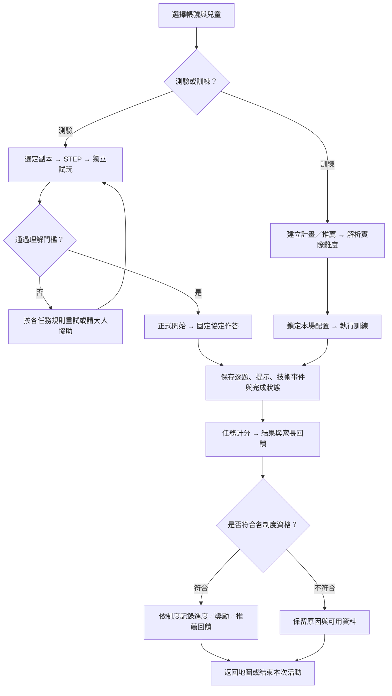

流程圖：現行遊戲總流程；各制度的資格目前不同，統一方案見第 13～14 節。

| 任務 | 遊戲情境 | 核心操作 | 主要觀察方向 |
| --- | --- | --- | --- |
| SRT | 松鼠弟弟採橡實 | 點好橡實，忽略壞橡實 | 持續注意、反應、抑制、漏答及波動 |
| PM | 湖中女神與兔子妹妹 | 看過圖片後找回原本物件 | 視覺辨識記憶、記憶負荷與選取過程 |
| CBT | 鹿先生的石頭小橋／鹿先生要過河 | 記住亮燈順序並依序點石頭 | 視空間序列記憶、順序與位置錯誤 |
| ARI | 貓狗合唱團 | 貓叫選狗、狗叫選貓 | 聽覺辨識、相反規則、反應抑制 |
| DCCS | 孔雀小姐的服飾店 | 依當前規則選分類箱 | 規則理解、切換、舊規則干擾與反向控制 |
| LB | 幫助迷路的綿羊奶奶 | 依數字與顏色安排門牌路線 | 順序追蹤、規則維持、規則切換 |

訓練選單的能力群組為「專注：SRT／ARI」、「記憶：PM／CBT」、「規則：DCCS／LB」。這是介面分組；每款任務仍可能同時涉及多種能力。ARI 為現行任務，已取代舊 SSG。

### 1.2 共通難度語言

目前六款訓練都使用五級：**入門 `beginner`、簡單 `easy`、中等 `medium`、難 `hard`、專業 `expert`**。各遊戲同一名稱的負荷不同，不能直接跨任務比較。

須區分三種數字：

- **地圖第幾關**：此次訓練計畫的先後順序。
- **遊戲難度第幾級**：決定題目、時間、提示與干擾的配置。
- **第幾題／跨度**：單場中的題次，或要記住的物件／步數。

例如地圖第 3 關可以是 PM 簡單級，而 PM 簡單級內有 3、4 個物件的不同題目。地圖顯示的「暖身、小挑戰、再挑戰、很專心、小高手」也是遊戲化文字，分析時應讀實際難度及協定。

### 1.3 五級難度重設的共同邏輯

| 級別 | 訓練定位 | 主要支持與挑戰 |
| --- | --- | --- |
| 1 入門 | 理解操作與建立成功經驗 | 小負荷、較長等待或必要操作／答案提示，清楚記錄支持 |
| 2 簡單 | 穩定使用基本規則 | 增加負荷或引入一次規則切換，保留部分支持 |
| 3 中等 | 在主要任務中獨立完成 | 增加記憶量、移除支持或引入任務需要的干擾 |
| 4 難 | 提高負荷與干擾控制要求 | 依任務增加序列、縮短反應窗、加入環境干擾或倒序 |
| 5 專業 | 完成高負荷／複合規則 | 高記憶量、較短刺激、雙條件或正反規則控制 |

| 遊戲 | 主要負荷軸 | 支持／干擾軸 | 重設時必須保留的區分 |
| --- | --- | --- | --- |
| SRT | 持續時間、出現節奏、刺激停留 | 可點／不可點比例、入門提示 | 沒有壞橡實的級別不判定抑制能力已達標 |
| PM | 需記住的物件數 | 操作提示、相似干擾 profile | 觀看與作答窗固定；慢速回想不單獨觸發記憶降級 |
| CBT | 記憶序列長度、可選位置數 | 固定／變動位置、觀察期環境動畫、提示 | 正序回憶、順序錯與位置錯分開；現行不是倒序任務 |
| ARI | 相反規則下的反應期限 | 重播、答案提示、背景聲 | 聲音播放技術失敗與真實作答錯誤分開 |
| DCCS | 單規則、多階段切換、條件規則 | 提示、時限、風中反向規則 | 測驗袋內顏色與訓練有袋／無袋條件規則分開 |
| LB | 正序／倒序、單色／交替色 | 每步提示與作答期限 | 正式選完整路線，訓練逐步答對前進 |

現有五級配置有部分同時改變多項條件；「下一次只動一個負荷軸」是後文的新增調整原則，不反向宣稱目前各級已完成單因子設計。地圖第幾關、能力難度第幾級、成就階級及帽子第幾回合各自保存，不能共用一個 level 欄位解讀。

## 2. 測驗與訓練流程

### 2.1 正式測驗

目前測驗地圖順序是：**ARI → DCCS → PM → CBT → LB → SRT**。一般依完成狀態逐關解鎖；地圖的星級通過門檻為 1 星，另有開發用解鎖例外。

正式測驗使用固定任務條件。PM／CBT 仍依預定跨度與停止規則進行；這種測量程序不等於訓練 AI 隨時改級。試玩、操作引導與正式資料分開，正式作答開始後才建立或啟用正式紀錄。

| 遊戲 | 正式測驗前的試玩／理解門檻 |
| --- | --- |
| SRT | 使用當次水果副本；操作示範後連續答對 2 題，且曾正確點好水果、正確忽略壞水果 |
| PM | 2 個目標加 2 個干擾選項；連續答對 2 題；試玩作答不設期限 |
| CBT | 固定短序列操作練習；連續答對 2 題後進正式序列 |
| ARI | 連續答對 2 題；錯誤重設該組進度，最多 3 組未通過後顯示大人協助；重播與播放失敗不當作新一輪 |
| DCCS | 顏色、種類、裝袋顏色三階段**各自**試玩，均須連續答對 2 題；錯誤歸零，未設固定嘗試上限 |
| LB | 使用當次石頭／信箱副本；先完成第一色 1～5 正序，再完成兩色交替至 6 的路線試玩 |

SRT 試玩通過後，先播完正式規則及開始語音再啟動 8 分鐘；CBT 正式作答由序列後的作答語音結束才開放。聲音播放異常須記為技術事件，不能直接當作兒童作答錯誤。

### 2.2 日常訓練

1. 家長選擇訓練項目與時間，也可按「推薦訓練」或不選項目交由系統安排。
2. 系統建立 `trainingLevelPlan`，正常入口最多 12 關，同一遊戲最多使用五級。
3. 地圖依計畫顯示關卡；正常操作要求先完成前面的關卡。
4. 每場依其五級配置執行，保存提示、錯誤、完成狀態、分數及建議。
5. 返回地圖後更新關卡進度及蜂蜜；部分結果頁還會判斷是否進帽子遊戲。

時間設定介面提供 10～60 分鐘。**時間設定目前不等於一個會精確在該分鐘停止整個計畫的總計時器**：正常計畫生成以關卡上限為主，各遊戲仍依自己的題數與期限結束。

直接進地圖、缺少明確計畫時另有輪替備援：依時間先取 6／12／15 關，再受可用遊戲、每遊戲最多 5 級及最少關卡數限制。這與正常設定入口的最多 12 關是不同分支。

### 2.3 測驗副本、訓練素材與選版制度

副本目的是更換刺激素材並降低重複使用同一素材的熟悉影響；兩套素材共用程序與計分架構，等值性仍需以實際資料檢驗。

| 遊戲 | 測驗 01 | 測驗 02 | 訓練專用 | 正常入口現況 |
| --- | --- | --- | --- | --- |
| SRT | 好／壞葡萄 | 好／壞蘋果 | 好／壞／金色橡實 | 已按孩子交替 01 → 02 → 01 |
| PM | 交通工具＋穿戴配件＋未分類，共 41 張 | 交通工具＋家具＋未分類，共 50 張 | 01 食物＋未分類，共 41 張；02 球具＋未分類，共 34 張 | 已依實際素材曝光次數選較少使用的分類；不是固定交替 |
| CBT | 荷葉、發亮荷葉、足跡圖 | 木塊、發亮木塊、足跡圖 | 石頭、發亮石頭、足跡圖 | 副本目前限隔離測試選單；一般測驗仍為原石頭，未接自動輪替 |
| ARI | 小豬／綿羊的圖片、叫聲、規則錄音 | 乳牛／猴子的圖片、叫聲、規則錄音 | 貓／狗及既有背景干擾聲 | 已按孩子交替 01 → 02 → 01 |
| DCCS | 褲子／襪子，含紅藍與透明袋版本；左藍褲、右紅襪 | 拖鞋／圍巾，含紅藍與透明袋版本；左藍拖鞋、右紅圍巾 | 上衣／帽子，左藍上衣、右紅帽子 | 已按孩子交替 01 → 02 → 01 |
| LB | 淺灰／深灰石頭 | 紅／紫信箱 | 黃／藍門牌，依既有紅色濾鏡呈現訓練交替色 | 已按孩子交替 01 → 02 → 01 |

**固定交替的消耗時點**：SRT 在正式準備語音完成並開始正式測驗時；ARI 在正式提醒播完、建立正式測驗時；DCCS 在第一題正式圖片載入且開放作答時；LB 在第一段正式規則播完且開放作答時。開頁、STEP、試玩、重播及開始前播放失敗均不消耗。正式開始後中斷仍算用過，下一場換另一版。

**PM 的曝光平衡**：測驗比較 car＋clothes 與 car＋furniture 的分類累計；car 共用，因此選版實質由 clothes／furniture 的累計差決定。訓練獨立比較 food／ball。相同時優先換成上次未用版本，無紀錄從 01 開始。次數不平衡時可能連用同一副本。

PM 只計正式記憶畫面及作答選項中實際顯示的圖片；同一目標於選項再次出現算第 2 次曝光。試玩、點擊與重繪不加次數；中斷保留已發生的曝光。舊資料缺少新版類別時不回推曝光。未分類次數可保存，但不加入各副本分類總和的選版比較。

同一場從試玩、正式到結果固定同一副本；重做試玩不改版。SRT／ARI／DCCS／LB 的已用版本及 PM 曝光目前依孩子保存在本機瀏覽器，未形成跨裝置共用輪替帳本。隔離測試的指定版本僅存記憶體。副本需保存 `testVersion` 或 `trainingStimulusVersion`、`stimulusSetId`、`stimulusName`、素材目錄版本及當題實際刺激身分。

ARI 的舊 `cat/dog` 欄位代表第一／第二種動物角色，不能據此把正式小豬記成貓；LB 的舊 `red-blue` 關卡 key 也不代表正式副本一定顯示紅藍。分析與匯出須讀實際動物／顏色欄位。CBT 自動輪替若要開放正常入口，必須另行接入，不能只靠副本素材已存在就標示完成。

來源：[SRT 副本](../src/config/srtAssessmentConfig.js)、[PM 選版](../src/utils/pmStimulusUsage.js)、[CBT 副本](../src/config/cbtAssessmentConfig.js)、[ARI 副本](../src/config/ariAssessmentConfig.js)、[DCCS 副本](../src/config/dccsAssessmentVersions.js)、[LB 副本](../src/config/lbAssessmentConfig.js)。

### 2.4 完成、停止、中斷與資料有效性的共同語言

| 情況 | 資料如何保留 | 後續用途 |
| --- | --- | --- |
| 完成全部預定內容 | 保存完成結果、原始 trials 及實際設定 | 依各制度資格計分、推薦、進度與獎勵 |
| PM／CBT 達既定容量停止規則 | 保留已作答與停止原因，不補造後續答案 | 可描述記憶表現；是否算徽章完整完成依各任務政策 |
| LB 某一步逾時 | 保存已完成目標、逾時及提示，本場結束 | 現行不標記該級完成 |
| 使用者離開／放棄／重整 | checkpoint 或中斷結果保留已發生行為 | 不冒充完整完成，不把未呈現題目算錯 |
| 音訊／圖片／儲存等技術異常 | 保存技術事件、發生階段與可用資料 | 無法可靠判斷的題目不拿來推論能力 |
| 試玩／教學／隔離測試 | 與正式題分開或僅留記憶體 | 不混入正式正確率、推薦學習及真實獎勵 |

現有獎勵、帽子、推薦與徽章對「完成」的檢查尚未完全一致。第 13 節另定統一的資格與仲裁提案，保留各任務停止規則，不以一個預設 `completed` 值覆蓋所有情況。

## 3. 六款遊戲完整規則與難度

### 3.1 SRT：松鼠弟弟採橡實

**玩法與目的**：普通橡實要點、壞橡實不能點；訓練另有可點擊的金色獎勵橡實。要在可點刺激中維持反應，同時在壞橡實出現時停止既有的點擊習慣。

**正式測驗**：固定 8 分鐘，測驗 01 使用葡萄、02 使用蘋果；刺激起始間隔隨機為 1 或 3 秒，每顆顯示 500 ms。每組 4 顆含 3 顆好水果、1 顆壞水果，組內隨機；時間到時最後一組可能未出完。沒有金色橡實，正式作答中不播放刺激或正誤回饋語音。

| 訓練難度 | 單場時間 | 出現節奏 | 停留時間 | 普通／壞／金色比例 | 提示 |
| --- | --- | --- | --- | --- | --- |
| 入門 | 180 秒（3 分） | 點擊後等 1 秒才出下一顆 | 持續至點擊 | 100%／0%／0% | 未點滿 3 秒顯示滑鼠 |
| 簡單 | 210 秒（3.5 分） | 每 1 秒 | 1 秒 | 100%／0%／0% | 無入門等待提示 |
| 中等 | 300 秒（5 分） | 每 1 秒 | 1 秒 | 65%／30%／5% | 同上 |
| 難 | 390 秒（6.5 分） | 隨機 1、1.5、2、2.5、3 秒 | 1 秒 | 70%／20%／10% | 同上 |
| 專業 | 480 秒（8 分） | 同上 | 0.8 秒 | 75%／10%／15% | 同上 |

中等以上的刺激比例以 20 顆區塊配置並打亂，單場實際比例受結束時間影響。一般定時級的間隔從刺激出現時計算，提早點擊不改變下一顆的排程；入門採等候反應的獨立規則。刺激寬度統一為 118 px。

入門提示每題只出現一次並持續至點擊。結束時尚未回答的刺激保留為 `pendingTrial`，不混入已完成題正確率；實際已出現的提示仍保留。金色橡實命中可作獎勵紀錄，現行計分不另給它獨立的評測能力權重。

訓練畫面另有收集積分：點普通 +3、點金色 +4、誤點壞橡實 −3、成功忽略壞橡實 +1、漏接 0，總積分最低為 0。背景點擊另記誤點與重複點擊。這份收集積分與 0～100 的任務分析總分分開。

**難度設計**：先學會點擊，再要求連續反應，接著加入不該點的刺激、變動等待與更短呈現。壞橡實比例較低仍可能使停止既有反應更困難，因此不能只以壞橡實比例排序難度。

**保留資料**：命中、正確忽略、漏答、誤點壞橡實、背景點擊、提示與提示後反應；RT 平均、標準差、變異係數及前中後段變化；實際刺激間隔與下一次設定間隔。小於 150 ms 的反應排除於有效 RT；有效值不足 2 筆時波動指標為 `null`。

來源：[SRT 協定](../src/utils/srtProtocol.js)、[測驗頁](../src/pages/TestPage_SRT.jsx)、[訓練頁](../src/pages/TrainingPage_SRT.jsx)。

### 3.2 PM：圖片記憶

**玩法與目的**：觀看並記住一組圖片，圖片消失後從選項中找回原本物件。可選取、取消選取，再提交答案；選取數達當題要求才可提交。

**正式測驗**：記憶量從 **2 到 7 個物件**，每個量 2 題，最多 12 題；每題觀看 5 秒、作答上限 15 秒。同一記憶量兩題都失敗就停止。正式測驗不加入等待提示、移動、波動或閃爍干擾。

| 訓練難度 | 記憶物件數 | 正常完成題數 | 觀看時間 | 作答上限 | 提示 |
| --- | --- | --- | --- | --- | --- |
| 入門 | 2 | 2 題 | 3 秒 | 15 秒 | 作答開始 3 秒且從未點過物件，顯示一次 MOUSE |
| 簡單 | 3～4 | 4 題 | 3 個看 3 秒；4 個看 5 秒 | 15 秒 | 無 |
| 中等 | 4～5 | 4 題 | 5 秒 | 15 秒 | 無 |
| 難 | 5～6 | 4 題 | 5 秒 | 15 秒 | 無 |
| 專業 | 6～7 | 4 題 | 5 秒 | 15 秒 | 無 |

訓練每個記憶量同樣安排 2 題；兩題皆失敗／逾時會依停止規則提早結束。單場保持該主要等級，不因反應慢而在關內改級。

新版圖片庫共 81 張，依測驗／訓練與當次副本分池：未分類 26、交通工具 7、穿戴配件 8、家具 17、食物 15、球具 8。每題目標至少包含 1 張當次分類素材與 1 張未分類素材，其餘目標及干擾項在允許池中隨機抽取。選項數為 `min(12, 記憶數 × 2)`，所有目標一定保留。例如記 7 個物件時顯示 12 個選項，含 7 個目標與 5 個干擾物。

入門滑鼠指向第一個顯示選項，教孩子可以點擊，**不揭露正確答案**。只要點過任何物件，本題就不再觸發等待提示，即使之後取消全部選取也一樣。15 秒從選項出現後第一個畫面起算，選取、取消及提示不延長期限；逾時標示 15000 ms，排除於有效 RT 的平均與波動計算。

**混淆紀錄**：提交／逾時後，比較「最終錯選」與「漏選目標」，優先標示相近外形，其次同類物品，再其次無預定關聯。一個錯選只計一次；取消的錯選只留在點擊歷程。新版預定外形群組包含蛋糕、鞋子、帽子、手錶、湯匙／叉子、貨車、直立相框及掛畫；未分類素材不因位於同一資料夾就視為同類，筷子不屬湯匙／叉子的外形群組。這是素材關聯，不能確認孩子真正錯誤原因。現行不強制高級題一定抽中相似干擾。

**難度設計**：主要逐步增加記憶量，保留充分觀看與固定作答上限。反應速度與時間波動供觀察，不直接降低記憶級別。

**保留資料**：目標／選項／最終選取、選取與取消時間、被上限阻擋的點擊、背景點擊、提示事件、獨立／提示後答對、跨度摘要、逾時及可能混淆關聯。

來源：[PM 協定](../src/utils/pmProtocol.js)、[素材與抽題](../src/utils/pmItems.js)、[測驗頁](../src/pages/TestPage_PM.jsx)、[訓練頁](../src/pages/TrainingPage_PM.jsx)。

#### 3.2.1 PM 相似物干擾與錯誤類型重設（提案／待實作）

目前 PM 已保存相似關聯並分析最終錯選，但 `forcedSimilarity: false`，因此只靠既有抽題不能保證孩子真的遇到相似干擾。本節新增可控制的相似干擾條件；原有五級記憶量、觀看時間及 15 秒作答窗保留。

##### A. 兩個負荷軸分開

一次 PM 訓練由「記憶難度」及「干擾 profile」共同描述。例如 `medium + P2` 表示記 4～5 個物件，成功符合配額時每題至少包含 1 個外形相似的非目標。記憶級別與 profile 分開保存，同一次調整只改其中一項。

| Profile | 每題干擾配置 | 用途 |
| --- | --- | --- |
| P0 基本隨機 | 維持現有抽取，不保證相似物 | 建立記憶基準；仍需記錄實際抽中的相似關聯 |
| P1 同類辨識 | 至少 1 個同類、不同外形群組的非目標 | 分辨同分類不同物件 |
| P2 外形辨識 | 至少 1 個與目標同外形群組的非目標 | 分辨外形相似的不同物件 |
| P3 混合辨識 | 至少 1 個外形相似＋1 個純同類非目標 | 同時辨認外形與分類干擾 |
| P4 進階混合 | 至少 1 個外形相似＋2 個純同類非目標 | 增加關聯干擾數量，保持原作答時間 |

同一非目標只占一個配額；外形相似優先，不再兼算純同類。其餘非目標從剩餘允許池抽取，因此表中是最低配額，實際出現數可以更高，必須保存實際值。Profile 編號是產品練習路徑，尚未證明各類干擾在不同素材池具有相等或單調增加的實際難度。P0 不是保證零相似物的控制條件；若研究需要「完全無相似干擾」條件，應另建排除式出題版本。

| 記憶難度 | 記憶量 | 初次使用的 Profile | 可逐步練習至 | 升級原則 |
| --- | --- | --- | --- | --- |
| 入門 | 2 | P0 | P0 | 先理解看圖、選取及提交 |
| 簡單 | 3～4 | P0 | P1 | 基本記憶穩定後才引入同類辨識 |
| 中等 | 4～5 | 沿用已掌握且允許的 Profile，無紀錄用 P0 | P2 | 分開觀察記憶失敗與外形混淆 |
| 難 | 5～6 | 沿用已掌握的 Profile | P3 | 逐次提高干擾，不同時縮短時間 |
| 專業 | 6～7 | 沿用已掌握的 Profile | P4 | 最高記憶量下逐步增加混合干擾 |

「可練習至」是開放上限，不是每次進入該級立即套用。升記憶量時保留原 profile；在同一記憶級別練 profile 時保留記憶配置。外形混淆增加而記憶基準穩定時，優先退回較低 profile，不直接降低記憶級別。若降記憶後舊 profile 超過新級上限，分兩次安排：先在原記憶級降低 profile，再重新評估是否需要降低記憶量。

##### B. 相似物與素材限制

| 類型 | 定義 | 現有例子 |
| --- | --- | --- |
| 外形相似 | 有人工預先定義且相同的 `similarityGroup`，為不同物件 ID | 蛋糕、鞋子、帽子、手錶、貨車、直立相框、掛畫、湯匙／叉子 |
| 同類但非外形相似 | 同一有效分類，且沒有命中該目標的外形群組 | 同為食物或交通工具，未被標成相同外形群組 |
| 無預定關聯 | 不符合上述兩種關係 | 分類不同且沒有共同外形群組 |

未分類資料夾不是同類群組；球具亦不能僅因「多數為圓形」就自動標成外形相似。food 有蛋糕群組，ball 目前沒有定義外形群組；球具訓練若使用外形配額，可從同池的未分類湯匙／叉子取得配對，但會增加該少數素材的曝光。未來若新增球具相似群組，需先人工核對並更新素材目錄版本。不同素材池的可用配對與曝光應分別檢查。

##### C. 出題與不足配額處理

1. 先鎖定孩子、模式、當次副本、記憶量、profile 與種子；一場內不換副本或 profile。
2. 計算選項數 `O = min(12, 2 × N)`，非目標數 `D = O − N`。N 為記憶量，目標與非目標 ID 不重複。
3. 在該模式允許素材中預先找可行的「目標—非目標」配對，保留每題至少 1 張分類目標及 1 張未分類目標。保留的相似非目標不能又被抽進目標。
4. 按外形配額、純同類配額選入非目標，再補齊其餘目標與選項；驗證所有目標均在選項中、配額沒有重複占用。
5. 每題最多嘗試 50 次構題；失敗後依 P4 → P3 → P2 → P1 → P0 的順序，只檢查不高於原要求的配置，選最高可行者，保存要求與實際 profile、失敗原因及實際配對。P1 若也不可行可退 P0，不跨池借測驗／訓練素材。
6. 有 fallback 的題目可繼續作答，但不能當成「原要求 profile 已掌握」的證據；本場出現任何 fallback 就不升 profile，先維持並檢查出題可行性。
7. 最後打亂選項位置，不以固定位置或一律不同尺寸暗示答案；只有實際呈現的素材加入曝光帳本。

例：N＝7 時 O＝12、D＝5，P4 的 3 個關聯非目標配額可容納，另有 2 個非目標。N＝2 時 D＝2，但入門仍只開放 P0，避免為了配額推高操作負擔。

正式測驗維持目前各副本隨機抽題與記錄相似條件。本提案先用於 training；若測驗也要強制相似比例，須另建正式 protocol 版本、固定配額與副本配平規則，另列成績可比性。

##### D. 最終錯誤、作答結果與過程事件分層

| 層次 | 建議欄位／值 | 定義與計數方式 |
| --- | --- | --- |
| 題目結果 | `exact_match_correct` | 最終選取集合完全等於目標集合 |
| 題目結果 | `incorrect_submission` | 已提交但集合不完全正確 |
| 題目結果 | `timeout` | 完整作答窗已開放但期限內未提交；同時保留當下選取與可分析的錯選／漏選 |
| 題目結果 | `interrupted`／`technical_invalid` | 未完整作答窗或技術問題；不當作逾時、一般錯答 |
| 物件錯誤 | `visual_similarity` | 最終錯選與至少一個漏選目標同外形群組 |
| 物件錯誤 | `same_category` | 未命中外形群組，但與至少一個漏選目標同有效分類 |
| 物件錯誤 | `unrelated` | 兩種關係皆未符合；沿用現有程式碼值 |
| 漏選 | `omission` | 每個未被最終選取的目標記 1 筆，與錯選分開彙總 |
| 過程事件 | `select`／`deselect`／`blocked_select`／`background_click` | 保留時間、物件、選取數；不直接等同最終錯誤 |
| 支持事件 | `idle_operation_hint` | 保留觸發時點與指向物；另分獨立與提示後成功 |

**分類順序固定**：最終錯選先對照漏選目標，再依外形相似 → 同類 → 無關分類。一個錯選只有一個主要類型，可保存多個匹配的漏選目標。取消的錯選不加入最終錯選；它可另記為「曾選錯後自行修正」。同一錯選不能同時計入外形及同類兩類。

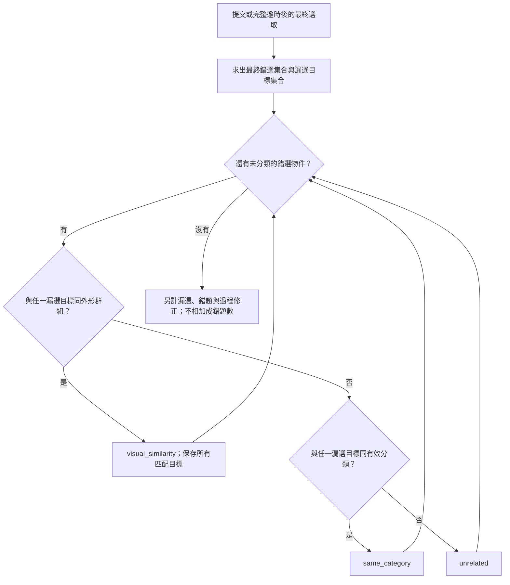

流程圖：PM 現行最終混淆分類；新版補上分母與分層結果保存。

錯選與漏選是不同計數單位。一次把 B 錯選成 A 的作答，可能同時有 1 個錯選、1 個漏選、1 題錯答，不能把三者相加當成 3 題錯誤。逾時也可以同時有物件錯誤，圖表要分層顯示。

**例子**：目標含「紫色奶油蛋糕、藍色水壺」，最後選「巧克力蛋糕、藍色水壺」：整題錯答 1 題、外形相似錯選 1 個、漏選 1 個、其他錯選 0 個。若先選巧克力蛋糕、取消後選回原蛋糕並正確提交，最終錯選為 0，另外記一次修正歷程。這是可能混淆的操作分類，不能僅憑關聯推斷孩子忘記、衝動或真正混淆的心理原因。

##### E. 結果頁與分析指標

| 指標 | 定義 |
| --- | --- |
| 整題正確率 | 完全正確題數 ÷ 有效完成作答窗題數；完整逾時列入分母，未完成窗的中斷／技術無效題排除 |
| 獨立正確率 | 無提示且完全正確題數 ÷ 有效完成作答窗題數 |
| 目標找回率 | 正確選到的目標總數 ÷ 已完成有效作答窗題目的目標總數 |
| 外形混淆占錯選比例 | `visual_similarity` 個數 ÷ 最終錯選總數；無錯選時顯示「無錯選」 |
| 同類混淆占錯選比例 | `same_category` 個數 ÷ 最終錯選總數 |
| 關聯非目標選取率 | 最終選中的關聯非目標個數 ÷ 各有效題實際呈現的關聯非目標個數；每題同一非目標只計一次機會 |
| 外形／同類非目標選取率 | 分別使用外形、純同類非目標的選中數與實際呈現數；零機會顯示「未施測」 |
| 相似干擾條件正確率 | 有實際關聯非目標的有效題中，完全正確題數 ÷ 該條件有效題數 |
| 自行修正率 | 曾選錯但在期限前修正並正確提交的題數 ÷ 曾有錯選的有效題數 |

「關聯非目標」的曝光分類按它與**全部目標**的關係預先計算；最終混淆分類依它與**漏選目標**的關係計算，兩者用途不同。應另保存曝光關係，不能拿最終錯誤分類回推原本沒有記下的機會數。

保留現有 `confusionAnalysis`、`tapLogs`、`clickLogs` 及別名，新增 `requestedInterferenceProfile`、`actualInterferenceProfile`、`similarityProtocolVersion`、`requestedQuota`、`actualQuota`、`distractorRelationsToAllTargets`、`fallbackReason`、`relatedDistractorExposureCount` 及每類選中數。0／缺值要分開，舊紀錄不補成零。

家長端呈現「這次較常選到外形相近的圖片」及下一次「先維持記憶量，練習分辨相近圖片」；專業端提供物件 ID、類型、匹配目標、當題 profile、機會分母、提示與取消歷程。PM 主分數暫沿用現行公式，混淆錯誤先列獨立分析，避免同一次錯選已扣正確率後又不明確重複扣分。

### 3.3 CBT：石頭小橋

**玩法與目的**：先觀察石頭依序亮起，等到開放作答，再按原順序點擊。現行全部等級為**正序回憶**。

**正式測驗**：全程使用固定位置與 ID 的 9 顆石頭，序列從 2 步增至最多 7 步，每個長度 2 題。每顆亮 0.8 秒、亮燈間隔 0.26 秒；作答上限 15 秒。同長度兩次失敗，或連續兩次逾時，依停止規則結束；到最高長度也結束。

目前正式棋盤為 960 × 600、石頭寬 300 px，置中並為旁白留空。有效點過的石頭改顯示既有 `step.webp`，每題清除；此視覺狀態不影響答案。

| 訓練難度 | 石頭數 | 序列長度 | 每顆亮燈 | 位置 | 觀察階段環境干擾 |
| --- | --- | --- | --- | --- | --- |
| 入門 | 5 | 2～3 步 | 1 秒 | 固定 | 無 |
| 簡單 | 6 | 3～4 步 | 0.8 秒 | 固定 | 無 |
| 中等 | 7 | 4～5 步 | 0.8 秒 | 每題變動 | 雨／雷電 GIF |
| 難 | 8 | 5～6 步 | 0.8 秒 | 每題變動 | 同上 |
| 專業 | 9 | 6～7 步 | 0.8 秒 | 每題變動 | 同上 |

訓練每個長度 2 題，通常最多 4 題；同長度兩題皆失敗／逾時，或完成該級最高跨度後結束。程式仍有 24 題保護上限，不能把它當作現在每場固定題數。單場主要難度固定，只依跨度規則在該級長度範圍前進。

訓練作答上限同為 15 秒，亮燈間隔 0.26 秒；目前各級不開放主動重播。中等以上同時調整石頭座標與 ID，專業級即使顯示全部 9 顆，畫面位置仍會變。訓練石頭寬 220 px，點擊區保留間距。

環境動畫在棋盤外，只在觀察階段出現，作答時移除但保留空間；雷電 GIF 沒有額外雷聲音檔，不另做非目標石頭閃爍干擾。

**入門支持**：每一步等候 3 秒仍未點擊，最多提示一次；第二步點錯時可顯示正確石頭與滑鼠，保留第一步供重試。答案提示持續顯示時不再重複算等待提示。`promptCount` 為實際提示次數，不等於有提示題數。

**計時與資料**：正式測驗在作答語音結束後開始 15 秒；訓練沿用作答提示開始的時點。走路動畫不延長期限，期限前完成最後一步可讓動畫結束。播放序列時的提前點擊只記錄事件、不加入答案。保留序列、實際點擊、逐步 RT、位置／順序錯誤、獨立跨度、支持後跨度、提示及提前點擊。

來源：[CBT 協定](../src/utils/cbtProtocol.js)、[測驗頁](../src/pages/TestPage_CBT.jsx)、[訓練頁](../src/pages/TrainingPage_CBT.jsx)、[正式布局](../src/utils/cbtAssessmentLayout.js)。

### 3.4 ARI：貓狗合唱團

**玩法與目的**：聽到貓叫選狗，聽到狗叫選貓；左右選項會安排不同位置，不能記固定邊。觀察聽覺辨識、維持反向規則、抑制直覺作答與反應控制。

**正式測驗**：01 為小豬／綿羊，02 為乳牛／猴子，聽到一種動物仍要選另一種。20 題，平衡聲音種類與正確左右位置組合；播放前等待 500 ms，每題 5 秒，不可重播，不依表現臨時改規則。RT 與作答期限從聲音實際開始播放的 `onplaying` 事件起算。

| 訓練難度 | 題數 | 每題上限 | 重播 | 正確答案提示 | 背景聲音干擾 |
| --- | --- | --- | --- | --- | --- |
| 入門 | 12 | 10 秒 | 可 | 等待 3 秒，或先前連錯達 3 次時提示 | 無 |
| 簡單 | 12 | 10 秒 | 可 | 無 | 無 |
| 中等 | 12 | 5 秒 | 不可 | 無 | 無 |
| 難 | 12 | 5 秒 | 不可 | 無 | 有 |
| 專業 | 12 | 3 秒 | 不可 | 無 | 有 |

各級播音前等待均為 500 ms；相同聲音／正確位置連續出現的控制目標為最多 2 次，隨機排列依生成器結果。背景干擾使用既有 `ARI/voice.mp3`，設定音量 0.25。

入門每題至多顯示一次直接答案提示；連錯門檻是在新題作答窗開啟時檢查前面累積錯誤。提示、重播不重設原本截止時間。刺激播放失敗會保留技術事件、阻止誤判或中止場次，與兒童答錯分開。

**難度設計**：依序移除提示、移除重播、縮短作答窗，再加入背景干擾與更短期限。全部五級都是同一相反規則；現行不再使用舊的三難度、8／12／16 題版本。

**保留資料**：聲音、正確動物、左右位置、實際選擇、同動物直覺錯誤、搶答、重複／背景點擊、逾時、提示原因、重播事件、播放失敗及聲音／左右側／前後段表現。

來源：[ARI 協定 3.0.0](../src/utils/ariProtocol.js)、[測驗頁](../src/pages/TestPage_ARI.jsx)、[訓練頁](../src/pages/TrainingPage_ARI.jsx)。

### 3.5 DCCS：孔雀小姐的服飾店

**玩法與目的**：看清楚當前規則，將服飾放進相符分類箱；切換後要改用新規則，避免持續沿用上一個規則。

**正式測驗**：題庫上限設定是顏色 6 題、種類 8 題、裝袋顏色 6 題；目前兩個副本每階段均只有 4 張可用刺激，實際為 4＋4＋4，共 12 題。**每階段前另有獨立試玩**，不把固定 2 題練習加到正式分母。正式第三階段全部按袋內衣服顏色分類，沒有訓練的風中反向規則，也沒有訓練的每題 10／15 秒逾時機制。

正式 01 的木箱參照為左邊藍褲子、右邊紅襪子，02 為左邊藍拖鞋、右邊紅圍巾；訓練才使用藍上衣／紅帽子。內部歷史欄位仍可能以 `top`／`bottom` 表示左右位置。每階段試玩連續答對 2 題；種類試玩優先使用與顏色線索衝突的題目，避免繼續按顏色也能通過。

| 訓練難度 | 規則與題數 | 每題上限 | 提示 | 特殊條件 |
| --- | --- | --- | --- | --- |
| 入門 | 6 題顏色 | 15 秒 | 等待 3 秒指向正確箱 | 建立單一顏色規則 |
| 簡單 | 4 題顏色 → 4 題種類，共 8 題 | 15 秒 | 同上 | 一次主要規則切換 |
| 中等 | 顏色／種類／條件規則各 4 題，共 12 題 | 15 秒 | 同上 | 有袋看顏色、無袋看種類 |
| 難 | 同中等，共 12 題 | 10 秒 | 無 | 獨立使用三階段規則 |
| 專業 | 三階段各 5 題，共 15 題 | 10 秒 | 無 | 風出現時選相反箱，風停恢復 |

表中為設定題數，實際生成仍需可用素材及配對成立。種類與條件階段的目標干擾比例設定為 0.5，實際衝突題會按配對與取整結果記錄。

**條件規則**：訓練 `dualRule` 階段有透明袋子時依衣服顏色，無袋時依服飾種類。它與正式第三階段「全部按袋內衣服顏色」不同，不能混為同一測量條件。

**風中反向規則**：專業級先無風 6 秒，再有風 6 秒，循環進行。風來時立即改選正常答案的另一箱，風停立即恢復；同一題還未作答也會改變答案。規則說明期間暫停風時鐘，繼續時累積恢復；減少動態效果時改為靜態風線，規則時間不變。

每題提示至多一次，持續到作答或逾時。訓練逾時記為未作答並前進，不代答。初始難度依選擇的五級解析，不再按前次測驗成績偏移到舊十階配置。

**保留資料**：當前／前一規則、服飾顏色與種類、袋子線索、分類目標、正誤、切換後表現、舊規則錯誤、干擾題、提示與逾時；專業級另保留風切換事件、作答時反向狀態及反向題數。

來源：[五級協定](../src/utils/dccsTrainingProtocol.js)、[訓練頁](../src/pages/TrainingPage_DCCS.jsx)、[測驗頁](../src/pages/TestPage_DCCS.jsx)、[正式設定](../src/config/dccsAssessmentConfig.js)。

### 3.6 LB：門牌導航

**玩法與目的**：依要求的數字順序與顏色規則找門牌，幫綿羊奶奶走回家。注意正式測驗與訓練的作答方式不同。

**正式測驗**有兩段：

1. 第一色 1 → 2 → … → 10，共 10 個選項；正式 01 為石頭，02 為信箱。
2. 第一色 1 → 第二色 2 → 第一色 3 → … → 第二色 10；每個數字都有兩種顏色選項，共 20 個選項、10 個正確目標。01 為淺灰／深灰石頭，02 為紅／紫信箱；訓練的交替色規則仍為紅／藍。

正式測驗先點選完整路線，可撤回上一個選取，選滿後提交，再播放路線並記錄各位置正誤；不採訓練「每步答對才前進」方式。正式不套用倒序、逐步提示或每步作答時限。

| 訓練難度 | 每場 10 個目標的路線 | MOUSE 正確答案提示 | 每個目標上限 |
| --- | --- | --- | --- |
| 入門 | 1 → 2 → … → 10 | 該步 3 秒仍未答對 | 20 秒 |
| 簡單 | 紅 1 → 藍 2 → … → 藍 10 | 該步 3 秒未答對；顏色規則錯誤立即提示 | 15 秒 |
| 中等 | 紅 1 → 藍 2 → … → 藍 10 | 無 | 15 秒 |
| 難 | 10 → 9 → … → 1 | 無 | 15 秒 |
| 專業 | 藍 10 → 紅 9 → … → 紅 1 | 無 | 15 秒 |

專業級反轉整條原本交替路線，仍維持奇數紅、偶數藍。顏色切換級每個數字都有兩種顏色選項。

訓練正確後才進下一個目標並重新計時；誤點不延長期限，也不延後原本 3 秒提示。簡單級僅數字順序錯誤不立即給規則提示，仍依等待規則。持續顯示的 MOUSE 只計一次。說明、教學、回饋與路徑動畫不占該步作答時間。

任一步逾時會保留已完成進度並結束本場，不標記該級完成。自適應建議只選下一級，不覆蓋五級內的路線、提示或秒數。

**保留資料**：預期及實際門牌、數字／顏色／順序錯誤、每步 RT、切換與干擾、完成進度、提示總數、等待提示及規則錯誤提示事件；正式另有選取、撤回與提交路線紀錄。

來源：[LB 協定](../src/utils/lbProtocol.js)、[測驗頁](../src/pages/TestPage_LB.jsx)、[訓練頁](../src/pages/TrainingPage_LB.jsx)。

## 4. 計分、星級與結果解讀

### 4.1 必須分開的四種數值

| 數值 | 用途 | 注意事項 |
| --- | --- | --- |
| 正確率 | 描述任務中答對比例 | 各任務的題／步／操作分母不同；未完成題不能直接算成已完成題 |
| 任務總分／星星 | 兒童回饋與該任務表現摘要 | 包含跨度、速度、錯誤或支持等任務專屬條件 |
| AI 分析分數 | 升降級及支持需求分析 | 可能與任務主分數使用不同權重，例如 PM |
| 推薦 reward | 更新推薦策略 | 0～1 的行為目標；不等於星星、金幣或能力總分 |

正確率欄位有 0～1 與 0～100 兩種相容格式，讀取時須先確認單位。原始 trial 與分析分數一起保存；缺值應顯示未記錄，不把它當作 0 或表現完美。

### 4.2 現行共用計分器的星級摘要

以下是共用計分器的主要條件；頁面有既有相容／備援顯示時，應同時核對當次保存的 `scoring` 與版本。

| 任務 | 3 星主要條件 | 2 星主要條件／限制 |
| --- | --- | --- |
| SRT | 總分 ≥80，且通過資料與行為限制 | 總分 ≥60；正確率 <60% 或漏答 >35% 時最多 1 星；資料不足、提示率 >40% 或壞橡實樣本足夠且誤點 >40% 時最多 2 星 |
| PM | 主分數 ≥80 | ≥60；無完成題或完成比例 <30% 為 0 星 |
| CBT | 測驗總分 ≥85／訓練 ≥82，且正確率與加權正確率皆 ≥80%、獨立跨度達標、逾時 <20%、重播題率 ≤35%、平均重播 ≤0.4、救援率 ≤25%、等待提示率 ≤35%；訓練入門另限最多2星 | 測驗 ≥60／訓練 ≥55，加權正確率 ≥55%、一般正確率分別 ≥55%／50%，跨度達該級要求；有其他可靠性限制 |
| ARI | 測驗：總分 ≥82、正確率 ≥80%、逾時 ≤20%；訓練：≥78、≥75%、≤25% | 測驗：≥60、≥55%、逾時 ≤45%；訓練：≥55、≥50%、≤50%；無題為 0 星 |
| DCCS 正式 | 總分 ≥80、總正確率及切換後正確率 ≥75%、舊規則持續錯誤 ≤1，需有切換資料；有條件規則資料時其正確率也須 ≥75% | ≥55、總正確率 ≥55%、切換後 ≥50%；有條件規則資料時 ≥50%；資料不足另有限制 |
| DCCS 訓練 | 按所屬階段的專屬權重與核心規則表現評分 | 不直接套用正式三階段門檻；現行五級仍對應既有計分配置，見第 11 節 |
| LB 共用計分 | 總分 ≥80、正確率 ≥75%、切換正確率 ≥65% | 總分 ≥55、正確率 ≥50%；訓練頁另有65%正確＋35%完成的保存公式，詳見16.7 |

PM 主分數上限配置為**正確率 50、記憶 35、作答過程 15**；速度與波動權重為 0，取消選取不直接減主分。逾時率 ≥30%／50%／80% 另有逐級降分與上限處理。PM 分析器的 AI 分數則是正確率 65%、負荷 25%、提示獨立性 10%，兩者不可混稱。

SRT 以有資料的分項重新加權；金色橡實不另作能力加分，不能把舊 `rewardSearch` 欄位視為現行金色橡實權重。CBT 區分獨立、提示、重播與救援完成，不能只看最後答對率。

DCCS 五級訓練目前明確套用既有計分模板，並改用五級的名稱、類別及最低題數：

| 現行級別 | 採用模板 | 分項權重 | 星級主要條件 |
| --- | --- | --- | --- |
| 入門 | `colorIntro` | 顏色正確 70%、首次正確 20%、穩定 10% | 3 星：總分 ≥85、主要規則正確 ≥80%、首次正確 ≥70%；2 星：≥60、主要規則 ≥55% |
| 簡單 | `switchClear` | 切換後正確 45%、整體正確 25%、首次正確 20%、穩定 10% | 3 星：≥80、切換後 ≥70%；2 星：≥55、切換後 ≥50%；均需切換題 |
| 中等、難 | `switchMaintain` | 切換後正確 40%、干擾控制 20%、首次正確 15%、整體正確 15%、穩定 10% | 同上，3 星另要求舊規則錯誤 ≤1 |
| 專業 | `highInterference` | 干擾控制 35%、干擾正確 20%、切換後正確 25%、整體正確 10%、穩定 10% | 3 星：≥80、切換後 ≥70%、干擾正確 ≥65%、干擾控制 ≥75%、舊規則錯誤 ≤1；2 星：≥55、切換後及干擾正確 ≥50%、干擾控制 ≥55%；均需切換與干擾題 |

不可用分項會依計分器的有效權重處理，另有最低樣本與可靠性限制；風中反向事件目前不另列一個獨立主分權重。

### 4.3 家長觀察與疲勞

共通整體分析器的能力卡：分數 <60、錯誤 ≥10 或高疲勞時為紅；否則分數 <80 或錯誤 ≥5 為橘；其餘綠。整體結果再彙總各能力卡；專屬遊戲分析可使用自己的判定。

共通疲勞規則為：後半 RT >前半 1.3 倍，或漏答增加至少 3 次，判為高；否則後半 RT >1.15 倍為中；其餘低。PM 專屬分析不直接用慢速回想推定降級。這些標記描述本次行為，需搭配相同難度、模式、提示與協定的歷史紀錄解讀。

來源：[六款計分器](#12-主要程式與延伸文件)、[整體分析器](../src/ai/overallPerformanceAnalyzer.js)、[共通疲勞](../src/ai/fatigueAnalyzer.js)。

## 5. AI 升級、維持與降級

### 5.1 共通分工

這裡的 AI 主要是**規則式行為分析**。遊戲專屬分析器讀取 trial、正確率、錯誤、提示、RT、跨度及疲勞，輸出下一次難度、調整原因與支持建議；聊天模型不直接改寫作答規則。

正式測驗維持既定程序；訓練頁以此次解析的配置執行。**產生建議不代表下一次地圖一定已採用**：目前地圖計畫、線上 UCB1、各遊戲保存的建議是不同路徑，尚無統一仲裁器把所有專屬建議重新編排成整份計畫。

專屬分析器的調整幅度也不同：SRT／PM／ARI／DCCS／LB 主要為相鄰一級，CBT 有降低兩級分支。UCB1 的 ±1 限制僅約束推薦候選動作，不會消除 CBT 本身的兩級降級建議。

**下一次從哪一級開始，須看入口**：

| 遊戲 | 現行起始難度解析 |
| --- | --- |
| SRT | 明確 difficulty 優先；否則依地圖遊戲級別及讀到的測驗帶選起點，低／無資料為 `[1,2,3,4,5]`、中為 `[2,2,3,4,5]`、高為 `[3,3,4,4,5]`。高帶為測驗 ≥3 星，或正確率 ≥85% 且 RT ≤850 ms／未記錄；低帶為 ≤1 星、正確率 <60% 或 RT ≥1250 ms；其餘中帶 |
| PM | 明確 difficulty 優先，否則依地圖級別固定對應五級；不再依慢速表現改初始記憶級 |
| CBT | 明確 difficulty 優先，否則由地圖級別決定；雖保留測驗建議讀取，但現行該關的基準與上限相同，結果仍限制在該級 |
| ARI | 明確 difficulty → trainingLevel／level → 已選級別或保存的推薦難度 → 入門；完成訓練後會保存下一次推薦 |
| DCCS | 明確 difficulty／地圖級別解析為五級，無參數預設入門；不做舊版 baselineShift |
| LB | 明確地圖級別優先；無明確級別時才使用 `getLBInitialTrainingConfig` 的自適應起點 |

所以同一地圖級別也可能因 SRT 測驗帶或導航參數得到不同實際難度；成就快照與分析均須使用頁面最後解析的配置。

### 5.2 SRT 升降級

先要求至少 **15 題及 8 筆有效 RT**，不足維持。

- **升一級**：正確率 ≥85%、未提示正確率 ≥80%、漏答 ≤10%、背景誤點 ≤10%、提示率 ≤20%、RT CV ≤0.35（或無可用 CV）、非高疲勞；壞橡實樣本足夠時誤點率另須 ≤15%。
- **降一級**：正確率 <65%、漏答 >25%、背景誤點 >25%、提示率 >40%、RT CV >0.5 或高疲勞，任一成立；壞橡實樣本足夠且誤點 >30% 也降級。
- 其餘維持；有前後段資料且中疲勞，可建議縮短時間／休息。

入門與簡單沒有壞橡實，不能將沒有抑制題的高正確率當成已驗證抑制能力；其升級判定只依當級可觀察資料。

### 5.3 PM 升降級

- 沒有完成題：維持。
- **降一級**：同跨度兩題逾時、逾時率 ≥50%、正確率 <50%，或同跨度兩題失敗且總正確率 <65%。
- **升一級**：至少 2 題、正確率 ≥85%、逾時 ≤15%、支持率 ≤10%，完成當級最高記憶量、尚未到 7 個且沒有提前停止；有 trial 時，同跨度另須至少 2 題獨立答對。
- 其餘維持；下一記憶量限制在推薦級的範圍內。

保留 15 秒作答與按記憶數決定的 3／5 秒觀看，不因較慢、RT 波動或取消選取直接降級。獨立與有提示完成分開分析。

### 5.4 CBT 升降級與支持建議

CBT 按以下優先順序判斷，前項命中就不再使用後項：

| 優先條件 | 建議 |
| --- | --- |
| 無完成題 | 維持、確認理解 |
| 後半表現下降指標 ≥0.30 | 減少疲勞負荷，主要級別維持 |
| 正確率 <55% 且前段錯誤率 ≥40% | 降一級、縮短序列 |
| 位置錯誤率 ≥45% | 降一級、減少空間負荷 |
| 順序錯誤率 ≥45% | 維持級別、降低路徑複雜度的建議 |
| 逾時率 ≥30% 且正確率 ≥50% | 降一級、縮短序列，作答仍為 15 秒 |
| 救援答對率 ≥40% | 維持並建議保留支持 |
| 等待提示率 ≥35% | 維持並建議增加非文字支持 |
| 達當級升級分數 | 升一級 |
| 分數 ≥55 | 維持 |
| 分數 ≥40、未達其他門檻 | 降一級 |
| 分數 <40、未達其他門檻 | 降兩級 |

入門／簡單／中等／難／專業的升級分數依序為 **65／70／75／85／90**，並限制在五級範圍。分析器仍保留重播／救援的相容欄位；現行配置沒有主動重播，不能只因建議文字出現重播就認為介面已開放。

### 5.5 ARI 升降級

五級各 12 題，因此一般可靠門檻為至少 6 題。少於門檻不升級，但正確率 <45%、逾時 ≥45% 或同動物錯誤 ≥45% 時可建議降低。

正常升級先要求 AI 分數 ≥82、前後段沒有明顯下降，再同時滿足：

| 當前難度 | 正確率至少 | 逾時／同動物錯誤／搶答各至多 | 穩定度分數至少 |
| --- | --- | --- | --- |
| 入門、簡單 | 85% | 12% | 60 |
| 中等 | 85% | 10% | 65 |
| 難、專業 | 90% | 8% | 70 |

AI 分數 <55 可降級；各級另有任一降級門檻：

| 當前難度 | 正確率低於 | 逾時或同動物錯誤達到 |
| --- | --- | --- |
| 入門、簡單 | 50% | 38% |
| 中等 | 55% | 32% |
| 難、專業 | 58% | 28% |

訓練頁會傳入上一輪分析，預設要求重複升級確認、降級不必重複確認。**第一輪沒有上一輪分析時，穩定化函式直接使用本輪方向**，所以不能說所有升級一律必須連續兩輪。聲音、左右與前後段比較也有最少樣本條件，資料不足不作強判讀。

### 5.6 DCCS 升降級

最低題數依級別為入門 3 題、其他 4 題，不足維持。

- **降一級**：高疲勞；或綜合分數 <52、正確率 <55%、需要切換且切換正確率 <50%、需要干擾且干擾控制 <50%、舊規則錯誤至少 3 次／有抑制資料且比例 ≥50%。
- **升一級**：綜合分數 ≥83、正確率 ≥80%、低疲勞、穩定度 ≥50；需要切換時須有切換題且正確率 ≥70%；需要干擾時須有干擾資料、控制 ≥75%、干擾正確率 ≥65%。
- 缺必要切換／干擾資料、稍有疲勞或穩定性不足時維持。

依現行分類，專業級特別要求干擾資料。風效與反向狀態已保存，但不能據此假設分析器已對所有風切換成本建立獨立且經驗證的新指標。

### 5.7 LB 升降級

綜合分數權重為正確率 30%、切換 22%、干擾 13%、速度 10%、穩定 10%、提示獨立性 8%、錯誤控制 7%。至少 5 筆操作才允許升級，至少 2 筆正確 RT 才適合速度／穩定性計算。

- **升一級**：綜合分 ≥82、正確率 ≥82%、切換 ≥72%、逾時 ≤15%、提示 ≤30%、最大連錯 ≤2；更佳表現另有 ≥92 分分支，仍最多升一級。
- **降一級**：正確率 <58%、切換 <52%、逾時 ≥30%、提示 ≥55%、最大連錯 ≥3，或綜合分 <55；更嚴重情況仍降一級。
- 題數不足會阻止升級，但不阻止明顯困難時先降低；其餘維持。

輸出仍使用固定五級配置，不自動加入舊版記憶任務、混合任務、位置重排或任意延長作答。

## 6. 訓練推薦系統

### 6.1 四個不同層次

| 層次 | 決定內容 | 現行狀態 |
| --- | --- | --- |
| 結果式訓練計畫 | 哪些遊戲多安排幾關 | 已接入模式選擇；亦作連線失敗備援 |
| 線上 UCB1 | 第一關優先選哪款遊戲，附一個受限級別 | 已接入模式選擇與訓練地圖，需雲端資料表與權限 |
| 專屬難度分析器 | 同遊戲下一次升／降／維持與支持 | 六款均有分析路徑；實際套用依入口 |
| 研究策略比較 | 比較六種政策在合成環境的 reward | 已有研究介面，不直接取代兒童訓練控制 |

### 6.2 近期結果如何排計畫

模式選擇頁整合本機／雲端可讀結果，依兒童與結果識別去重，擷取每款最近最多 30 筆關卡分數。由新至舊賦予 N、N−1、…、1 的權重，計算近期加權分數。

有紀錄的遊戲優先按分數由低到高排序，沒有紀錄的排後；同分依原選單順序。自動計畫對每款遊戲建立以下權重池，再輪流填入關卡：

| 近期加權分數 | 權重 |
| --- | --- |
| <50 | 4 |
| 50～<70 | 3 |
| 70～<85 | 2 |
| ≥85 或無可用紀錄 | 1 |

最多 12 關、單一遊戲最多 5 級；同遊戲出現次數對應第 1、2、…、5 級。只選一款時最多排該款 5 級；不會為湊 12 關而生成第 6 級。手動選項的計畫不使用弱項加權。

按「推薦訓練」成功時，目前先選出 UCB1 的一款遊戲；無選項而直接確認時可使用結果排序產生自動計畫。地圖另會在允許項目內請求線上推薦，替換第一關，其他關卡保留原計畫。

### 6.3 線上 UCB1 的動作與演算法

候選動作為六款任務 × 五級，但統計 arm 目前只按**遊戲任務**，沒有為「PM 第 1 級」與「PM 第 2 級」分開學習。

候選限制為：已知目前數字級別時只允許同級及相鄰一級，且限於呼叫端允許的遊戲。線上入口預設級別為 1；地圖通常傳計畫第一關級別。這是單一傳入級別，不能假設已逐款套用專屬分析器的目前能力。

未嘗試任務先各選一次，之後使用：

```text
UCB 分數 = 該任務平均 reward + sqrt(2 × ln(總回饋次數) / 該任務回饋次數)
```

目前任務目錄順序為 CBT、PM、SRT、ARI、LB、DCCS；未嘗試任務依候選順序取第一個。**選定任務後，UCB 實作取該任務第一個允許的動作**，而動作目錄的級別由低至高，因此不是再用 UCB 學出最佳難度。例如候選為 2、3、4 級，會先取第 2 級。

目前 context 包含近期正確率、RT、訓練次數、上一任務、傳入級別與各任務摘要；線上建構器將 RT 波動／表現變化暫填 0，且 UCB1 本身以 reward 歷史選任務，不使用這些 context 做個人化回歸。字串難度轉數字仍有相容限制，不能只看 `current_difficulty` 就認定完整還原五級。

### 6.4 Reward 與回饋閉環

| 版本 | 計算 |
| --- | --- |
| `reward_accuracy_v1` | 正確率 |
| `reward_efficiency_v1` | 正確率 × 限制在 0～1 的速度效率 |
| `reward_balanced_v1`，預設 | 0.55 × 正確率 + 0.20 × 效率 + 0.15 × 穩定 + 0.10 × 完成 |

速度效率以目標 RT／觀察 RT 計算並限制範圍；目前線上目標 RT 為 1000 ms。穩定項為 `1 − clamp(RT 標準差 / 目標 RT)`。所有 reward 限制在 0～1，權重與版本一起保存。

1. 驗證登入與可存取兒童，取得匿名研究參與者 ID。
2. 重建 UCB 歷史狀態：讀同一策略已取得 reward 的決策，目前最多 1000 筆。
3. 先存推薦決策，再把任務／級別呈現在地圖。
4. 同瀏覽器 session 的未完成決策從 sessionStorage 重用。
5. 統一結果保存後，符合任務的訓練結果會計算 reward，追加回饋；成功後才清除本次決策。
6. 雲端服務或 schema 不可用時，使用原計畫並顯示備援提示。

**目前實作限制**：回饋函式主要比對 training 模式與任務代碼，沒有完整比對實際難度／安排 ID／完成狀態；結果轉換器直接給 `completed: true`。缺 RT 也可能在前處理被轉為 0。因此不能把「已有 reward」直接當作嚴格完成驗證，或把缺測時的效率／穩定分數當作真實表現。這與第 7 節成就所用的完整完成檢查不同。

平衡 reward 含速度目標，與 PM「記憶升降級不依速度」是不同用途、不同規則，文件與分析不可混用。

### 6.5 研究用六種策略

| 策略 | 主要方法 |
| --- | --- |
| Random | 在允許動作中使用種子隨機抽取，作基準 |
| Rule-based | 依近期弱項、變異、表現變化與訓練次數給優先度 |
| ε-Greedy | 預設 ε=0.10，部分隨機探索，其餘選平均 reward 高的任務 |
| UCB1 | 平均 reward 加探索項；現行線上策略 |
| Thompson Sampling | Beta(1,1) 起始，reward 更新 α、1−reward 更新 β |
| Contextual Bandit | 對角 LinUCB 原型，使用白名單行為 context |

研究 Rule-based 優先度為 `(1−近期正確率) + 0.25×受限RT變異 − 0.15×近期表現變化 − 0.01×訓練次數`；選定任務後，正確率 ≥85% 提議升、<60% 提議降，再受允許動作限制。這是共同比較策略，沒有取代六款專屬分析器。

策略模擬使用同一套合成環境及可重現種子，呈現整體及末 20 回合平均 reward；目前各策略的環境亂數使用 `seed + policyIndex`，並非完全相同的每回合亂數序列。模擬與實際兒童決策分開，不把模擬排名當成已驗證訓練效果。

來源：[模式選擇](../src/pages/ModeSelectPage.jsx)、[地圖](../src/pages/GameMenuPage.jsx)、[線上推薦](../src/analytics/recommendation/onlineRecommendation.js)、[UCB](../src/analytics/recommendation/policies/UCBPolicy.js)、[Reward](../src/analytics/recommendation/rewards.js)。

## 7. 成就適性化與成長徽章

### 7.1 設計目的與共同門檻

目前使用成就政策第 2 版，將徽章改成「在適合自己的安排下持續達標」。各遊戲共用同一達標條件，保留當時難度，鼓勵規律練習與個人成長。

**一次有效達標必須同時符合**：

- 正式訓練模式，具有兒童與有效遊戲身分。
- 開始前有系統安排／推薦／預設或醫療指定的難度快照。
- 結果的兒童、遊戲及實際解析難度與安排一致。
- `completed: true`、至少 1 題，且不屬進行中、中斷、放棄等狀態。
- 結束時間有效且不早於安排時間。
- 正確率 **≥80% 且 ≤100%**，79.99% 不向上取整取得資格。
- 同兒童、同遊戲、同一 **Asia/Taipei 日曆日**尚未計入。

可使用該難度原有提示；提示數留在明細，沒有「所有人必須無提示」的共同要求。同一筆 `resultId` 不重複計入，當天重玩也不再多計。

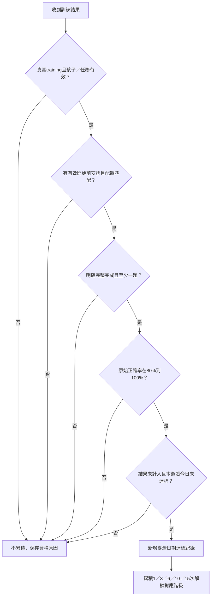

流程圖：現行成長徽章判定摘要；各任務的完整完成語意見第 7.1 節及第 14.1 節。

### 7.2 六枚徽章與五階門檻

| 遊戲 | 成長徽章 |
| --- | --- |
| SRT | 橡實守護者 |
| PM | 圖片記憶家 |
| CBT | 石頭路記憶家 |
| ARI | 聲音反轉家 |
| DCCS | 規則切換家 |
| LB | 門牌導航員 |

| 階級 | 累積有效達標次數 |
| --- | ---: |
| 銅級 | 1 |
| 銀級 | 3 |
| 金級 | 6 |
| 鑽石級 | 10 |
| 星耀級 | 15 |

不是連續天數；同遊戲最高階至少需要 15 個不同臺灣日期達標。不同遊戲各自累積，每天可以分別各計一次。降級練習、後續失敗或一般結果歷史裁切，都不收回已取得徽章。

### 7.3 適性化實際放在哪裡

適性化發生在**開始前的安排難度**，達標條件與階級次數保持共同規則。例如兒童被安排 CBT 入門且達標可累積；另一位被安排 CBT 專業且達標也累積。徽章代表符合各自安排的持續達標，跨兒童不能只憑同階徽章推論相同能力。

| 安排來源 | 代碼 | 目前用途 |
| --- | --- | --- |
| 正常訓練地圖 | `system_plan` | 地圖帶入遊戲、兒童、關卡等資料，再保留實際解析難度 |
| 推薦入口 | `system_recommendation` | 推薦導航狀態 |
| 沒有手動難度的預設入口 | `system_default` | 預設配置 |
| 醫療指定 | `clinician` | 已支援導航資料格式；尚未新增獨立處方操作介面 |

單純手動網址／難度參數且沒有有效安排，不累積；正式測驗、臨時遊戲測試、未完成或安排不符也不累積。正常地圖安排本身可以來自家長選擇的訓練項目，並非只承認 UCB1。

### 7.4 保存、查閱與舊制

新制使用兒童專屬 `achievementProgress_v2_<childId>`，保存達標明細與已獲階級；明細包含日期、結果、難度、正確率、安排來源、提示次數與協定。現行沒有獨立雲端徽章帳本；雲端結果資料的存在不等於徽章一定已跨裝置同步。

第一次載入新成就頁時，舊成就依既有帳本與舊結果計算後存成 `achievementLegacyAwards_v1_<childId>`，作「舊制收藏」永久保留，不繼續按舊門檻升階，也不混入新制次數。一般帽子貼紙另用原收藏流程。

來源：[成就政策](../src/utils/achievementProtocol.js)、[安排快照](../src/utils/useTrainingAchievementAssignment.js)、[成就頁](../src/pages/Achievement.jsx)、[統一保存](../src/utils/resultManager.js)。

## 8. 帽子追蹤遊戲與一般貼紙

### 8.1 遊戲本體的規則

帽子遊戲為訓練間的獎勵活動，觀察貼紙藏在哪頂帽子下，追蹤交換後位置，再選一頂帽子。

1. 每回合從 23 種森林貼紙中隨機取一張，隨機選定藏貼紙的帽子。
2. 預覽位置 3 秒。
3. 執行該回合次數的兩帽交換；交換中不能選。
4. 最後一次交換後再等 250 ms，開放一次選擇。
5. 猜中獲得 1 張當回合貼紙，可選擇下一回合；猜錯顯示答案，本次沒有下一回合入口。
6. 最多 5 回合，也可返回地圖；前面已取得貼紙保留。

| 回合 | 帽子數 | 交換次數 | 每次交換時間 |
| --- | ---: | ---: | ---: |
| 1 | 3 | 2 | 760 ms |
| 2 | 4 | 3 | 680 ms |
| 3 | 5 | 4 | 590 ms |
| 4 | 6 | 5 | 510 ms |
| 5 | 7 | 6 | 440 ms |

難度同時增加追蹤物件、交換次數及速度。此遊戲目前沒有依六款訓練分析或 UCB1 自動升降級，回合配置固定，也不列入六款正式測驗能力分數。

### 8.2 「5～8 次觸發」的設計與實作差異

設計目標為每完成隨機 5～8 個有效訓練關卡，出現一次帽子邀請；正常完成、跳過、取消後重新抽間隔。共用 [hatRewardScheduler.js](../src/utils/hatRewardScheduler.js) 已有排程、pending session、接受／跳過／完成／取消、關卡去重與領獎驗證函式。

**目前主要頁面沒有呼叫這組共用排程 API**，實際是多個結果頁各自處理：

| 結果頁 | 現行觸發位置／狀態 |
| --- | --- |
| SRT | 訓練結果返回時，使用 `hatRewardSchedule_<childId>` 的 remaining／processedTokens |
| PM | 訓練結果返回時，使用 `hatRewardProgress_<childId>`，另有 PM 結果去重 |
| ARI | 訓練結果載入後登記，返回時轉帽子；使用 `hatRewardSchedule_<childId>` 的 completedCount／target，另有 ARI 去重與 pending |
| DCCS | 訓練結果返回時，使用 `hatRewardProgress_<childId>` 計數；頁面鎖可防連點，但未見與共用模組等同的持久結果去重 |
| LB | 訓練結果返回時，使用 `hatRewardScheduler_<childId>`，保存上一筆結果與決策 |
| CBT | 目前結果頁未見帽子累積／觸發接線 |

PM／DCCS 共用一種進度 key；SRT／ARI 雖共用 key 名稱，欄位格式不同，可能互相覆寫。因此不能宣稱目前已做到「六款遊戲一致共用一個有效關卡計數器」。各結果頁通常在觸發時就重設間隔，也與共用模組「邀請解決後再重抽」的生命週期不同。

### 8.3 領獎與入口限制的實際狀態

帽子頁以 `rewardSessionId:round-N` 為領獎 ID，保存 `hatStickerClaims_<childId>`，阻止同 session／同回合重複領取；收藏寫入 `hatStickerCollection_<childId>`。重複貼紙會增加張數，保存首次／最後取得時間。

帽子頁目前沒有以共用排程的 pending session 驗證入口；缺 session ID 時會自行建立 fallback。因此「只能由有效訓練邀請進入、直接網址無法領獎」是**尚未完整落實的設計要求**，不能當作已實作保證。這些領獎防重主要是同一瀏覽器的本機資料，也不是伺服器端獎勵驗證。

### 8.4 23 種一般貼紙

| 編號 | 貼紙 | 編號 | 貼紙 | 編號 | 貼紙 |
| --- | --- | --- | --- | --- | --- |
| R1 | 蜂蜜小熊 | R9 | 勤勞蜜蜂 | R17 | 森林松鼠 |
| R2 | 森林狐狸 | R10 | 森林花朵 | R18 | 花朵刺蝟 |
| R3 | 快樂小雞 | R11 | 森林木屋 | R19 | 智慧貓頭鷹 |
| R4 | 森林小兔 | R12 | 蜂蜜小屋 | R20 | 池塘青蛙 |
| R5 | 花角小鹿 | R13 | 蜂蜜罐 | R21 | 紅色蘑菇 |
| R6 | 藍羽小鳥 | R14 | 花朵提籃 | R22 | 向日葵花束 |
| R7 | 點心狐狸 | R15 | 森林樹樁 | R23 | 森林寶箱 |
| R8 | 蜂蜜刺蝟 | R16 | 溫暖提燈 | — | — |

收藏頁呈現種類數、總張數、重複數與收集進度；一般貼紙與六枚成長徽章分開。`stickerManager`／`stickerConfig` 仍有其他收藏與融合模組，但目前主要成就頁未見完整融合操作接線，不將它列為已開放玩法。

來源：[帽子頁](../src/pages/HatStickerGamePage.jsx)、[共用排程模組](../src/utils/hatRewardScheduler.js)、各遊戲結果頁及[成就頁](../src/pages/Achievement.jsx)。

## 9. 金幣、蜂蜜、家具與休息

### 9.1 星級金幣

訓練統一結果保存時，以星級基礎獎勵乘難度倍率並四捨五入：

| 星級 | easy 類 ×1 | normal 類 ×1.5 | hard 類 ×2 |
| --- | ---: | ---: | ---: |
| 1 星 | 10 | 15 | 20 |
| 2 星 | 20 | 30 | 40 |
| 3 星 | 30 | 45 | 60 |

現行字串解析將 `beginner/easy` 歸 easy、`medium` 歸 normal、`hard/expert` 歸 hard；舊名稱及其他字串依相容正規表示式解析，不是每級各自一種倍率。同結果 ID 不重複加幣，帳本最多保留最近 500 個已獎結果識別。

金幣與家具保存在 `ef_economy_<childId>`。現行保存路徑主要檢查 training 模式；金幣計算會把 0／缺星限制為至少 1 星，未使用成就相同的完整完成資格檢查。這是目前程式行為，不應把領到金幣當成成就達標證明。

### 9.2 蜂蜜長期任務

蜂蜜同時要求累積星星與有效訓練日，達兩項才完成：

| 階段 | 有效日 | 星星 | 每日可計星星上限 |
| --- | ---: | ---: | ---: |
| 1 | 14 | 180 | 18 |
| 2 | 21 | 270 | 18 |
| 3 | 28 | 360 | 18 |
| 4 | 35 | 450 | 18 |
| 5 | 42 | 540 | 18 |

- 同一關卡 ID 去重；每日最多計 18 星。
- 當日完成至少 3 個有效關卡，或已計入至少 6 星，算 1 個有效訓練日。
- 進度為 `min(星星完成率, 有效日完成率)`，沒有同時達標前不提前滿格。
- 依兒童保存，登入個案可同步 `honey_mission_progress`，本機保留備援；合併採較高階段、各日較高星數及紀錄聯集。
- **已有五輪門檻，但尚未接入領取後自動升下一輪／重設流程**，不能當作現在會自動循環五輪。

蜂蜜日界目前由瀏覽器本地日期產生；成長徽章則固定臺灣日期。臺灣裝置通常一致，跨時區時兩者不能假設相同。

### 9.3 家具與房間

家具已有定價、購買與所有權邏輯：不足額不能買、已擁有不能重複買，價格表約 30～350 金幣，未列品項預設 100。房間與擺設程式仍保留，但目前 `SHOW_AVATAR_ROOM = false`，主要產品入口隱藏；不將它寫成現行一定可見的獎勵入口。

### 9.4 休息站

休息頁已有 120 秒預設、呼吸／眼睛休息提示、返回任務／地圖及家長提前結束操作，也可由導航參數指定時間。設計文字建議約每 20 分鐘休息；目前未見主要遊戲共用且自動累積 20 分鐘後導向休息的完整接線，應視為既有頁面與待整合流程。

來源：[經濟系統](../src/utils/economyManager.js)、[蜂蜜與地圖](../src/pages/GameMenuPage.jsx)、[家具價格](../src/config/furnitureConfig.js)、[功能開關](../src/config/featureFlags.js)、[休息頁](../src/pages/RestPage.jsx)。

## 10. 介面、行為資料與回饋設計

### 10.1 兒童操作設計

使用森林、動物、既有圖片與影片降低文字需求，透過 STEP 動畫、錄製語音、小雞旁白、滑鼠／手指提示引導。觀察與作答階段分開，提示的性質也要區分：PM 的滑鼠教操作；SRT 的滑鼠提示點刺激；CBT／ARI／DCCS／LB 某些入門提示會揭露下一步或答案。

各任務依自己的需求保留畫面穩定：CBT 正式固定九顆位置、環境動畫不推動棋盤；DCCS 正式刺激與分類箱使用固定相對位置；LB 正式同段路線的選項位置在語音、選取及撤回時保持一致。避免將純動畫時間當成兒童思考時間。

結果以完成、星星、鼓勵及下一步為主；家長／醫療顯示較完整數據。提示與技術事件應保留原始紀錄，避免把提示後成功當成完全獨立完成，或把播放失敗當成不理解規則。

### 10.2 保存內容

共通結果包含兒童、遊戲、模式、難度、地圖關卡、session／result ID、開始結束、完成狀態、停止原因、協定、題數、正確率、RT、錯誤、分數、星級、AI 分析及推薦。

| 任務 | 特別需要保留的條件 |
| --- | --- |
| SRT | 刺激類型、呈現及間隔、漏答／抑制、分段與波動 |
| PM | 記憶量、目標與選項、完整選取消除、提示及可能混淆 |
| CBT | 石頭座標、播放與作答序列、逐步時間、提前點擊及支持 |
| ARI | 聲音、左右、預期／實際動物、重播、提示及技術事件 |
| DCCS | 現行／前一規則、分類參照、袋子、衝突、風效／反向 |
| LB | 路線、數字／顏色、預期／實際步驟、提示、撤回及提交 |

六款正式測驗共用 attempt 保存機制，在開始、逐題與中斷保留快照，同次完成／中斷沿用識別，支援本機暫存與雲端同步。未完成題的事件可以保存，但計算完成題正確率或記憶跨度須依任務排除未完成部分。

### 10.3 家長、醫療、研究與助手

- **家長結果**：歷史、正確率、RT、錯誤類型、疲勞、白話建議與下一次訓練。家長小助手目前是依結果及內建規則回覆。
- **醫療介面**：授權個案趨勢、多次比較、逐題／提示／刺激資料、Excel 匯出與結合個案資料、系統指標及知識庫來源的 RAG 助手。
- **研究介面**：Participant → Session → Task Session → Trial 階層，支援資料品質、特徵、統計、模型比較、可解釋分析、推薦紀錄與縱向追蹤。

聊天助手、研究模型、線上 bandit 與任務升降級各有資料來源及用途。現行沒有經驗證年齡常模可將遊戲分數直接換成診斷；跨模式、難度、提示及協定比較時應先確認可比性。

## 11. 現況差異與測試入口

### 11.1 目前應特別注意的版本與整合差異

| 項目 | 本次原始碼核對結果 |
| --- | --- |
| 六款訓練難度 | 全部五級；DCCS 舊十階與 ARI 舊三階不作現行規則 |
| PM 正式起始量與素材 | 2～7 個物件、最多 12 題；新版總素材 81 張，按模式／副本分池；舊 29 張敘述只供歷史資料辨識 |
| CBT 舊細難度 | 現行配置五級、正序、最多 7 步；舊 18 微難度／倒序描述不適用 |
| DCCS 正式題數與試玩 | 目前兩副本實際均為 4＋4＋4＝12 題；三階段各自連續兩題試玩通過 |
| DCCS 正式／訓練裝袋 | 正式第三段按袋內顏色；訓練條件段有袋看顏色、無袋看種類 |
| DCCS 訓練計分配置 | 五級已明確套用既有模板，詳見第 4 節；舊十階仍支援歷史資料，風效沒有獨立主分權重 |
| DCCS 結果文字 | 部分 `LEVEL_INFO`／難度映射仍保留十階文字，可能與五級訓練不一致 |
| 升降級套用 | 六款可產生建議；不能宣稱地圖全部關卡會自動依專屬建議重排 |
| UCB1 難度 | 任務是統計 arm；級別為該任務第一個允許動作，尚未分級學習 |
| 推薦回饋資格 | 尚未完整核對難度／完成／安排；缺 RT 可能被轉 0 |
| 成就醫療指定 | 支援資料格式，沒有新增獨立處方操作頁 |
| 帽子邀請 | 多結果頁各自接線，CBT 未見接線；共用排程尚未全面採用 |
| 帽子入口 | 本機每 session／回合去重已有；pending session 強制驗證未接入 |
| 蜂蜜五輪 | 門檻已定義，自動領取／升輪未完成 |
| 家具／房間 | 程式保留，主要入口目前隱藏 |
| 20 分鐘自動休息 | 有休息頁與設計文字，未見完整共用觸發 |

上述為目前實作狀態與需要追蹤的整合點，本次只新增本規格文件，沒有更動遊戲邏輯；後文的重設提案尚未實作。

### 11.2 臨時遊戲測試

在非輸入框／編輯區的頁面空白處，連續輸入三個半形句點 `...`，每次間隔小於 1.5 秒，可開啟測試選單。目前 `ENABLE_TEMPORARY_GAME_TESTING = true`。

選單提供六款測驗及其可用副本、每款五級訓練，以及帽子第 1～5 回合。CBT 荷葉／木塊副本目前由此隔離入口指定；正常正式入口仍用石頭。使用虛構兒童與記憶體儲存，不寫入正式結果、同步佇列、進度、金幣、貼紙或成就；網址 `gameTesting=1` 維持重新整理後隔離。「結束測試」重新載入並清除預覽資料。

此入口用於驗證各級規則及時序，不作正式訓練成績。測試版可直接指定帽子回合，正常帽子流程從第一回合開始。

### 11.3 本文件的驗證範圍

本次依工作區的協定常數、主要遊戲頁、素材副本設定、推薦、成就、獎勵及分析器整理並檢查連結。第3.2.1及13～15節為新增設計，第16～23節補入完整細則、圖表與案例。v2已執行第23節的唯讀數值案例，沒有重新跑完整測試套件、建置、瀏覽器實玩、資料庫驗證或部署；舊文件測試結果不當成本工作區目前已通過的證明。

## 12. 主要程式與延伸文件

| 範圍 | 主要來源 |
| --- | --- |
| 測驗地圖／順序 | [TestMapPage.jsx](../src/pages/TestMapPage.jsx) |
| 訓練設定與弱項計畫 | [ModeSelectPage.jsx](../src/pages/ModeSelectPage.jsx) |
| 地圖、解鎖、蜂蜜、推薦第一關 | [GameMenuPage.jsx](../src/pages/GameMenuPage.jsx) |
| SRT | [協定](../src/utils/srtProtocol.js)、[計分](../src/utils/srtScoring.js)、[分析](../src/ai/srtTrainingAnalyzer.js) |
| PM | [協定](../src/utils/pmProtocol.js)、[計分](../src/utils/pmScoring.js)、[分析](../src/ai/pmTrainingAnalyzer.js)、[素材](../src/utils/pmItems.js) |
| CBT | [協定](../src/utils/cbtProtocol.js)、[計分](../src/utils/cbtScoring.js)、[分析](../src/ai/cbtTrainingAnalyzer.js) |
| ARI | [協定](../src/utils/ariProtocol.js)、[計分](../src/utils/ariScoring.js)、[分析](../src/ai/ariTrainingAnalyzer.js) |
| DCCS | [訓練協定](../src/utils/dccsTrainingProtocol.js)、[正式協定](../src/utils/dccsAssessmentProtocol.js)、[計分](../src/utils/dccsScoring.js)、[分析](../src/ai/dccsTrainingAnalyzer.js) |
| LB | [協定](../src/utils/lbProtocol.js)、[計分](../src/utils/lbScoring.js)、[分析](../src/ai/lbTrainingAnalyzer.js) |
| 推薦與研究政策 | [線上入口](../src/analytics/recommendation/onlineRecommendation.js)、[動作邊界](../src/analytics/recommendation/actions.js)、[決策保存](../src/analytics/recommendation/decisionLog.js)、[研究說明](adaptive_recommendation.md) |
| 成長徽章 | [政策](../src/utils/achievementProtocol.js)、[安排](../src/utils/useTrainingAchievementAssignment.js)、[成就頁](../src/pages/Achievement.jsx)、[規則文件](achievement-protocol.md) |
| 帽子本體／共用排程 | [HatStickerGamePage.jsx](../src/pages/HatStickerGamePage.jsx)、[hatRewardScheduler.js](../src/utils/hatRewardScheduler.js) |
| 帽子實際觸發 | [SRT 結果](../src/pages/ResultPage_SRT.jsx)、[PM 結果](../src/pages/ResultPage_PM.jsx)、[ARI 結果](../src/pages/ResultPage_ARI.jsx)、[DCCS 結果](../src/pages/ResultPage_DCCS.jsx)、[LB 結果](../src/pages/ResultPage_LB.jsx) |
| 金幣／家具 | [economyManager.js](../src/utils/economyManager.js)、[furnitureConfig.js](../src/config/furnitureConfig.js) |
| 結果、同步與正式快照 | [resultManager.js](../src/utils/resultManager.js)、[resultSync.js](../src/utils/resultSync.js)、[useTestAttempt.js](../src/utils/useTestAttempt.js) |
| 測試與功能開關 | [featureFlags.js](../src/config/featureFlags.js)、[測試選單](../src/temporaryGameTesting/catalog.js)、[測試說明](temporary-game-testing.md) |
| 更詳細操作規格 | [SRT](srt-protocol.md)、[PM](pm-protocol.md)、[CBT](cbt-protocol.md)、[ARI 試玩](ari-practice.md)、[DCCS 訓練](dccs-training.md)、[DCCS 正式](dccs-assessment.md)、[LB](lb-protocol.md) |
| 研究資料與長期分析 | [資料字典](data_dictionary.md)、[特徵字典](feature_dictionary.md)、[研究工作台](research_professional_dashboard.md)、[縱向追蹤](longitudinal_modeling.md) |

後續改動任務規則時，請同步更新本文件對應難度表、提示／計時、停止條件、計分與升降級、結果欄位及協定版本；若只是舊碼相容分支，不將它寫成新場次的現行玩法。

## 13. 重新設計提案：統一升降級、推薦與安排

本節為下一版統一制度，尚未接入程式。第 5 節保留目前各遊戲實際門檻，本節說明如何整合與套用，不把既有六款分析器改成同一個通用正確率公式。

### 13.1 名詞、資料與責任

| 項目 | 決定的內容 | 不應混用的內容 |
| --- | --- | --- |
| 地圖進度 | 第幾個安排、是否解鎖／完成 | 不代表兒童能力自動升一級 |
| 任務難度 | 本款遊戲的五級配置 | 不等於跨任務可比較的能力等級 |
| PM Profile | 同記憶級下的相似物干擾條件 | 不取代記憶量或作答期限 |
| 任務分析器 | 根據本款表現產生升、維持、降、支持建議 | 不直接更改其他遊戲的級別 |
| 訓練推薦 | 允許遊戲中下一場優先練哪款 | 不自行跳過任務的升級資格 |
| 統一仲裁器 | 驗證安排、資格及限制，形成下一次最終配置 | 不在正在作答的題目中途改答案或時限 |
| 成長徽章 | 累積符合安排的有效達標日 | 不作為難度上升的必要門檻 |

每個孩子分別保存六款的 `currentLevel`、`lastAppliedConfig`、`pendingRecommendation`、`upgradeEvidence`、`downgradeEvidence`、`lastValidResultId`、`protocolVersion`。PM 另保存 profile 與該 profile 的有效樣本。結果保存當時快照；未來調級不能回寫舊場次難度。

### 13.2 配置套用的優先順序

1. 隔離測試入口使用指定配置，結果完全不更新真實孩子狀態。
2. 有效醫療指定安排使用其遊戲、級別及明訂限制；分析器可產生建議，另留紀錄供後續安排。
3. 已確認的訓練安排／正在進行的 session 使用開始前鎖定的配置，整場固定。
4. 新建自動訓練安排，採用同遊戲最新、通過資格與邊界檢查的分析器建議。
5. 尚無可用建議則沿用同遊戲最後有效級別；完全無資料以入門開始，有對應正式測驗及明訂映射時才可選簡單。
6. 手動選難度需保存來源及是否符合有效安排，不憑手動網址自動取得成長徽章資格。

UCB1 先選任務，最終級別再由該任務的狀態與仲裁器解析。**先算出最終動作再寫推薦決策**；若決策已寫入而配置須變更，舊決策標記撤銷並建立新決策，不能顯示 A 配置、保存 B 配置、用 C 配置的結果回饋。

地圖生成時，每個關卡保留獨立 `assignmentId` 與預計配置。完成同遊戲第 1 次、第 2 次不再直接推成入門、簡單；每次先看已掌握級別與本次新建安排。已開始的場次保留，尚未開始的安排才可重新產生版本。

### 13.3 統一調級狀態機

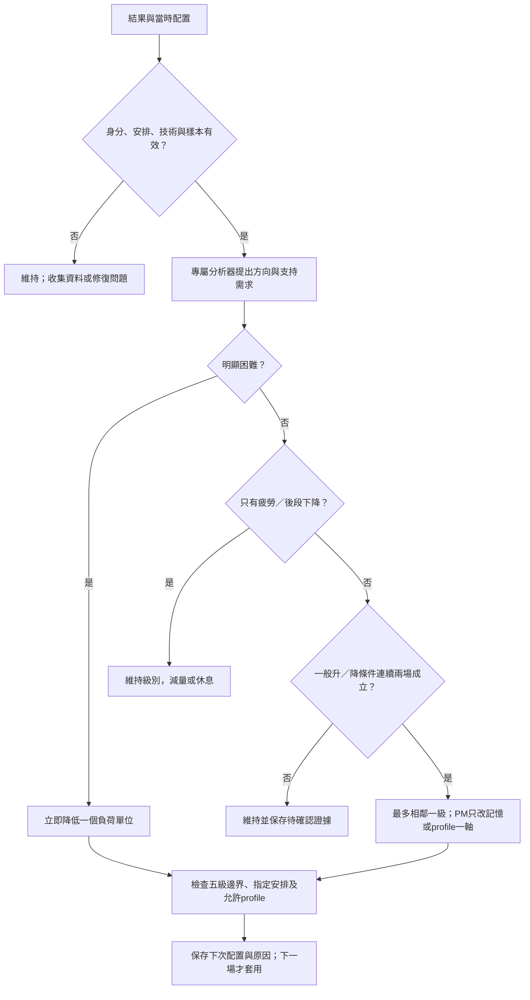

流程圖：新版升降級仲裁。優先序為無效／不足 → 明顯困難 → 單純疲勞 → 一般降級確認 → 升級確認 → 維持；若上下方向同時命中，先處理困難，不先升級。

| 情況 | 下一版共同處理 |
| --- | --- |
| 無作答、樣本不足、技術無效 | 維持並收集更多資料；技術問題不消耗升降級確認次數 |
| 達各遊戲升級條件 | 同級、同主要配置連續 2 場有效結果均達標後，最多升 1 級；首場只記待確認 |
| 達一般降級條件 | 同配置連續 2 場有效結果均顯示困難後，最多降 1 級 |
| 單場明顯困難 | 有效樣本下整體正確率 <40%，或有效作答窗逾時率 ≥50%，可立即降 1 級；PM 先依第 13.4 節選擇降低 profile 或記憶量，保留任務專屬原因 |
| 有效維持結果 | 維持級別，重設相反方向的連續證據；不把交錯成功／失敗當成連續達標 |
| 中斷或主動離開 | 保存可用表現，不單憑離開降級；達任務有效容量停止可由專屬分析器判斷 |
| 疲勞／後段下降 | 優先縮短下一場量或安排休息；沒有其他能力困難證據時維持級別 |
| 只依賴提示完成 | 保留支持後能力，獨立掌握另判；不只看最後答案正確就升級 |
| 已在入門又需降級 | 保持入門並提供該級允許支持，不能生成第 0 級 |
| 已在專業又達升級 | 保持專業，可累積掌握紀錄；PM 可在允許範圍練下一 profile |

「連續 2 場」不要求不同日期，但同一 `resultId` 只能算一場；不可將重新整理、重複同步或試玩當作第二份證據。這是難度制度，與徽章「同遊戲每天最多一次」分開。有效維持或相反方向會打斷對應升／降連續紀錄；缺資料的無效場不作成功或失敗。

**單軸限制**：PM 的記憶量與 profile 一次只動一項。其他遊戲沿用既有完整五級模板時，必須標示該步實際改了哪些參數；若要做到嚴格單軸過渡，另建立明確的中間配置與新 protocol，不能偷偷改既有級別常數。CBT 原有一次降兩級建議在本提案中由仲裁器先限為降一級，再按下一次表現重新判斷；目前程式仍保留原分支。

### 13.4 六款專屬證據與處理方向

| 遊戲 | 升級前的必要證據 | 表現困難時優先處理 |
| --- | --- | --- |
| SRT | 至少 15 題及 8 筆有效 RT，另符合該級正確／漏答／誤點／提示／穩定門檻 | 分辨漏接、不可點誤點、背景亂點與後段下降；需要抑制指標時確認真的有 no-go 機會 |
| PM | 完成最高記憶量、同跨度至少 2 題獨立答對及既有正確／逾時／支持門檻 | P0 記憶不足才考慮減記憶；相似條件困難先退 profile；慢速與取消選取只作過程觀察 |
| CBT | 按既有升級分數及獨立跨度，檢查提示、位置、順序與逾時 | 提前錯／位置錯可減負荷；順序錯可先給較簡單路徑安排；疲勞先減量 |
| ARI | 至少 6 題及該級正確／同動物錯誤／搶答／逾時／穩定門檻 | 先確認叫聲確實播放；區分聽同選同、左右偏好及期限不足 |
| DCCS | 入門至少 3 題、其他至少 4 題；需要切換／干擾時要有實際題目 | 固著舊規則、條件線索及風中反向錯誤分開；缺必要條件的題目不宣稱已掌握 |
| LB | 至少 5 筆操作及既有正確／切換／提示門檻，正式完成情況另記 | 分辨數字、顏色、倒序及重複誤點；逾時保留進度，不假設整條路線完成 |

PM 提高 profile 分為「試用新條件」與「確認掌握」兩步。目前配置連續 2 場達既有記憶與獨立條件，且整題正確率 ≥85%、提示率 ≤10%、逾時率 ≤15%，才安排高一個允許 profile 的探索場；記憶量保持不變，標示 `profileStatus: probe`，不能立即寫成已掌握。從 P0 試用 P1 時不要求過去有關聯機會，因為 P0 本就沒有配額保證。

新 profile 同配置連續 2 場均達上述門檻，兩場合計至少 4 題實際符合該 profile 的干擾配額，且關聯非目標選取率 ≤20%，才確認掌握並保存為 `profileStatus: mastered`。沒有足夠關聯機會、素材 fallback 或未記錄分母時不確認掌握；可維持探索並收集資料。探索未達標但未達明顯困難時依共同確認規則處理，明顯困難則退回上一個已掌握 profile。

若 P2～P4 有足夠機會且關聯非目標選取率 >40%，而同記憶量近期 P0 表現穩定，優先降低一個 profile。這些新增百分比是版本化起始門檻，不回套既有結果。記憶升級仍依原跨度證據；不必先練到該級允許的最高 profile 才能增加記憶量。

### 13.5 下一次推薦與時間安排

新版推薦輸入包含允許任務、每款目前級別、近期同配置的正確率／錯誤／支持、距離上次練習、有效練習次數、預計時間、待確認調級、未完成邀請與指定安排。缺值保留 `null`，不以 0 表示完美穩定。

初期繼續使用目前已接入的 UCB1 與弱項備援，但選任務與定級分開。弱項排序要參考同遊戲、同 protocol／配置的個人歷史，跨遊戲的原始分數只作排程參考，不直接當成共同能力量尺。研究用其他政策維持獨立版本。

| 條件 | 安排規則 |
| --- | --- |
| 有效明確指定安排 | 先遵循指定任務與級別限制，再安排其他允許任務 |
| 有待確認的升／降方向 | 優先安排同配置再觀察，避免只靠一次結果改級 |
| 遊戲種類允許至少兩款 | 一款最多連續安排 2 場，之後輪換；只選一款時保留例外 |
| 同一能力群多場後 | 可在允許範圍換到另一能力群，降低長時間重複負荷 |
| 線上推薦失敗 | 使用本機最後有效級別及結果式計畫，顯示可用的備援原因 |
| 時間不足開始下一完整場 | 停在關卡邊界，保留後續安排，讓家長決定下次繼續 |
| 約 20 分鐘或出現明顯疲勞訊號 | 在安全的題間／關卡邊界提供 120 秒休息；不在作答窗中插入動畫 |

家長設定的時間在本提案中是計畫預算：估算各任務完整場時間、教學與休息，再排入可完成的場數。SRT 必須納入該級 3～8 分鐘，其他依題數及個人歷史估計。不為了硬切到設定分鐘而將完整題窗截斷或把截斷當成漏答；目前程式仍是第 2.2 節所述的關卡計畫。

### 13.6 推薦回饋與 Reward 修訂

每份推薦都保存 `recommendationId`、`assignmentId`、孩子、任務、最終難度、PM profile、副本／protocol、建立時間、狀態與版本。回饋須符合相同孩子、任務、實際難度及 profile，並確認結果確實屬於該安排。開始前換任務、取消或過期要解決舊決策，不能被日後同遊戲的任意結果填入。

| 結果類型 | 新版回饋政策 |
| --- | --- |
| 有效完成預定安排 | 保存 outcome 與實際 reward，成功後清除 active decision |
| 任務規定的容量停止 | 保存停止原因；只有安排明訂此停止為有效 outcome 時才計 reward，完成分項按實際完成量處理 |
| 手動離開／技術無效 | 保存狀態但不憑預設 `completed: true` 更新學習；可重試的同步問題保持待送 |
| 不同難度／不同 profile／不同安排 | 不匹配，不更新原推薦；另行保存一般結果 |
| 同一結果重送 | 唯一結果識別及一次性 outcome 保證不重複學習 |

現行 `reward_balanced_v1` 的固定 1000 ms 與缺測轉 0 問題列為修訂範圍。新增版本採以下原則：

- PM 使用 `reward_pm_memory_v2` 起始提案：`0.70 × 整題正確率 + 0.20 × min(1, 獨立跨度 / 本次目標最高跨度) + 0.10 × 完成比例`，各分項均為 0～1，不納入作答速度。實際干擾條件與錯誤另行保存，不能把不同 profile 的結果無條件混算成同配置成長。
- 其他任務保留平衡目標時，RT 目標依任務／難度／protocol 設定，另存來源，不共用所有任務 1000 ms。
- 不足以計算的分項為 `null`。有足夠核心資料時只按有效分項重新正規化權重並記錄實際權重；核心正確率或安排匹配不可靠時不計 reward。
- 完成比例依任務預定有效題數／步數／時長計算，不能由轉換器一律填 1。
- 新舊 reward 分開保存與重建政策狀態，不把更換公式造成的分數變動解讀為能力進步。

UCB1 仍以任務為 arm；若改成任務 × 級別 × profile，需另建政策版本、樣本條件及評估，這份文件沒有宣稱目前已做到。

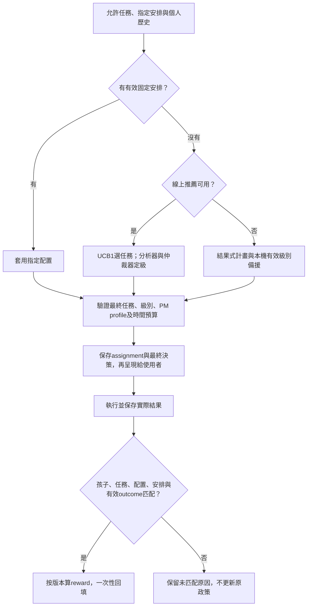

流程圖：新版推薦與回饋閉環；現行入口的匹配限制仍以第 6.4 節為準。

## 14. 重新設計提案：帽子與獎勵閉環

本節補齊既有模組與結果頁間的接線。帽子五回合的帽數、交換數、速度及 23 張貼紙仍採第 8 節配置，不讓帽子勝負改變六款訓練難度。

### 14.1 共用有效訓練關卡計數

六款結果保存成功後，統一經一個入口登記帽子進度。資格為正常 training、真實孩子、有效安排／場次識別、明確完整完成、至少一個有效作答單位、不是技術無效或隔離測試。同一安排完成重送不重算；同地圖同一關重玩不重算，之後新訓練計畫中的新安排可計。

容量停止是否屬完整完成依任務政策保存：CBT 的既定容量停止可以是完整施行；PM 未完成預定輪數及 LB 逾時不冒充全部完成。此處是補齊共用資格的提案，現有各結果頁尚未一致。

每次抽出 5、6、7、8 中一個整數為目標間隔，每個整數機率相同。進度按孩子保存並跨遊戲累積。低星但有效完成也計，避免只有高表現才有休息型獎勵；正式測驗、試玩、重刷舊關或未完成不計。

### 14.2 邀請與遊戲生命週期

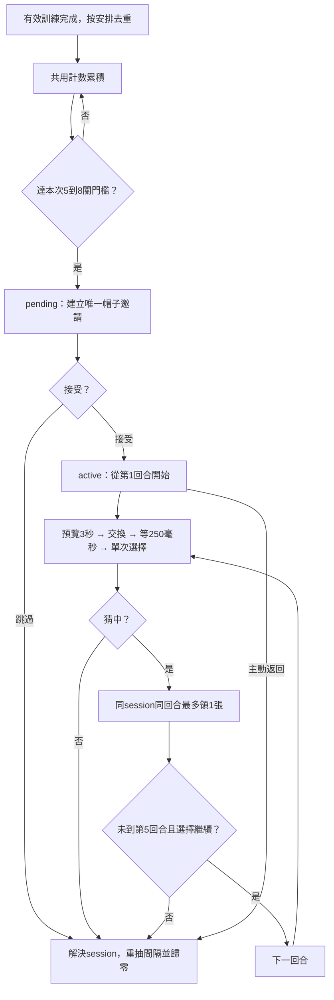

流程圖：新版六款共用帽子排程與五回合獎勵；跳過、結束、猜錯與返回均保留既得貼紙。

pending／active 期間不累積下一次帽子邀請。若玩家繼續別的訓練，先讓他明確跳過邀請；不能留下多個未解決 session。重新整理復原同一邀請／回合，不另抽新獎品與新位置；若無法恢復，保存中斷並安全結束，已得貼紙保留。這需要新增帽子回合快照，現有頁面尚未完整接入。

正常進入帽子頁要檢查孩子、session 及 pending／active 狀態；過期或無效邀請返回地圖。臨時測試仍可指定第 1～5 回合，但全程在記憶體中，不提供真實獎勵。

### 14.3 領獎、去重與遷移

每回合最多領 1 張，唯一鍵建議為 `(childId, rewardSessionId, round)`；貼紙可重複，重複只增加收藏張數。交換中與結果已鎖定時不能再次作答。領獎成功後才顯示已入收藏，失敗顯示待重試；不重新抽貼紙。

舊帽子進度分散在多個 storage key。遷移時保留全部原始資料與已領取鍵，優先使用能證明來源且可去重的有效關卡聯集；只有計數、無來源識別時採保守單一進度，不直接將多個計數相加。遷移版本與採用規則需保存，避免同一舊進度再次匯入。

初期可完成同瀏覽器一致性；若要求跨裝置發獎去重，需雲端唯一鍵與同筆交易寫入領獎／收藏，不能把本機 key 當成跨裝置保證。

### 14.4 其他獎勵的統一方向

| 系統 | 下一版處理 |
| --- | --- |
| 星星／金幣 | 保留既有倍率，但明確 0 星＝0 金幣；不因缺星補成 1 星。正常有效完成才發完成獎勵，相同結果 ID 去重 |
| 成長徽章 | 沿用第 2 版：符合安排、明確完成、正確率 ≥80%，同遊戲臺灣日每天一次；不要求帽子勝利或最高級 |
| 蜂蜜 | 保留五輪日數＋星數門檻，每天最多 18 星；全系統統一用 Asia/Taipei 日界，領取與升輪須有唯一紀錄 |
| 蜂蜜最後一輪 | 第 5 輪完成後顯示全階完成；不自動無限重置，若增加循環另訂新版規則 |
| 家具／房間 | 保留目前隱藏狀態與所有權資料；開放入口時才驗收購買與布置，不把隱藏功能列為現行主要玩法 |
| 休息 | 約 20 分鐘或疲勞訊號提供休息，家長可提早結束；休息本身不算完成一個訓練關卡 |

## 15. 資料規格、完整流程與驗收

本節為整合與開發驗收規格；清單不是已執行或已通過的測試報告。

### 15.1 必備保存欄位

| 資料層 | 必備內容 |
| --- | --- |
| 安排 | assignmentId、孩子、來源、任務、最終難度、PM profile、預期題數／跨度／時長、建立時間、protocol、版本 |
| Session／結果 | sessionId、resultId、assignmentId、recommendationId（可空）、模式、開始／結束、完成類型、停止原因、有效性、同步狀態 |
| 副本 | testVersion／trainingStimulusVersion、stimulusSetId、stimulusName、素材目錄版本、選版依據 |
| Trial | trialId、順序、實際刺激與選項、規則、目標與答案、載入／呈現／作答窗起點、回應時點、RT、正誤、逾時、有效性 |
| 事件 | 點擊／取消／背景／提前操作、提示原因、重播、播放失敗、圖片失敗、技術事件與相對時間 |
| 錯誤與曝光 | 主要錯誤類型、相關目標、機會分母；PM 額外保存最終錯選／漏選與全目標的干擾關係 |
| 分析與調級 | 使用的樣本數、指標分母、方向、原因、確認次數、原配置／下次配置、規則版本 |
| 推薦與獎勵 | 政策／reward 版本、選定動作、實際 outcome、資格原因、金幣／徽章／帽子／蜂蜜各自去重 ID |

同一時間保存 ISO 時間與以 `performance.now()` 取得的場內相對毫秒；日期統計固定 Asia/Taipei。原始資料與衍生指標分開，RT 缺測、真正 0、無相應施測機會要能區分。模式、protocol、副本、難度、profile、提示與裝置條件一併用於判斷歷史可比性。

既有 JSON payload 可容納部分新增欄位；跨裝置輪替、唯一獎勵帳本及新增查詢欄位是否需要 schema／索引調整，須依最終資料保存方式設計，不在文件中假設已完成 migration。

### 15.2 一次完整訓練流程範例

以下是重設後的目標流程，並非目前所有入口均已如此運行。

1. 家長選孩子與 20 分鐘，可選任務或使用推薦；系統讀各款最後有效級別及允許安排。
2. 推薦選出 PM；仲裁器讀到 PM 中等、P1，建立配置快照與 assignmentId，保存最終推薦。
3. PM 選訓練素材曝光較少的 food／ball 組合；固定本場副本，安排 4、5 個物件各 2 題。
4. 每題依 P1 配額出題，觀看 5 秒、作答 15 秒；所有提示、選取與取消留事件。
5. 孩子在一題將目標蛋糕選成另一種蛋糕：整題錯答 1 題；記外形錯選 1 個與漏選 1 個。這可能是額外隨機抽中的外形配對，實際曝光資料需如實記錄。
6. 保存結果、同步狀態與各項分母；分析器產生維持／下次 profile／難度建議。若只有 1 場升級證據，先維持待確認。
7. 各獎勵分別判定：若本例 4 題中答對 3 題，整題正確率為 75%，不達徽章 80%；仍可依有效完成資格計入帽子間隔與星級金幣。若下一場 4 題全對，也仍須符合安排與每日去重才累積徽章。
8. 若累積達帽子門檻，建立一次邀請。接受後由第 1 回合開始，猜對領一張，可繼續；猜錯或返回保留已領貼紙。
9. 邀請解決後重抽間隔，返回尚未開始的地圖安排；剩餘時間不足以開始完整場時結束今日計畫。

### 15.3 正式測驗流程範例

ARI 第一次正式測驗選 01 小豬／綿羊；STEP 與試玩都用同一版，聽到小豬選綿羊。通過試玩並播完正式提醒才開始 20 題、每題 5 秒，同時標記 01 已用。正式作答不可重播或直接答案提示。若正式第 8 題後中斷，保留有效已作答資料與中斷狀態；下次正常測驗使用 02 乳牛／猴子，重新走完整程序，不自動把新素材接在舊第 9 題。

PM 則依曝光較少的分類決定副本，因此中斷後的下一版不一定與上次相反。副本輪替、容量停止與未完成結果須按各任務實際制度解讀。

### 15.4 開發優先順序

| 優先 | 工作 | 可驗收產物 |
| --- | --- | --- |
| P0 | PM 控制式相似出題、錯誤分層與曝光分母 | 所有 profile 可生成、fallback 有紀錄、錯誤數可回溯至物件 |
| P0 | 統一難度解析與安排快照 | 地圖、頁面、結果、推薦決策使用同一實際配置 |
| P0 | 完成資格與去重 | 無效／未完成不冒充完成，各制度各自保存資格及唯一識別 |
| P1 | 統一調級仲裁器與連續確認 | 各任務門檻保留，下一次最多一級且可回溯原因 |
| P1 | 六款接共用帽子排程、入口及領獎狀態 | CBT 也累積，同一邀請不重開、不重領 |
| P1 | 推薦結果匹配與 reward 新版 | 任務／難度／profile／安排全匹配，缺 RT 不變成完美效率 |
| P1 | CBT 副本正常入口與輪替（若納入本次產品範圍） | 決定正式啟用配置，測驗／訓練素材正確分流 |
| P2 | 時間預算、休息接線、蜂蜜領取升輪、跨裝置帳本 | 時間邊界、日期、獎勵與恢復流程有可重現紀錄 |

### 15.5 完整驗收清單

- [ ] 六款均能以五級進入，實際配置、介面名稱與結果難度一致；地圖序號不誤作能力級別。
- [ ] 每款正式測驗與訓練的素材、提示、期限、題數／跨度及停止條件符合第 2～3 節。
- [ ] SRT 8 分鐘從正式語音後開始，刺激間隔不受提早點擊影響，最後未完成刺激不混算完成題。
- [ ] PM 測驗 01／02、訓練 01／02 只取各自允許池，保留所有目標與正確選項數。
- [ ] PM 每個記憶量及 profile 均檢查配額可行性、目標／非目標互斥、沒有重複占配額；fallback 有原要求及實際配置。
- [ ] PM 外形相似優先於同類，同一錯選只屬一類；取消、blocked、背景點擊不當最終錯選。
- [ ] PM 錯選、漏選、錯題、逾時分層；零機會顯示未施測，舊資料不補造分母。
- [ ] CBT 正式位置固定、序列與答案時間一致；訓練的環境動畫只在觀察期且不移動點擊目標。
- [ ] ARI 真正播音才啟動期限；兩副本的聲音、圖片、規則與實際動物紀錄一致。
- [ ] DCCS 兩副本實際各 12 題，三階段各自試玩；訓練裝袋／風中反向不混入正式袋內顏色。
- [ ] LB 正式選完整路線，訓練逐步前進；顏色、倒序、提示及逾時進度正確。
- [ ] 開頁、STEP、試玩不消耗固定輪替版本，正式開始後中斷會換版；孩子之間完全隔離。
- [ ] PM 曝光只累計實際呈現的正式記憶與選項，重繪／點擊不重算，測驗與訓練分開平衡。
- [ ] 升降級只在下一場生效，連續確認、嚴重困難、缺資料、首尾級及 PM 單軸規則均有明確結果。
- [ ] 已寫推薦與實際安排一致，錯孩子／任務／難度／profile 的結果不能填回；重送不重複更新 reward。
- [ ] 斷線時保留有效結果與待同步狀態，備援計畫可用；恢復後同一結果不重複發獎。
- [ ] 六款完整訓練都可進共用帽子間隔，邀請接受／跳過／取消／完成及重新整理均不重算。
- [ ] 帽子只有開放選擇時可點，五回合參數正確，同 session 同回合最多領一次，測試模式不領真實貼紙。
- [ ] 徽章 79.99% 不達標、80% 達標，同遊戲同臺灣日最多一次；後續失敗與降級不收回已獲徽章。
- [ ] 金幣、蜂蜜、徽章、帽子使用各自資格，0 星與未完成不被預設值誤發；蜂蜜領取升輪有去重紀錄。
- [ ] 兒童畫面顯示必要引導與鼓勵，家長／專業端可回查提示、錯誤、分母、原始配置與停止原因。
- [ ] 桌機、平板、手機的素材載入、語音自動播放恢復、點擊區與減少動態效果完成實機檢查。
- [ ] 臨時測試模式重整後仍隔離，不改真實版本、曝光、結果、同步、成就、金幣或貼紙。

### 15.6 本次交付與後續維護

本次交付為這份 Markdown 規格，整理現有內容並提出明確標記的新規則，未修改遊戲程式、資料庫或線上站點。已做文件結構、必備主題與本機來源連結檢查；沒有把本節驗收清單標成已通過。

後續採用提案時，應同時更新對應 protocol、抽題器、分析器、結果欄位、推薦及獎勵接線，再依本清單驗收。某一項完成後才將狀態由「提案／待實作」改成「已接入」，並保留版本與生效日期。

## 16. 完整計分公式與邊界處理

本節補足第 4 節的公式。除標示提案外，均為目前共用計分器；頁面顯示相容分支與計分器產出仍需分別核對。`r` 代表 0～1 比例，`p` 代表 0～100 百分比；`clip(x,a,b)` 為限制範圍，`round(x,d)` 為四捨五入至 d 位，未寫 d 表示整數。各分項先依下列規則取整，再合計，不可一律改成最後才取整。

### 16.1 共通資料處理與計分流程

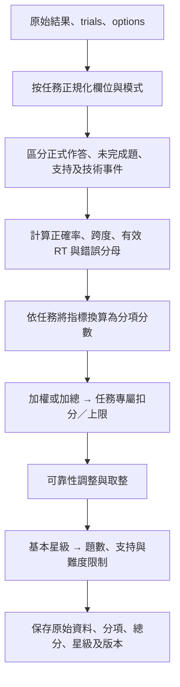

流程圖：計分器共同概念流程；各任務實際步驟依第 16.2～16.7 節。

| 情況 | 現況與應保留資訊 |
| --- | --- |
| 百分比格式 | 讀取前確認 0～1 或 0～100；PM、CBT 的比例不可直接當 ARI 的百分比輸入 |
| RT | 全部以 ms；各任務有效條件不同，不能只套一個通用篩選器 |
| 標準差 | 下列主計分多用母體標準差；ARI 另保留樣本標準差。匯出須明訂採用欄位 |
| 沒有資料 | 多個舊函式仍回傳數值保底，結果展示應同時讀可靠性，不將保底當實測能力 |
| 支持 | 答對、獨立答對、提示後答對各有不同用途；不刪除提示紀錄後重算成獨立完成 |
| 星星與完成 | 0 分可能仍被舊計分器給 1 星，星星本身不是完整完成或獎勵資格 |

### 16.2 SRT 現行主計分

有效 RT 為命中可點刺激且 RT ≥150 ms；正確忽略沒有反應時間。整體正確率為命中＋正確忽略占有效試次比例。前後半注意分以有效命中 RT 按順序分兩半，前半使用 `ceil(n/2)` 筆；至少兩筆且兩半都有資料才可計算差值。

| 分項 | 上限 | 精確換算 |
| --- | ---: | --- |
| 正確 | 35 | `round(35 × r正確)` |
| 速度 | 25 | 平均 RT ≤500／650／850／1100／1400／更高，依序 25／22／18／13／8／4；缺 RT 為 null |
| 穩定 | 15 | RT SD ≤120／180／260／400／600／更高，依序 15／13／10／7／4／2；不足兩筆為 null |
| 前後半注意 | 10 | 後半平均 RT−前半平均 RT ≤50／120／220／350／更高，依序 10／8／6／4／2；無資料為 null |
| 抑制 | 10 | 壞刺激至少 3 題；誤點百分比 ≤5／15／30／45／更高，依序 10／8／6／3／1；未達機會數為 null |
| 金色搜尋舊相容項 | 5 | 預設停用 `includeRewardSearchScore=false`；只有明確啟用且金色至少 3 題才使用命中率 ≥85／65／45／25／更低 → 5／4／3／2／1 |

主總分 `round(100 × 有效分項得分和 / 有效分項上限和)`；無有效分項為 0。預設金色項不上分母，例如其餘五項全滿為 `95/95 ×100＝100`。背景／重複點擊保留為行為與調級資料，主公式沒有另外一個固定每次扣分項。

基本星級 ≥80 為 3、≥60 為 2、其餘 1。再取限制後較低星級：總試次 <15 或有效 RT <8，最多 2 星；正確率 <60% 或漏答率 >35%，最多 1 星；至少 3 題壞刺激且誤點率 >40%，或支持率 >40%，最多 2 星。共用函式的星級下限仍為 1，連空資料亦須避免被 UI 誤解為已完成；新版完成資格應另判。

### 16.3 PM 現行主計分

只用 `completed` 題計分，完整逾時為失敗題，未完成題的事件另保留。正確題需 `!isTimeout && isCorrect`。令 `a` 為整題正確率、`t` 為逾時率、`w` 為曾有錯誤 select 的題數／完成題數。

| 分項 | 公式 |
| --- | --- |
| 正確 A | `round(50 × a)` |
| 記憶 M | `round(clip(12 × d/5,0,12) + clip(13 × s/7,0,13) + 10 × h)` |
| 作答過程 P | `round(clip(15 + 2a − 9t − 4w − q,0,15))`；t ≥0.8 時 q＝6，否則 t ≥0.5 時 q＝3，其餘 q＝0 |
| 原始主分 | 有完成題時 `round(A+M+P)`；無完成題為 0 |

`d` 為答對題中的最高成功五級難度，沒有可解析難度時回退最高通過題號；此回退只為舊資料相容，不能把題號當新難度。`s` 為同跨度至少兩題答對的最大記憶量。`h` 為高負荷題正確率；高負荷定義是難度 ≥4 **或**記憶量 ≥4，沒有此類題時沿用整體正確率。

| 逾時率 | 總分的最後處理 |
| --- | --- |
| t ≥0.8 | `clip(原始主分−20,0,25)` |
| 0.5 ≤t <0.8 | `clip(原始主分−12,0,40)` |
| 0.3 ≤t <0.5 | `clip(原始主分−6,0,55)` |
| t <0.3 | 不另扣分 |

速度分（上限 5）及穩定分（上限 10）仍存在雷達／觀察輸出，**不加入主分**。取消選取不直接扣分，但「曾錯選再取消」仍可能令 w 增加，這和最終混淆錯選數為 0 是不同指標。相似／同類／無關錯選暫無額外專屬扣分。

完成率 `round(完成題數 / max(完成題數,傳入預定輪數),2)`。無完成題或完成率 <0.3 為 0 星，其餘 ≥80／≥60／更低為 3／2／1 星。注意完成率目前先取兩位小數再判斷，新增更嚴格門檻時需版本化。

### 16.4 CBT 現行主計分

主分為「跨度 30＋加權正確 25＋順序 15＋獨立 15＋穩定 10＋速度 5」，合計 100。

**跨度**：獨立跨度 I 為獨立正確題的最大序列長度，支持跨度 H 為有支持正確題的最大長度；有效跨度 `E=round(I+0.5×max(0,H−I),1)`。CBT 主計分的跨度以最大正確長度取得，與 PM 的同跨度兩題成功定義不同。

| E 下界，按大到小先命中 | 7 | 6.5 | 6 | 5.5 | 5 | 4.5 | 4 | 3.5 | 3 | 2.5 | 2 | 1 | 更低 |
| --- | ---: | ---: | ---: | ---: | ---: | ---: | ---: | ---: | ---: | ---: | ---: | ---: | ---: |
| 跨度基礎分 | 30 | 28 | 26 | 24 | 22 | 19 | 17 | 14 | 12 | 9 | 7 | 4 | 0 |

跨度再加 I ≥6 時＋2、否則 I ≥5 時＋1；平均難度 ≥4 時＋2、否則 ≥3 時＋1；H>I 時−1，最後限制 0～30。

**加權正確**：每題錯誤為 0；正確題按優先序給權重：獨立 `cleanCorrect`＝1、`rescueCorrect`＝0.55、replay 嘗試＝0.7、rescue 嘗試＝0.5、其餘有重播／提示／救援支持＝0.75、其餘＝1。`加權正確分=round(25×權重和/完成題數)`。

**順序分**：每題依相同序列位置的正確步數／目標長度形成 match rate，再按計分器彙總成百分比；百分比 ≥90／75／60／40／20／更低，依序 15／12／9／6／3／0。少點部分不自動補齊為正確。

**速度分**：有有效正確 RT 時，平均 ≤2500／4000／6000／8000／更高，依序 5／4／3／2／1；缺 RT 為 0。

**穩定分**：從 10 開始，各類扣分可相加，最後限制 0～10：

| 因素 | 扣分，類內依首個符合門檻 |
| --- | --- |
| RT SD | 缺值 −2；>4500 −5；>3000 −3；>1800 −1；其餘 0 |
| 逾時率 | ≥0.5 −4；≥0.3 −2；≥0.15 −1 |
| 後半正確率下降 | ≥0.4 −4；≥0.25 −2 |
| 前段錯誤占所有錯題 | 有錯題且比例 ≥0.5，−2 |

**獨立分**：從 15 開始，下列各列可相加，最後限制 0～15。除平均重播外，各率以相應題數／完成題數計算：

| 因素 | 門檻與加減分 |
| --- | --- |
| 平均每題重播 | ≥1.5 −5；≥1 −4；≥0.5 −2；>0 −1 |
| 有重播題率 | ≥0.6 −3；≥0.35 −2；≥0.15 −1 |
| 用提示題率 | ≥0.6 −3；≥0.3 −2；>0 −1 |
| 等待提示題率 | ≥0.6 −3；≥0.35 −2；>0 −1 |
| 救援題率 | ≥0.5 −4；≥0.3 −3；≥0.15 −1 |
| 首次正確率 | ≥0.85 ＋1；<0.4 −2；其餘 0 |

六項加總取整後，再依逾時率 ≥0.5／≥0.3 額外−10／−5；平均重播 ≥1.5／≥1 額外−8／−4；救援率 ≥0.5／≥0.3 額外−6／−3。各類可疊加並限制 0～100。重播／救援欄位是相容計分能力，現行五級沒有主動重播按鈕。

星級完整條件見第 4 節，補充：預期跨度取平均難度四捨五入後對應該級最大跨度；二星要求 rawSpan ≥`max(2,預期跨度−1)`。**訓練入門以主要出現難度判斷，最多 2 星**，即使總分與三個星級門檻均達標仍適用。其他級最多 3 星，無完成題 0 星。

### 16.5 ARI 現行主計分

主分六項上限為 40、20、15、10、10、5。以有效正確 RT 的中位數 70%＋平均數 30% 取整為代表 RT。百分比錯誤率下列均使用 0～100。前後半按所有題次以ceil(n/2)分割，各半至少3題才比較；各半RT取正確有效RT的中位數，與全場代表RT不同。

| 指標 | 公式 |
| --- | --- |
| 正確 A | `round(0.40×p正確,1)` |
| 抑制 I | `round(0.15×clip(100−1.15×p同動物錯誤−0.45×p過早反應,0,100),1)` |
| 期限 T | `round(0.10×clip(100−1.5×p逾時,0,100),1)` |
| 速度 V | `round(0.20×基礎速度能力×(0.45+0.55×RT可靠度),1)`；沒有有效 RT 為 0 |
| 穩定 S | `round(0.10×(0.65×SD能力+0.35×CV能力),1)`；只有 1 筆 RT 時能力固定 35、0 筆固定 0 |
| 注意 N | `round(0.05×clip(100−1.4×max(前半正確率−後半正確率,0)−min(max(後半RT−前半RT,0)/25,20),0,100),1)`；前後比較不足時能力保底 50 |

RT 可靠度 `clip(有效正確RT數 / max(3,ceil(總題數×0.5)),0,1)`。基礎速度按下表節點線性內插：RT≤excellent 為 100，excellent→good 為 100→85，good→acceptable 為 85→60，acceptable→slow 為 60→30，slow→answerTimeLimit 為 30→10，超過上限為 5。各分支依程式順序判斷；作答窗本身由遊戲協定決定。

| 計分模板 | excellent／good／acceptable／slow（ms） | stable／acceptable／unstable SD（ms） |
| --- | --- | --- |
| 入門、簡單訓練 | 1000／1500／2100／3000 | 300／650／1000 |
| 中等訓練；正式預設 normal | 900／1400／2000／2800 | 280／600／900 |
| 難、專業訓練 | 900／1400／2000／2700 | 280／600／900 |

訓練速度模板的末端時限取各級實際 10000／10000／5000／5000／3000 ms。正式計分器仍可讀舊 easy／normal／hard 模板，normal 內的速度換算末端為 4000 ms；它不會改變正式遊戲的 5000 ms 作答窗，需保存兩者避免誤解。

SD 能力：≤stable 為 100，stable→acceptable 線性 100→70，acceptable→unstable 線性 70→35，超過 unstable 為 25。CV 能力：≤0.2／0.3／0.4／0.55／更高為 100／85／65／40／20，缺 CV 保底 55。

行為額外扣分 `B=round(clip((0.35×背景點擊數+0.45×刺激前點擊數+0.25×重複點擊數)×min(1,12/總題數),0,8),1)`。作答窗內 `anticipation` 已反映正確與抑制，不再以同一 anticipation 計數加入 B；分母與記錄類型仍需保持一致。

原始總分為六項和，先減 B 且最低 0。最低可靠題數 `K=max(4,ceil(預期題數×0.5))`；總題數 n<K 時再乘 `(0.55+0.45×n/K)`，達 K 不乘折減；無題總分為 0。最後取整限制 0～100。正式頁需傳 `plannedTotalRounds:20`，避免計分器舊 normal 預設 12 的可靠題數門檻被誤用。星級依第 4 節。

### 16.6 DCCS 現行主計分

各正確率先正規化為 0～1。基本規則理解 B 為顏色與種類都有資料時兩者正確率的算術平均；只有一種時用該種，皆無則用整體。舊規則錯誤分母優先用實際interferenceTrials，若沒有則回退postSwitchTrials；`interferenceControl=clip(1−perseverativeErrors/分母,0,1)`，兩種分母都沒有時為null。外層仍可讀取明確提供的同名比率覆寫回退計算，因此要保存使用來源。DCCS有效RT為有限且>0，包含各正式題的實際回應，不只取正確題；不能與ARI的正確RT樣本直接混稱同一條件。

**正式**以有效分項重新正規化權重：

| 分項 | 沒有 dualRule 資料 | 有 dualRule 資料 | 有效條件 |
| --- | ---: | ---: | --- |
| dualRule 正確率 | 不用 | 35% | dualRuleTrials>0 |
| 切換後正確率 | 40% | 25% | postSwitchTrials>0 |
| 整體正確率 | 25% | 0% | totalTrials>0 |
| 抑制舊規則 | 20% | 20% | hasInhibitionData |
| 基本規則理解 B | 10% | 10% | totalTrials>0 |
| RT 換算 | 5% | 10% | 平均 RT>0 |

總分 `round(Σ(有效權重×0～100分項)/Σ有效權重)`。正式第三段 `bag_color` 不應自動寫成訓練的 dualRule；以該筆實際欄位及 trial 解析結果決定使用哪欄，不只看階段序號。

RT 分：平均 ≤1800／2800／4000／5500／7500／更高 ms，依序 100／90／78／65／50／35；非正數的通用 helper 保底 55，但正式 RT 分項在平均≤0 時會被排除。

**訓練**依第 4.2 節五級模板權重計算，同樣除以實際啟用權重。responseStability 以有效 RT 的 CV 與 SD 先取得一致性分：CV≤0.2 且 SD≤500 →100；否則 CV≤0.35 且 SD≤1000 →85；否則 CV≤0.5 且 SD≤1800 →70；否則 CV≤0.7 且 SD≤2500 →55；其餘 40。`穩定分=round(0.75×一致性分+0.25×RT換算分)`；RT≤1 筆保底 55 並標不可靠。

星級先依正式／各級模板判定，再看資料品質：未達該級 minimumTrials 固定為 1 星；正式無切換後題亦固定 1 星。訓練空資料也可能由保底與最低一星路徑產生輸出，必須另顯示無有效作答並拒絕完成獎勵。穩定保底 55 是現行相容行為，不是實測 55 分。

### 16.7 LB 共用計分與訓練保存公式

| 分項 | 公式／規則，均為 0～100 |
| --- | --- |
| 規則理解 A | `round(100×正確操作數/總操作數)` |
| 切換 F | 有切換題：`round(100×切換正確數/切換題數)`；沒有切換題沿用 A |
| 速度 V | 無正確 RT 為 0；平均 RT≤900 為 100，否則 `round(clip(100−100×(平均RT−900)/(5000−900),0,100))` |
| 穩定 S | 無正確 RT 為 0，只有 1 筆為 60；至少 2 筆且 CV≤0.2／0.35／0.5／0.7／更高，依序 100／85／70／55／40 |
| 抗干擾 X | 有干擾題為干擾正確百分比取整；沒有干擾題現行保底 75 |

原分 `0.35A+0.25F+0.15V+0.15S+0.10X`，限制 0～100；若呼叫者傳有效 `childAge`，≤3 歲加 5、≥5 歲減 2、其他不調，再限制並取整。未傳、空、null 或非正年齡不調。這是舊規則，不是年齡常模；目前正式頁的主要呼叫沒有傳 childAge，不能宣稱所有 LB 結果都有年齡校正。

無正確 RT 時，內部統計用全 RT 中位數、設定保底 2500 ms 或界限中點擇值防 NaN，但速度與穩定分仍為 0。無干擾題的保底 75 與無切換時沿用 A 都應標來源。無操作輸出 0 分／0 星，其他按第 4 節門檻給星。

**訓練頁目前的實際保存公式另有一套**：`summarizeLogs`先以正確操作數／全部操作數取整成accuracy，再以完成正確步數／預定10步取整成completionRate；`score=round(0.65×accuracy+0.35×completionRate)`。完成率100時，score≥85／≥60／其餘給3／2／1星；未完成一律1星，並另外保存completed=false。例：10步全對為100分3星；10步全完成但另有5次誤點，accuracy=67、完成率100、score=79、2星。

正式測驗頁使用上述共用 `calculateLBScore` 作主計分；LB結果頁亦可能從trialLogs再呼叫共用計分並將顯示星限制為1～3。因此「訓練保存的score/stars」與「結果頁重算的finalScore/stars」可能不同，不能只讀其中一個就宣稱全入口一致。新版應指定唯一權威計分與scoringVersion，再同步地圖、結果、獎勵及專業匯出；本版只揭露差異，未更改程式。

### 16.8 正式頁包裝與計分來源

| 任務 | 需一起核對的頁面規則 |
| --- | --- |
| SRT | 共用計分為主；遊戲收集積分另算，不相互覆蓋 |
| PM | 正式頁先判dataQuality：有效題<2或逾時率≥50%為insufficient，officialScore／officialStars強制0；即使共用函式原先給1星也不直接顯示。訓練有計分失敗回退0分1星路徑，仍須讀完成狀態 |
| CBT | 正式／訓練均使用calculateCBTScore；舊getStars等簡化工具只作相容，不取代本次scoring |
| ARI | 正式傳normal與plannedTotalRounds=20；訓練傳五級及12題，不能沿用舊模板expectedTrials當正式實際題數 |
| DCCS | 正式／訓練均傳明確模式至calculateDccsScore；題目metadata與前規則推論版本會影響指標 |
| LB | 正式共用計分、訓練頁保存公式、結果頁重算需分列；缺值與星級顯示限制也須保留 |

### 16.9 新版統一缺測規則（提案／待實作）

保存 `rawMetric`、`sampleCount`、`available`、`fallbackApplied`、`fallbackReason` 與 `scoringVersion`。顯示端將沒有施測機會寫為「未施測」，樣本不夠寫「資料不足」，不直接展示保底值為真實能力。新主公式若要排除保底並重分配權重，建立新 scoringVersion，不覆寫歷史分數。

星級與任務難度分開：是否取消 CBT 入門二星上限是新的產品決策，現行文件照實記錄保留；徽章仍按安排與正確率判定，不要求三顆星。零有效作答在新版回饋層顯示未完成，不發完成金幣，不以舊函式的一星解鎖。

來源：[SRT 計分](../src/utils/srtScoring.js)、[PM 計分](../src/utils/pmScoring.js)、[CBT 計分](../src/utils/cbtScoring.js)、[ARI 計分](../src/utils/ariScoring.js)、[DCCS 計分](../src/utils/dccsScoring.js)、[LB 計分](../src/utils/lbScoring.js)。

## 17. 六款錯誤分類與計數規格

### 17.1 共通分層與互斥原則

舊欄位原樣保留。以下 `primaryErrorCode`、`eventCode` 與統一優先序是提案；表中的現有值是欄位或既有語意對照，不表示目前已存在一個共用 enum。

| 層次 | 計數單位 | 可否與別層並存 |
| --- | --- | --- |
| outcome | 每題／每目標窗：正確、錯誤、完整逾時、中斷、技術無效 | 一個作答單位只取一個主要 outcome |
| primaryError | 同作答單位的主要錯誤類型 | 與 outcome 同存；成功題為 null |
| itemError | PM 物件錯選／漏選、CBT 或 LB 的步驟差異 | 可多筆，不能與錯題數直接相加 |
| behaviorEvent | 背景、提前、重複、選取與取消等事件 | 可以與正確題並存，不等同主錯誤 |
| supportEvent | 提示、重播、救援及來源 | 可與任何有效 outcome 並存 |
| technicalEvent | 圖片、音訊、儲存、分頁隱藏等 | 先影響有效性，再決定是否可算能力錯誤 |

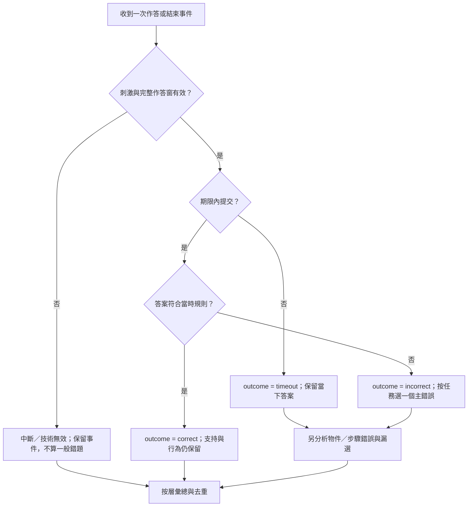

流程圖：新版錯誤分類決策。SRT 的 no-go 完整等待且不點為正確，需先按任務規則判定，不套用「沒有按鈕提交就是逾時」。

### 17.2 各款錯誤字典

| 任務 | 現有欄位／語意 | 統一碼提案 | 判定與單位 |
| --- | --- | --- | --- |
| SRT | `miss`／missed | `go_omission` | 可點刺激的有效窗內未命中，每刺激一次；同時 timeout 標記不能再加一個漏答 |
| SRT | `clickedRotten` | `nogo_commission` | 點到不可點刺激，每刺激一次；後續連點另留事件 |
| SRT | anticipatoryNoise／RT<150 | `anticipatory_response` | 過短反應留標記，排除有效 RT；不必然抹除命中／正誤紀錄 |
| SRT | backgroundClick | `background_click` | 每次有效背景事件；不加入刺激題數分母 |
| SRT | repeatedClick | `repeated_click` | 同刺激已處理後額外點擊，按事件去重 |
| PM | visual_similarity | `visual_similarity` | 最終錯選與漏選目標同外形群組，每錯選物件一次 |
| PM | same_category | `same_category` | 沒有外形命中，但與漏選目標同有效分類，每錯選一次 |
| PM | unrelated | `unrelated` | 其餘最終錯選，每錯選一次 |
| PM | missedTargetIds | `target_omission` | 每個未被選取目標一次，不冒充額外錯題 |
| PM | deselect／blocked_select | `self_correction`／`blocked_select` | 修正需有先錯選再取消且正確提交證據；blocked 只算操作事件 |
| CBT | sequenceError／orderError | `sequence_order_error` | 輸入物件屬目標序列但相同位置不符，每錯誤題一個主碼，另存錯誤步驟 |
| CBT | locationError | `sequence_location_error` | 點到不屬本題目標序列的有效位置；若舊頁只留 sequenceError，不能無資料再推定 |
| CBT | fewer／more taps | `sequence_under_response`／`sequence_over_response` | 目標與實際長度不同；期限到仍少點，outcome 優先 timeout，少點為細項 |
| CBT | earlyClick | `premature_click` | 序列／作答語音未完時點擊；記事件、不加入答案 |
| CBT | repeatedClick | `repeated_click` | 保留原判定與相鄰點擊時間，不將合法非相鄰重用位置直接算重複誤點 |
| ARI | sameAnimalError | `same_animal_error` | 聽到某動物卻選同一動物；依副本真實動物識別 |
| ARI | anticipation | `anticipatory_response` | 作答後依現行 anticipation 旗標判定，排除相關有效 RT |
| ARI | prematureClick | `premature_click` | 刺激／作答尚未啟用時點擊，留事件，不提交本題 |
| ARI | randomClick／repeatedClick | `background_click`／`repeated_click` | 場內事件總數；目前 250 ms 內點擊另記重複，需保留原時間判定 |
| ARI | timeout | `answer_timeout` | 聲音有效播放後的完整期限內無有效作答，每題一次 |
| DCCS | perseverative／isPerseverativeError | `previous_rule_error` | 依當時前規則預期箱與實際箱參照判定；與歷史推論欄位分開 |
| DCCS | error_type／other rule error | `current_rule_error` | 不符合當下顏色／種類／袋內色／條件規則，且非更優先舊規則錯誤 |
| DCCS | windActive／reverseActive | `reverse_rule_error` | 風中仍選正常箱，或風停仍選反向箱；保存風切換時點與答案時點 |
| DCCS | timeout | `answer_timeout` | 只適用有期限的訓練；正式目前無限時，不補造逾時 |
| LB | colorError | `color_rule_error` | 數字正確但交替色不符，每次錯誤操作一次 |
| LB | numberError | `number_order_error` | 顏色正確而數字不符，每次操作一次 |
| LB | sequenceError | `sequence_direction_error` | 單色正序／倒序下選錯下一數字 |
| LB | ruleSwitchError | `combined_rule_error` | 交替色條件下數字與色皆錯，或無法細分的複合規則錯誤 |
| LB | distractorClick／blankClick | `distractor_click`／`background_click` | 舊相容判定存在；現行五級未必實際生成假門牌，不宣稱每級都有此題型 |
| LB | timeout | `step_timeout` | 同一目標期限結束一次，保留該目標前的多次錯誤操作 |

### 17.3 同一題符合多類時的優先序

PM 以第 3.2.1 節物件互斥分類；整題 timeout 不抹除物件細項。CBT：技術無效／中斷 → 完整逾時 → 點到序列外位置 → 序列內但順序錯 → 長度差；前段／後段錯為額外位置標籤。ARI：技術無效／中斷 → 逾時 → anticipation → 同動物 → 其他有效錯答；刺激前點擊單獨事件。

DCCS 提案：技術無效／中斷 → 訓練逾時 → 可確認反向狀態錯誤 → 可確認舊規則錯誤 → 當前規則錯誤。若多個規則剛好指向同一箱，不能僅憑選錯就確定心理機制，保存 `ambiguousRuleAttribution:true`。風切換成本另按事件窗口計算，不與「整個切換後階段」混稱同一指標。

LB 先背景／假門牌，再數字正確色錯、色正確數字錯、兩者皆錯；同一目標可多次錯答再成功，因此「錯誤操作率」與「首次目標成功率」是兩種指標。正式先選整條路線，提交後按位置判斷，不套用訓練逐步重試分母。

### 17.4 保存與呈現

每個主錯誤保存 `trialId`、`primaryErrorCode`、`classificationVersion`、`basis`、`expected`、`actual`、`eligibleOpportunityCount`、`supportBeforeResponse`。細項以 `errorDetails[]` 保存；事件須有 `eventId`／序號，避免相同事件同時放在 tapLogs、clickLogs 又重算。

DCCS 舊 `errorType/isPerseverativeError` 與新 `error_type/error_type_basis:displayed_box_references` 可能推論不同，需明確選定分析版本。醫療端可並列歷史值與實際箱圖推論，不能無版本直接混算。共通 `errorAnalyzer` 將若干計數直接相加只是舊摘要，不可把它當六款新的唯一錯題數。

來源：[PM 錯選分析](../src/utils/pmItems.js)、[CBT 正規化與計分](../src/utils/cbtScoring.js)、[ARI 計分](../src/utils/ariScoring.js)、[DCCS 正式資料](dccs-assessment.md)、[LB 訓練分類](../src/pages/TrainingPage_LB.jsx)、[共通舊錯誤摘要](../src/ai/errorAnalyzer.js)。

## 18. 抽題、素材與畫面排列

### 18.1 現行六款抽題規則

| 任務 | 目標與選項生成 | 重複、平衡與限制 |
| --- | --- | --- |
| SRT 正式 | 每 4 顆固定 3 good、1 bad，組內打亂；每次間隔從 1／3 秒抽取 | 不保證全場各間隔數量相等；結束可截斷最後區塊，不補出未呈現刺激 |
| SRT 訓練 | 中等以上每 20 顆按比例放普通／壞／金色再打亂 | 入門／簡單僅普通；不限制同類刺激連續長度，不把全場比例當每小段都相同 |
| PM | 依當次池先取分類及未分類目標各一，其餘目標無放回抽取；非目標不含目標；全部選項打亂 | 同題物件 ID 不重複；不同題可重複，現行沒有全場禁重複或每張等次數保證；相似配額提案見第 3.2.1 節 |
| CBT 正式 | 9 個固定位置，依跨度隨機生成序列 | 相鄰兩步不同；新題第一步避開上一題最後一步；同位置可非相鄰再出現，並非整條不重複 |
| CBT 訓練 | 用該級石頭數與長度抽序列，現行 pathComplexity=simple | 同樣避相鄰及跨題交界重複；保留 zigzag 等相容生成分支，但現行五級不自動啟用 |
| ARI 正式 | 兩種聲音 × 正確左右位置四組合，各 5 題，共 20 | 同場固定實際動物對；平衡左右與聲音，不能依固定一邊猜答案 |
| ARI 訓練 | 四組合各 3 題，共 12，最多嘗試 120 次打亂 | 同聲音／正確位置連續不超過 2 是生成目標；若找不到，回傳違規程度最低的候選，現況不是絕對保證 |
| DCCS 正式 | 按當次四張卡片 metadata 建立三階段題目，每階段各 4 題 | 目前各階段不是任意從大題庫抽 6／8／6 題；種類試玩另用衝突卡，不消耗正式題 |
| DCCS 訓練 | 依五級階段與分類參照建立題目；種類／條件干擾率目標 0.5 | 實際比例受配對、樣本及取整影響，保存實際衝突題數；專業風狀態獨立隨時間改變答案 |
| LB 正式 | 路線本身固定，將完整 10／20 個選項隨機放進分離槽位 | 同段落語音、選取、撤回、路線播放不重排；第二段每數字兩色，實際顏色依副本 |
| LB 訓練 | 每場固定該級 10 目標路線，單色 10 選項、交替色各數字兩色 | 錯誤後不重抽答案，不自動增加假門牌、記憶模式或位置打亂條件 |

### 18.2 PM 素材索引與相似配對

| 分類 | 新 ID 範圍 | 張數 | 已定義的相似群組 |
| --- | --- | ---: | --- |
| 未分類 | PM_UNCLASSIFIED_01～26 | 26 | handled_utensils：03／05；04 筷子不算 |
| 交通工具 | PM_CAR_01～07 | 7 | trucks：03／05 |
| 穿戴 | PM_CLOTHES_01～08 | 8 | shoes：01／04／05；watches：02／06；hats：03／07／08 |
| 家具 | PM_FURNITURE_01～17 | 17 | photo_frames：02／03／04／06；wall_pictures：05／07 |
| 食物 | PM_FOOD_01～15 | 15 | cakes：01／07／08 |
| 球具 | PM_BALL_01～08 | 8 | 現況沒有定義 similarityGroup |

圖片副檔名以素材清單為準，未分類 07 為 png，其餘上述新素材以既有 webp 引用。每個 ID 對應的真實名稱、檔案及文字定義，以 [pmAssets.js](../src/config/pmAssets.js) 為唯一目錄；舊 PM01～PM29 不重新映射新圖片。新增素材需同時更新 alt、模式分類、版本、相似群組與可行配額檢查。

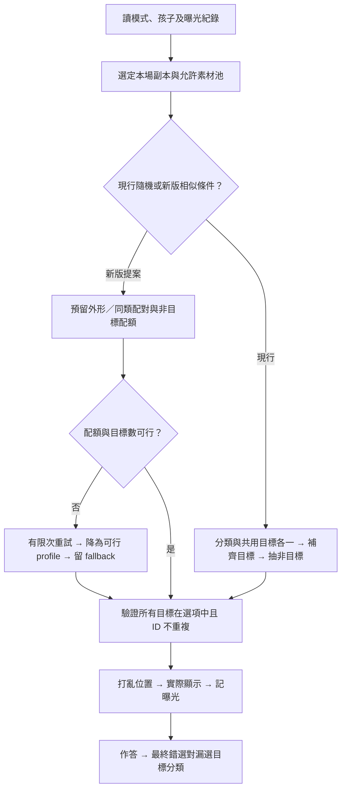

流程圖：PM 現行抽題與相似干擾提案的分流。

### 18.3 排版、點擊區與重排

| 任務／階段 | 現行布局與穩定性 |
| --- | --- |
| PM 試玩 | `createPMScatterLayout` 按容器實測寬高及 seed 散落；預留選取放大 1.05 倍與 7 px 光暈，同題同尺寸重繪位置固定；視窗改尺寸才重算。最多 350 次尋空間，不足則隨機格槽兜底。正式測驗目前維持原布局，不自動套試玩散落算法 |
| CBT 正式 | 960×600 邏輯棋盤；固定 9 ID。各行列中心為 x=160／480／800、y=100／300／500，石頭寬 300，整盤等比縮放；存實際座標 |
| CBT 訓練 | 石頭寬 220；入門／簡單固定。中等以上基準位置加入水平±14、垂直±10 px 偏移並重新分配 ID，避開和前題完全相同位置；包含點擊外框的間距需保留 |
| ARI | 左右兩個有效選項；同題載入與重播不重新換邊。小雞與重播放獨立區域，不覆蓋可選動物 |
| DCCS 正式 | 1360×989 邏輯畫布：刺激中心 50%／43%、寬30%；左箱 27%／82%、右箱 73%／82%、箱寬32.5%。中央有物件時小雞13%／19%、寬13%；只有箱時50%／36%、寬54%；無物件時50%／50%、寬72% |
| LB 正式／試玩 | 選項在分離固定槽位中隨機配物件，右下保留房子；同一段內不因語音或撤回重排。正式走一步700 ms、回家1000 ms屬播放動畫，不是選取 RT |
| 帽子 | 各帽維持固定 identity，交換 slot；答案追蹤 identity，而不是交換前畫面索引 |

新版提案：容器改尺寸時保留物件 ID、選取狀態及原截止時間；重新布局不重新抽題、不重算曝光。若尺寸小到無法提供互不重疊的可操作區，於作答窗前提示調整方向／視窗，不能在作答中偷偷縮小到難以操作又照常判漏答。

### 18.4 隨機性與可重現性補強（提案／待實作）

正式／訓練多個抽題器目前使用 Math.random；PM 試玩布局有種子，但不能宣稱六款所有隨機流程已可回放。下一版每場建立 `sessionSeed`，按任務、trial、用途導出不同 seed，分開控制內容、位置、副本決策、風事件與獎勵，防止一個新動畫額外抽亂數就改變後續題庫。

保存最終刺激、位置、順序與 generatorVersion，重現時以保存快照優先；只存 seed 不足以跨演算法版本重現。ARI 生成上限未達條件時另存 run-limit 違規，不能標成完全符合；PM fallback 與曝光亦要可回查。

## 19. 逐畫面操作、語音與計時

### 19.1 共通畫面契約

以下是規格化階段名稱，未要求現有元件一律改成相同變數。實際 route 與原有開始圖片、跳過、下一步、送出、撤回及返回按鈕保留。

| 畫面／階段 | 兒童操作 | 計時與保存 |
| --- | --- | --- |
| 遊戲開始 | 看本次任務，按進入遊戲 | 不啟動正式 RT 或消耗副本 |
| STEP | 看影片，或跳過／下一步 | 停止離開的影片與音訊；不計正式題數 |
| 試玩說明 | 聽規則，依該遊戲恢復播放 | 不接受正式答案，保留試玩專屬狀態 |
| 試玩操作 | 依任務練習，允許既定引導 | 試玩門檻與時限見下表，不混正式成績 |
| 試玩通過 | 等通過語音，按開始或依任務自動開始 | 正式準備完成後才建立 attempt／標記副本 |
| 記憶／刺激 | 觀察或聽刺激 | PM／CBT 觀察中不收答案；ARI 播音起算方式另列 |
| 作答 | 點物件、選箱、選路線或送出 | RT 起點、期限及提示全部以原 ref／deadline 維持，重繪不重啟 |
| 鎖定／回饋 | 等中性動畫或訓練回饋 | 第一次有效提交就鎖定；回饋不當作額外思考時間 |
| 結果 | 看鼓勵、查看家長結果、返回地圖 | 先保存結果再導航／發獎；重播完成語音不重存結果 |

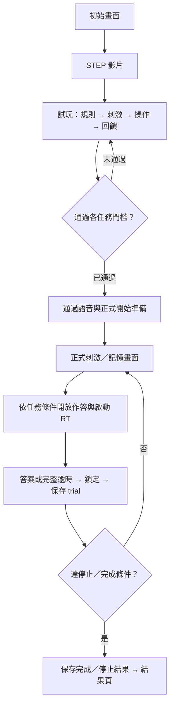

流程圖：六款正式測驗的畫面主線，任務專屬例外見以下各節。正式各階段的頁面退出仍可走中斷流程。

### 19.2 SRT 畫面時序

| 階段 | 現行操作、語音與判定 |
| --- | --- |
| 試玩說明 | 使用本次水果版的 enterPractice、ruleGo、ruleNoGo 及 beforeTrial；有操作示範 |
| 試玩刺激 | 顯示2秒、反應窗2秒，go點中或no-go不點正確；反應窗結束後才播回饋，空白至少500 ms且語音結束才出下一顆 |
| 試玩門檻 | 連對2題且兩種刺激都曾正確；配置另有 maxTrials=20，未過不能自動當成通過，重試／協助以元件狀態處理 |
| 正式準備 | 試玩通過語音、短暫完成動畫，再播正式規則與開始提示；播放失敗停留重試 |
| 正式作答 | 準備語音全部完畢才啟動8分鐘；水果500 ms，下一顆由前一次出現的1／3秒排程決定，不播放正誤旁白 |
| 結束 | 固定結束時間、保存結果，再播當版完成語音；未完成最後題保留 pending |
| 訓練 | STEP後依選定五級執行；入門等點擊後再等1秒，其他級固定排程；提示、積分與全場時長見第3.1節 |

### 19.3 PM 畫面時序

| 階段 | 現行操作、語音與判定 |
| --- | --- |
| 試玩記憶 | 顯示2張5秒並播 memorize：「仔細看看，把這些圖片記起來喔！」 |
| 試玩作答準備 | 換選項並播 answer：「找找看，剛剛看過哪些圖片？」；播畢才可點 |
| 試玩操作 | 無作答期限，可選取／取消；至少選1張即可送出，只有選取集合恰等目標才正確。這與正式／訓練選滿指定數才能送出不同 |
| 試玩支持 | 無操作5秒且沒有音訊在播時播 reminder；首次選取後排程1200 ms播取消教學，若聲道忙每700 ms再試；不因選項正誤才教取消 |
| 試玩回饋 | 正確／重試語音，回饋至少1100 ms；連對2題通過，播 complete 後才開放開始圖片與手指 |
| 正式 | 按開始直接進第一題記憶；每題看5秒，選項出現後首個requestAnimationFrame啟動15秒。逾時自動提交當下選取，reactionTime固定15000 |
| 題間 | 保存後進 feedback／題間畫面，再按下一題入口或結束；不重播試玩取消教學與答案引導 |
| 訓練 | 觀看時間依2／3張3秒、4張以上5秒；作答15秒。入門3秒從未點過才顯示一次操作手指，不延長deadline |

實際語音鍵與檔名見 [pmPracticeAudio.js](../src/utils/pmPracticeAudio.js)。目前該試玩播放器遇 error、play拒絕或 watchdog 會結束回呼並可能推進下一階段，與CBT／ARI嚴格重試不同；新版改為技術事件並在必要規則／刺激失敗時停留重試，不能在文件中誤寫成目前所有語音失敗都會鎖住。

### 19.4 CBT 畫面時序

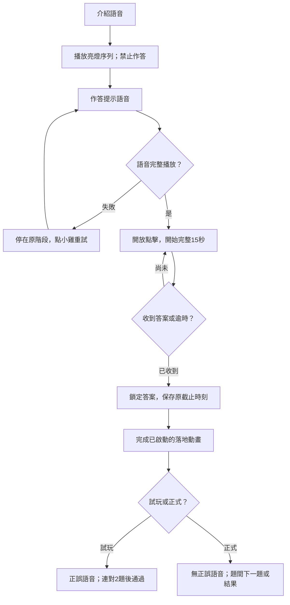

流程圖：CBT 正式與試玩的語音／作答鎖定。訓練的計時起點目前另有差異，見下表。

| 階段 | 現行操作、語音與判定 |
| --- | --- |
| 試玩 | INTRO→SHOW_SEQUENCE→YOUR_TURN→WAIT_RESPONSE→LANDING→FEEDBACK／PASSED；2步、每步亮1000 ms、間隔500 ms，避免上題完整相同序列 |
| 試玩作答 | 作答語音完才開15秒；小手依序提示兩位置；收兩次有效點擊才判定。第二次有效點擊即停期限，再等300 ms落地動畫才回饋 |
| 試玩語音 | intro「仔細看，記住亮起來的順序！」；answer「換你囉！照剛剛的順序點一點！」；correct／retry／passed 錄音見 cbtPracticeAudio |
| 正式刺激 | 九顆固定位置；亮800 ms、間隔260 ms，2～7步、每長度2題；不顯示手指 |
| 正式作答準備 | 播「換你開始點囉」；真正ended後才開15秒，失敗點小雞重試；提前點擊不作答案、不留有效腳印 |
| 正式輸入 | 有效點擊皆使用相同腳印，不透露正誤；仍依原規則在錯誤位置結束該題，沒有逐題正誤語音 |
| 訓練差異 | 現行訓練期限起點在作答提示開始；不直接套用正式「ended才起算」。新版若統一需改訓練protocol並驗證，不只改說明文字 |

### 19.5 ARI 畫面時序

| 階段 | 現行操作、語音與判定 |
| --- | --- |
| 試玩 | intro→rule→question_prompt→stimulus_playing→answer_prompt→awaiting_answer→feedback；使用本次實際動物聲音與相反規則 |
| 試玩門檻 | 每組第一聲隨機，答對後換另一聲；連對2題通過。答錯重設並換下一組，最多3組；重播與技術失敗不加組 |
| 試玩回饋 | 至少1000 ms且語音播完；操作手指指相反動物，只有可答時可點／重播 |
| 通過 | 播通過語音，按「開始挑戰」，再播正式「記得喔！要點另一隻動物！」；完畢建立正式場次 |
| 正式 | 每題先等500 ms再播刺激；從該聲音onplaying起算5秒並開放答案。聲音本身仍在播時允許依目前作答狀態輸入，不能把RT錯改成ended起算 |
| 正式題間 | 有效作答／逾時先鎖定，頁面定義FEEDBACK_TIME=420 ms、NEXT_TRIAL_DELAY=260 ms控制過渡；正式不播正誤語音或提供重播 |
| 訓練 | 每場12題；只有入門／簡單可重播，入門可提示；重播不改原deadline。RT<150 ms按計分器anticipation排除正確／有效RT |
| 結果 | 保存後播放完成語音，失敗可重播完成錄音；重播不重算結果 |

### 19.6 DCCS 畫面時序

| 階段 | 現行操作、語音與判定 |
| --- | --- |
| 每階段試玩 | practice_intro→practice_question→practice_feedback；顏色、種類、袋內顏色各自連對2題，錯誤歸零；種類使用衝突刺激 |
| 試玩提示 | 可答時指向正確箱，第一次有效點擊立即收起；只在試玩出現 |
| 試玩回饋 | 450 ms投入動畫，等語音且至少1000 ms；通過階段至少1200 ms，播通過語音後才正式 |
| 正式顯示 | 圖片及兩箱載入完成、300 ms出現動畫及兩次requestAnimationFrame後，同時開放作答並記RT起點 |
| 正式輸入 | 第一有效箱點擊鎖定並保存，450 ms投入；正誤使用相同動畫，保留600 ms換題過渡；無作答期限、不提供逐題正誤 |
| 規則切換 | 本階段4題完，先進下一規則獨立試玩，不能一次試玩通過就跳過另外兩階段 |
| 語音恢復 | 平常不提供喇叭重播，失敗提供「重試語音」。正式開始語音失敗另保留既有明確確認後開始路徑並記audioEvents，不能假定全部失敗都自動略過 |
| 訓練 | 依五級15／10秒與提示；專業無風6秒／有風6秒循環，規則說明暫停風時鐘，作答中風改變時答案可立即改變 |

### 19.7 LB 畫面時序

| 階段 | 現行操作、語音與判定 |
| --- | --- |
| 試玩一 | 規則／示範第一色1，再由孩子依序走1～5；錯誤依數字規則語音回饋 |
| 試玩二 | 轉換語音、兩色規則及1／2示範，再走交替色1～6；數字／顏色錯分開提示，使用同副本實際顏色 |
| 正式第一段 | 先播該版rule1，語音完成與選項啟用才開始選路線時間；首次正式作答啟用才標副本使用 |
| 正式操作 | 選到10步可送出；可撤回最後一步，選取／撤回不重排。RT為第一次自作答起點、其後自前一保留選取起點的間隔；另存累計時間 |
| 正式提交後 | 鎖定整條路線，按每個位置保存正誤並播放，每步700 ms、回家1000 ms；播放時間不算選取RT |
| 第二段 | 播rule2，仍先選完整10步再送出；每數字兩色，共20選項；正式無逐步答案提示與期限 |
| 訓練 | STEP後直接逐目標作答，答案正確才前進；每步期限依五級。正確回饋420 ms、錯誤680 ms、回顧每步520 ms不占下一目標答題窗 |

### 19.8 統一語音與按鈕鎖定補強（提案／待實作）

必要規則與刺激音訊只有實際playing／ended才可推進對應階段；可恢復失敗顯示既有重試操作，記錄重試次數與原因。鼓勵／完成語音失敗可保留結果並提供重播，不能重算題目。PM／LB目前部分播放器以錯誤完成回呼恢復流程，整合時需逐一改為明確策略。

按鈕有效性由狀態與一次性提交鎖共同決定，不能只靠灰階CSS。提交、返回、重播及結束同步處理時要先固定resultId／trialId並取消舊callback；過期的音訊ended不可把新題推進。訓練提示不得默默重設deadline，試玩與正式提示的用途要以欄位區分。

來源：[SRT 試玩](srt-practice.md)、[PM 試玩](pm-practice.md)、[CBT 試玩](cbt-practice.md)、[ARI 試玩](ari-practice.md)、[DCCS 正式](dccs-assessment.md)、[LB 試玩](lb-practice.md)、[LB 正式頁](../src/pages/TestPage_LB.jsx)。

## 20. 暫停、離開與恢復

### 20.1 現況與新版政策範圍

現行六款正式測驗有 `useTestAttempt`，約每15秒checkpoint；一般pagehide中斷，BFCache保留時先checkpoint，卸載時中斷。DCCS另處理pageshow／pagehide返回開始畫面。目前未見六款一致的 `visibilitychange` 暫停機制，不能宣稱切分頁、鎖屏或開設定會全部正確凍結期限。

本節其餘為統一提案。不同中斷原因須保存 `reason`、`phaseAtInterrupt`、`monotonicAtInterrupt`、`elapsedActiveMs`、`remainingAnswerMs`、已呈現內容、是否已提交及有效性。壁鐘ISO只用於日曆與跨系統時間，不用來回推精確RT。

### 20.2 模式與階段處置矩陣（提案）

| 事件／階段 | 正式測驗 | 訓練 | 帽子獎勵 |
| --- | --- | --- | --- |
| STEP／試玩切到背景 | 停影片與音訊，回來重播當階段；不消耗正式副本 | 相同，不記能力失敗 | 尚未開始不消耗回合 |
| 正式／訓練刺激或作答窗切到背景、鎖屏 | 該題標技術中斷，本次正式施測停止並保存；再次開始為新attempt，不續作舊題 | 立即停計時與聲音，當題標不可比較；回來可重開本題的新trial，不重用已看過的記憶題 | 停交換並保存回合快照；優先依原身份、貼紙與位置恢復，不重抽獎品 |
| 題間／已提交後切背景 | 已提交題保留，本次正式施測中斷，不追加逾時 | 已提交題保留，回來從下一題準備繼續 | 已提交答案保留，未成功領取用同一claimId重試 |
| 訓練手動暫停 | 正式作答不提供一般暫停，退出走中斷 | 可於題間暫停；中途暫停先結束該題為中斷，不保存為一般錯答 | 主動返回取消session，已得貼紙保留 |
| 開設定頁 | 作答中先結束本次施測，不能跳設定後視為沒發生 | 走暫停確認狀態；返回重開中斷題或下一題 | 交換中先暫停／保存，不在背後繼續洗帽 |
| 僅網路中斷、本機可用 | 遊戲可繼續，本機保存並排隊；不把網路狀態當能力錯誤 | 相同；在線推薦不可用採備援 | 本機可去重則保存待同步，不重新抽獎 |
| 本機保存也失敗 | 題間停止並提示恢復儲存，不宣稱結果已保存 | 相同 | 不先宣稱已入收藏，保留待重試 |
| 切換孩子／登出 | 停舊場並依舊孩子保存中斷，清除活動狀態後才切換 | 相同，不能把結果寫給新孩子 | 舊孩子session保留在舊孩子名下 |
| 瀏覽器重整／關閉 | 保存能保存的checkpoint，舊attempt不自動續做 | 使用已存快照判斷可恢復題間；已開始的記憶／聲音題重新開新trial | 由同一session快照恢復；無法恢復則中斷並保留既得貼紙 |

訓練回到前景後不直接啟動期限，先顯示繼續入口；暫停≤60秒可延續場次的下一有效trial，超過60秒結束為中斷並以新場次開始。60秒是本提案的版本化起始設定。SRT訓練累積實際active時長，暫停不占計畫時長；中斷中的刺激不補成漏答。

PM／CBT重新開始當題須換新題並保留先前實際曝光；已看過的內容不能再當全新獨立記憶測量。新trial以 `replacesTrialId` 關聯舊中斷題，不多發關卡獎勵。DCCS專業恢復時記錄風時鐘與規則狀態；若不能可靠恢復，從題間明確重新開始規則準備，不讓答案在看不到畫面時偷偷改變。

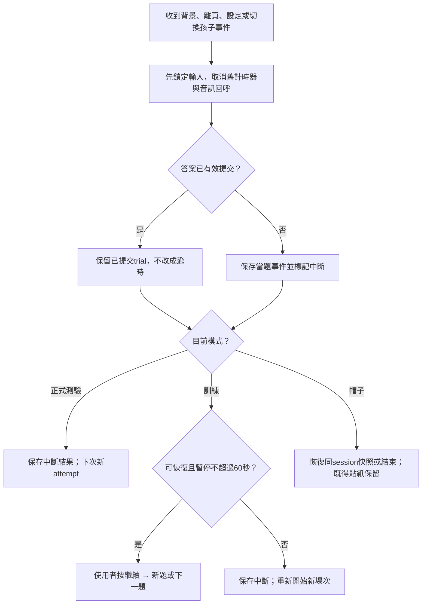

流程圖：新版暫停與中斷決策。

### 20.3 截止時間與事件競態（提案）

每個有效作答窗使用單一deadline，輸入事件先取得單調時間並判斷 `responseAt <= deadline`；符合且未提交才接受，逾期不受setTimeout回呼尚未執行影響。deadline時答案處理與timeout競爭時，只允許一個最終outcome。圖表與結果保存 `responseAcceptedAt`，避免雙擊、音訊ended與換題callback產生兩筆。

語音重播、取消選取、提示、畫面重繪與視窗縮放均不改deadline。必要刺激在作答窗內實際播放失敗，標技術無效／中斷，不當作有效逾時。顯示「資料已保存」必須來自持久化成功狀態；同步失敗則顯示待同步與重試，不用再玩一次來覆蓋舊結果。

## 21. 聲音、顯示與全域設定

### 21.1 現行設定值及作用範圍

設定保存在同瀏覽器 `efGameTrainingSettings`，目前為裝置／瀏覽器共用設定，並非每個孩子獨立雲端偏好。設定頁寫入後以storage／自訂事件通知App更新。

| 設定 | 預設 | 範圍／選項 | 現況接線 |
| --- | --- | --- | --- |
| 背景音樂 | 60% | 0～100 | App的BGM audio.volume直接使用此比例 |
| 音效 | 75% | 0～100 | 有介面與保存，但目前未見共用音訊引擎將sfxVolume套到全部遊戲錄音，不能宣稱所有聲音皆受控 |
| 亮度 | 95% | 40～100 | App以CSS變數處理；首頁固定原亮度，不套設定比例 |
| 護眼模式 | 開 | true／false | 切換App外層class；不是裝置層護眼功能 |
| 字體 | 標準 | normal／large | 切換App外層class，文字是否有效放大需逐頁驗證 |
| 按鈕 | 大 | normal／large | 切換App外層class；圖片式點擊區仍須逐頁驗證 |
| 背景音樂快速開關 | 開 | 本次App狀態 | 尚需使用者第一次互動才嘗試播音；不等同把全部刺激音訊靜音 |
| 減少動態效果 | 依系統 | prefers-reduced-motion | 部分角色、手指與風動畫已有分支，不代表全部任務均已完成統一規格 |

App在 `/test-*`、`/training-*`、`/result-*` 及帽子頁全程停BGM，包含語音間隙，測驗地圖除外。醫療登入／主要醫療儀表板亦停BGM；其他前景影音playing時讓出BGM，影片開始後解除靜音。不能把影片、刺激聲、規則旁白與一般背景音樂視作同一類。

### 21.2 新版聲音分流與優先序（提案）

| 聲音類別 | 優先與控制 |
| --- | --- |
| 任務刺激聲 | ARI叫聲等最高優先；獨立音量通道，正式作答中不被鼓勵聲、點擊聲或BGM蓋住 |
| 必要規則／作答提示旁白 | 依階段單通道播放，播放期間是否可點由任務決定；不能因一般音效設0而無聲自動通過必要教學 |
| 任務指定干擾聲 | ARI難／專業沿用配置音量0.25；與刺激的相對音量屬protocol，不能讓一般音效設定只改其中一個造成條件失衡 |
| 回饋音效／鼓勵 | 低於刺激與必要指示；受一般音效設定控制，失敗不改正誤與已保存結果 |
| BGM | 僅非任務頁適用；有前景影音即暫停，任務頁不在語音間隙重新響起 |

正式ARI開始前需完成可聽聲音檢查；若刺激通道無法播放或使用者設為無聲，停在準備畫面並提供修復入口，不把沒聽到當成反向規則失敗。此項是新增流程，不宣稱現況已接。

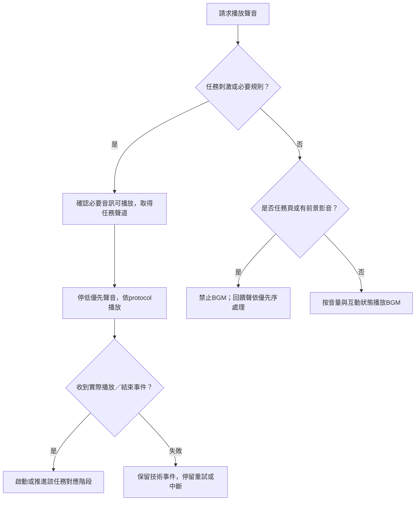

流程圖：新版聲道仲裁；現行App已停任務BGM，統一刺激／旁白聲道仍待整合。

### 21.3 顯示設定與作答可比性（提案）

字體／按鈕改變只影響可讀性和操作區，不改題目比例、刺激停留時間、答案、規則及截止時間。亮度與護眼不可改變DCCS／LB的顏色身分或將good／bad線索弱化到無法辨識；正式開始前鎖定影響刺激辨識的設定並記錄快照，場中變更走第20節。

減少動態效果可停角色漂浮、嘴型循環或裝飾風線，仍保留必要規則提示；帽子交換本身承載答案位置，不能直接隱藏全部交換而照常判錯，需提供等價、可追蹤的低動態轉場並另記呈現版本。觸控、滑鼠及鍵盤的有效輸入同樣使用一次性提交鎖；按鈕至少保持可辨識的焦點與無障礙名稱。

來源：[App聲音與設定](../src/App.js)、[設定頁](../src/pages/SettingsPage.jsx)、[DCCS風效](../src/components/DccsWindEffect.jsx)。

## 22. 重新測驗與資料重設

### 22.1 現行重設工具的實際行為

`resetTestRecords(childId)` 由家長結果相容頁的重設操作呼叫，處理localStorage及sessionStorage；它不是雲端刪除API，也不是完整個案資料刪除。它會移除六款舊正式結果、部分訓練摘要／星星、測驗完成標記及共用推薦／流程快取，並從 `efGameResults` 刪除指定孩子的test模式結果；未提供childId會清除此歷史內全部test結果。

| 資料 | 現行工具結果 |
| --- | --- |
| 指定孩子在統一歷史中的正式測驗結果 | 從本機統一歷史移除；其他孩子有可解析ID的結果保留 |
| 六款正式結果／完成與星星相容key | 移除列在工具中的全域key及指定孩子key；也包含若干training summary／stars舊key |
| 共用 ef_latest_results、ef_ai_recommendation、currentTestFlow 等 | 全域移除，可能使其他孩子的快取也需重建，不等於其他孩子雲端資料被刪 |
| 雲端結果、逐題行為與同步outbox | 此工具未執行雲端刪除或一致性清理；雲端重新載入可能恢復本機已清結果 |
| SRT／ARI／DCCS／LB副本輪替key | 此工具未列入，通常保留 |
| PM測驗／訓練曝光key | 此工具未列入，保留 |
| achievementProgress_v2、舊徽章、一般貼紙 | 此工具未列入，保留 |
| 帽子排程／領獎、蜂蜜、金幣／家具 | 此工具未列入，保留 |
| efGameTrainingSettings | 保留 |

若本機歷史JSON損壞，舊工具會移除該份歷史key；這是既有容錯行為，不能視為精準只刪某孩子的保證。新介面不可只寫「全部重設」而讓人誤認連徽章與雲端紀錄也會清空。

### 22.2 新版操作種類與保留矩陣（提案）

| 操作 | 測驗歷史 | 難度／推薦 | 副本／曝光 | 徽章／貼紙／蜂蜜／金幣 |
| --- | --- | --- | --- | --- |
| 再測一次 | 全部保留，新建attempt與結果ID | 保留既有狀態，正式結果按新版本成為新觀察 | 依各任務正常選版；已用／已呈現紀錄保留 | 保留，不因重測自動加訓練獎勵 |
| 重做未開始的安排 | 不改歷史 | 舊安排撤銷，新建assignment；舊推薦不再等待回饋 | 未開始不消耗版本／曝光 | 保留，不新增完成獎勵 |
| 重新建立訓練起點 | 不改歷史 | 只重設該孩子指定任務級別、待確認證據及未開始推薦；起點來源可追溯 | 保留，避免假裝從未看過素材 | 既得獎勵全保留 |
| 清除本機快取 | 不刪雲端權威歷史；先完成同步或明列未同步資料 | 從權威資料重建，不任意重置能力 | 依獨立保存政策恢復，不默默歸零 | 保留權威帳本及未同步領獎 |
| 刪除指定結果 | 僅列出且授權的resultId與其依附資料 | 重新計算衍生建議；保留舊決策的刪除註記 | 實際已發生曝光及已用副本仍保留 | 預設保留已發獎紀錄，另存來源結果已刪註記，不因歷史刪除重領 |
| 恢復顯示／音訊預設 | 不影響 | 不影響 | 不影響 | 不影響；僅設定回預設 |
| 刪除整個孩子 | 獨立個案刪除流程，另列本機／雲端與依附資料 | 依明列範圍處理 | 依個案刪除範圍處理 | 與歷史／研究關聯一併明列，不挪給另一孩子 |

「再測一次」應作一般重測入口，不必先刪舊資料。長期變化、推薦與同配置比較均需要保留歷史；重測也不能讓孩子再次取得同一已領過安排的獎勵。

### 22.3 刪除與同步的執行流程（提案）

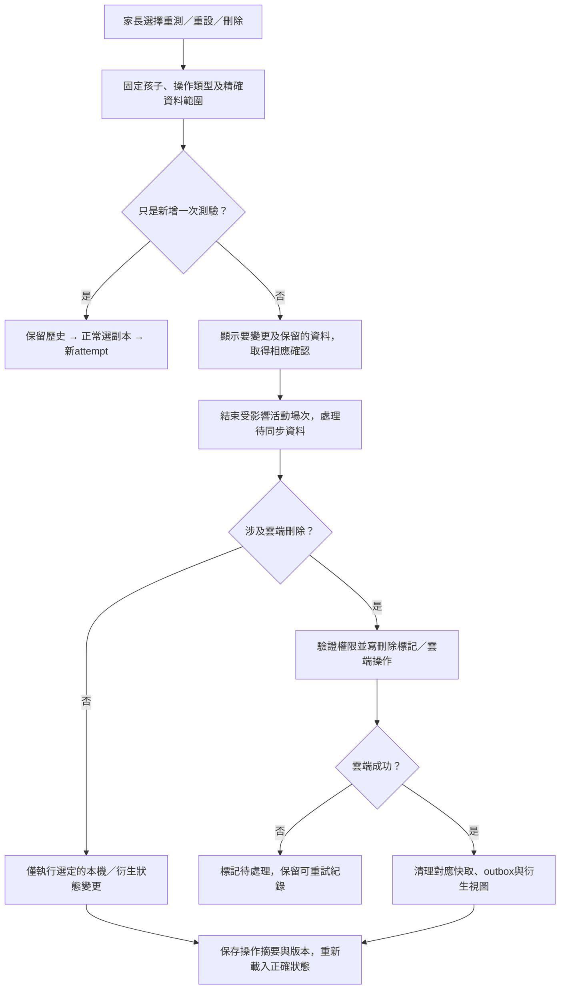

流程圖：新版資料操作流程；本次只寫規格，沒有執行任何資料重設或刪除。

離線刪除須保存待處理標記，避免舊outbox稍後把同一結果重新上傳；沒有雲端確認前不得宣稱雲端已刪除。完成後逐項核對其他孩子、獎勵去重、PM曝光及副本帳本未被誤清。舊進度遷移前保留來源快照，遷移可重試且同版本只執行一次。

來源：[現行重設工具](../src/utils/resetTestRecords.js)、[家長結果相容頁](../src/pages/ResultPage_PA.jsx)、[個案身分儲存](../src/utils/activePatientStorage.js)、[結果同步](../src/utils/resultSync.js)。

## 23. 可重現驗收案例與流程圖索引

### 23.1 已核算的現行計分案例

2026-11-07 以本工作區現有共用計分器做純函式呼叫，未開瀏覽器、不寫孩子資料、不發獎勵。以下數值是這些明確輸入的預期輸出，不代表完整遊戲入口、音訊或雲端流程已驗收。

| ID | 輸入 | 預期現行輸出 | 驗收重點 |
| --- | --- | --- | --- |
| S01 | SRT訓練20題，每4題3普通命中＋1壞正確忽略；所有命中500 ms、無支持 | 總分100、3星；分項35／25／15／10／10，金色null | 有效上限95重新正規化為100，金色不加主分 |
| P01 | PM入門2題、每題記2個且全對、RT2000 ms、無錯選歷程；plannedTotalRounds=2 | 總分81、3星；正確50、記憶16、過程15、跨度2 | 入門可3星；觀察速度5及穩定10不再加進81 |
| P02 | PM入門2題全部完整逾時，RT15000 ms、未選任何物件；預定2題 | 總分0、1星；逾時率1、完成作答窗比例1 | 現行低分一星不代表正確或徽章達標；完整逾時與未呈現不同 |
| C01 | CBT入門4題長度2／2／3／3，序列與答案完全一致，各2000 ms，獨立首次正確 | 總分82、2星；跨度12、加權正確25、順序15、獨立15、穩定10、速度5 | 即使82與全部正確，入門仍有2星上限 |
| A01 | ARI中等訓練12題，兩種聲音交替，全部選相反動物，RT900 ms、無事件 | 總分100、3星；40／20／15／10／10／5 | 各指標、可靠性與無扣分條件 |
| D01 | DCCS入門訓練6題顏色規則，全對且firstTryCorrect=true、RT1000 ms | 總分100、3星 | 單規則模板70／20／10及有效題數 |
| L01 | LB共用函式，以training模式處理10次單色正序全對，RT900 ms、無干擾、未傳年齡 | 總分98、3星；A/F/V/S=100、X=75 | 無干擾保底75使原分97.5取整98；不是訓練頁保存公式 |
| L02 | LB訓練頁summarizeLogs，10個正確操作、expectedSteps=10、rt900 ms | 保存score100、3星；accuracy100、completionRate100 | 與L01同樣全對仍不同，驗證兩套公式現況 |

### 23.2 PM 分類的固定輸入案例

| ID | 目標／最後選取 | 預期 |
| --- | --- | --- |
| P03 外形優先 | 目標：FOOD_01蛋糕、UNCLASSIFIED_01水壺；選FOOD_07蛋糕、水壺 | 外形1、同類0、無關0、漏選1；一個錯選不能同時算同類 |
| P04 同類 | 相同目標；選FOOD_09胡蘿蔔、水壺 | 外形0、同類1、無關0、漏選1 |
| P05 修正後 | 曾選FOOD_07又取消，最後選回FOOD_01與水壺 | 最終三類錯選皆0、漏選0；錯選歷程另保留，可影響現行過程w但不算最終混淆 |

表中省略的共同ID前綴為 `PM_`，完整實際ID以下方程式碼為準。P03～P05亦可由既有 `analyzePMConfusions` 核算，P05的過程歷程需在遊戲整合案例另驗。

<details>
<summary>展開：重現上述八組分數與三組 PM 分類的唯讀 Node 程式</summary>

在專案根目錄、使用現有node_modules執行此段。它以既有Babel將模組載入記憶體，圖片只作為字串參照，不啟動React、資料庫或音訊，也不修改任何檔案。若未安裝本專案依賴，先依專案既有安裝流程準備環境。

```javascript
// game-design-reference-cases-v2
process.env.BROWSERSLIST_IGNORE_OLD_DATA = 'true';
const fs = require('fs');
const path = require('path');
const vm = require('vm');
const assert = require('node:assert/strict');
const babel = require('@babel/core');
const cache = new Map();
function load(file) {
  file = path.resolve(file);
  if (!path.extname(file)) file += '.js';
  if (cache.has(file)) return cache.get(file).exports;
  if (!/\.[cm]?jsx?$/.test(file)) return file;
  const mod = { exports: {} };
  cache.set(file, mod);
  const code = babel.transformSync(fs.readFileSync(file, 'utf8'), {
    babelrc: false, configFile: false,
    plugins: ['@babel/plugin-transform-modules-commonjs'],
  }).code;
  const localRequire = name => name.startsWith('.')
    ? load(path.resolve(path.dirname(file), name)) : require(name);
  vm.runInThisContext('(function(require,module,exports){' + code + '\n})',
    { filename: file })(localRequire, mod, mod.exports);
  return mod.exports;
}
const srt = load('src/utils/srtScoring.js');
const pm = load('src/utils/pmScoring.js');
const cbt = load('src/utils/cbtScoring.js');
const ari = load('src/utils/ariScoring.js');
const dccs = load('src/utils/dccsScoring.js');
const lb = load('src/utils/lbScoring.js');
const { analyzePMConfusions } = load('src/utils/pmItems.js');
const rows = [];
function check(id, result, expected) {
  const actual = { score: result.totalScore ?? result.finalScore, stars: result.stars };
  assert.deepEqual(actual, expected, id);
  rows.push({ id, ...actual });
}
check('S01', srt.calculateSrtScore(Array.from({ length: 20 }, (_, i) => ({
  trialIndex: i + 1, targetType: i % 4 === 3 ? 'rotten' : 'normal',
  trainingAction: i % 4 === 3 ? 'correctAvoid' : 'hit', isCorrect: true,
  reactionTime: i % 4 === 3 ? null : 500,
})), { mode: 'training' }), { score: 100, stars: 3 });
const pmTargets = ['PM_UNCLASSIFIED_01', 'PM_FOOD_02'];
check('P01', pm.calculatePMScore(Array.from({ length: 2 }, (_, i) => ({
  trialIndex: i + 1, level: i + 1, memoryCount: 2, difficulty: 'beginner',
  isCorrect: true, completed: true, reactionTime: 2000,
  targetIds: pmTargets, selectedIds: pmTargets, tapLogs: [],
})), { mode: 'training', plannedTotalRounds: 2 }), { score: 81, stars: 3 });
check('P02', pm.calculatePMScore(Array.from({ length: 2 }, (_, i) => ({
  trialIndex: i + 1, level: i + 1, memoryCount: 2, difficulty: 'beginner',
  isCorrect: false, completed: true, isTimeout: true, reactionTime: 15000,
  targetIds: pmTargets, selectedIds: [], tapLogs: [],
})), { mode: 'training', plannedTotalRounds: 2 }), { score: 0, stars: 1 });
check('C01', cbt.calculateCBTScore([2, 2, 3, 3].map((n, i) => ({
  trialIndex: i + 1, difficulty: 'beginner', difficultyKey: 'beginner',
  sequenceLength: n, sequence: Array.from({ length: n }, (_, k) => k),
  targetSequence: Array.from({ length: n }, (_, k) => k),
  userSequence: Array.from({ length: n }, (_, k) => k),
  isCorrect: true, completed: true, reactionTime: 2000,
  cleanCorrect: true, attemptType: 'first',
})), { mode: 'training' }), { score: 82, stars: 2 });
check('A01', ari.calculateAriScore(Array.from({ length: 12 }, (_, i) => ({
  trialIndex: i + 1, soundType: i % 2 ? 'dog' : 'cat',
  correctTarget: i % 2 ? 'cat' : 'dog', selectedAnimal: i % 2 ? 'cat' : 'dog',
  selectedTarget: i % 2 ? 'cat' : 'dog', isCorrect: true, reactionTime: 900,
  correctPosition: i % 2 ? 'left' : 'right', selectedPosition: i % 2 ? 'left' : 'right',
})), { mode: 'training', difficulty: 'medium', plannedTotalRounds: 12 }),
{ score: 100, stars: 3 });
check('D01', dccs.calculateDccsScore({
  mode: 'training', difficulty: 'beginner',
  trialLogs: Array.from({ length: 6 }, (_, i) => ({ trialIndex: i + 1,
    rule: 'color', isCorrect: true, firstTryCorrect: true, reactionTime: 1000 })),
}), { score: 100, stars: 3 });
check('L01', lb.default(Array.from({ length: 10 }, (_, i) => ({
  trialIndex: i + 1, isCorrect: true, reactionTime: 900, rule: 'forward',
})), { mode: 'training' }), { score: 98, stars: 3 });
const lbTrainingSource = fs.readFileSync('src/pages/TrainingPage_LB.jsx', 'utf8');
const lbTrainingAST = require('@babel/parser').parse(lbTrainingSource,
  { sourceType: 'module', plugins: ['jsx'] });
const summaryNode = lbTrainingAST.program.body.find(node =>
  node.type === 'FunctionDeclaration' && node.id.name === 'summarizeLogs');
assert.ok(summaryNode, 'LB training summary function exists');
const summarizeLBTraining = vm.runInThisContext('(' +
  lbTrainingSource.slice(summaryNode.start, summaryNode.end) + ')');
const lbTrainingResult = summarizeLBTraining(Array.from({ length: 10 }, () =>
  ({ isCorrect: true, rt: 900 })), { expectedSteps: 10 });
check('L02', { totalScore: lbTrainingResult.score, stars: lbTrainingResult.stars },
  { score: 100, stars: 3 });
const targetIds = ['PM_FOOD_01', 'PM_UNCLASSIFIED_01'];
for (const [id, selectedIds, expected] of [
  ['P03', ['PM_FOOD_07', 'PM_UNCLASSIFIED_01'], [1, 0, 0, 1]],
  ['P04', ['PM_FOOD_09', 'PM_UNCLASSIFIED_01'], [0, 1, 0, 1]],
  ['P05', targetIds, [0, 0, 0, 0]],
]) {
  const result = analyzePMConfusions({ targetIds, selectedIds });
  const actual = [result.visualSimilarityConfusionCount, result.categoryConfusionCount,
    result.unrelatedErrorCount, result.missedTargetIds.length];
  assert.deepEqual(actual, expected, id);
  rows.push({ id, counts: actual });
}
console.log(JSON.stringify({ passed: rows.length, cases: rows }, null, 2));
```

</details>

### 23.3 功能與整合驗收案例

以下為預期行為，**尚未以本次工作執行瀏覽器或雲端驗收**。「現行」驗證已有規則；「提案」須功能接入後才執行。每案應保存實際步驟、畫面／log、resultId、protocol與通過／失敗原因。

| ID／範圍 | 操作與輸入 | 預期結果 |
| --- | --- | --- |
| G01 現行試玩 | SRT連對2題但尚未正確遇過no-go | 不通過，繼續至兩種條件均符合 |
| G02 現行副本 | ARI孩子A最後用01，開02教學後離開；再次進入但尚未正式開始 | 仍02；正式開始後中斷，下次01；孩子B不受影響 |
| G03 現行PM曝光 | 顯示2個目標，再顯示4個選項，其中含同2目標；rerender3次 | 總呈現6次，兩目標各2次；rerender不再增加；分類帳本依實際圖片類別累計 |
| G04 提案PM配額 | N=7、P4、可用池有完整配對 | 12選項、7目標、5非目標，其中至少1外形＋2純同類，ID互斥且配額不重複 |
| G05 提案PM fallback | 固定seed，使要求profile無法在50次構題內滿足 | 用不高於要求的可行profile並保存要求／實際／原因；該場不確認原profile掌握 |
| G06 現行CBT計時 | 正式序列播完，作答語音尚有2秒；此時點擊，再等ended | 語音期間點擊不加入答案；ended後才有完整15秒；不先扣2秒 |
| G07 現行ARI技術 | 動物聲play被拒，沒有onplaying | 不開5秒作答窗、不算同動物錯誤或逾時；保留技術事件與恢復路徑 |
| G08 現行DCCS | 顏色試玩通過並完成4題，進種類規則 | 再做種類試玩；不是直接進正式種類題；全場4＋4＋4 |
| G09 現行LB期限 | 簡單訓練某目標3秒提示已排，2秒點錯數字 | 錯誤不延長15秒deadline或原3秒提示；提示只按原因出現一次 |
| G10 提案調級確認 | 同配置第一場達升級，第二場有效維持，第三場達升級 | 仍待確認，不能把第一與第三場合為連續兩場 |
| G11 提案PM單軸 | 中等P1已達條件，下一次探索P2 | 保持記憶4～5、不改觀看／期限，只改profile；未直接宣稱掌握 |
| G12 提案嚴重困難 | 有足夠有效樣本且整體正確率<40%，位於非入門 | 可降一個允許負荷單位；PM先選適當profile／記憶軸，不同時改兩軸 |
| G13 提案上下界 | 入門需降；專業需升 | 不產生0或6級；維持邊界並給支持／掌握紀錄 |
| G14 提案推薦匹配 | 推薦PM medium P2，結果是PM medium P1或不同assignmentId | 保存結果但不回填原推薦reward；留未匹配原因 |
| G15 提案時間預算 | 剩餘4分鐘，下一場SRT專業8分鐘 | 不開始這一完整場，不用4分鐘強行截斷冒充完成 |
| G16 提案中斷 | PM觀看後作答第2秒鎖屏，20秒後回來 | 舊題標中斷且曝光保留；按繼續後新trial新題，舊題不列一般錯誤 |
| G17 提案逾期競態 | deadline為15000，輸入時點15001，timeout回呼尚未執行 | 不接受逾期答案；只落一個timeout outcome |
| G18 提案截止同時 | responseAt=15000，點擊與timeout回呼競爭 | 依單一deadline與提交鎖接受合格答案一次，不雙重保存 |
| G19 提案帽子 | 間隔目標5，SRT／PM／CBT／ARI／LB各有效完成一個不同安排，重送其中一結果 | 共5次、僅1個邀請；重送不變6；DCCS亦可替換其中任一款參與累積 |
| G20 提案領獎 | 同rewardSession、round=1猜中，重整並重送領獎 | 收藏只＋1，貼紙不重抽；第2回合猜錯，保留第1回合貼紙 |
| G21 現行徽章 | 同日同遊戲先79.99%後80%，其餘資格符合 | 第一次不計，第二次計1；同日再成功仍1；隔臺灣日可再計1 |
| G22 提案獎勵 | 未完成結果被舊計分器給1星 | 不依星星直接發完成金幣、帽子次數或完成徽章 |
| G23 提案音訊 | ARI刺激尚在播，另一元件請求BGM／鼓勵音 | 刺激不中斷、不被覆蓋；原deadline不重設 |
| G24 提案設定 | 正式DCCS作答中開亮度／護眼設定 | 走正式中斷政策；不在背景繼續計RT後當有效作答 |
| G25 現行重設 | 重設孩子A，A與B皆有正式歷史與副本／曝光紀錄 | 記錄實際舊工具的A本機test移除、B歷史保留與全域快取清理；副本／曝光／獎勵key不被工具清除 |
| G26 提案再測 | 家長選再測一次 | 保留原結果、難度及收藏，正常選副本並建立新attempt；不先刪歷史 |
| G27 提案刪除同步 | 離線刪指定結果，該結果尚在outbox，之後連網 | 刪除標記阻止舊結果重新上傳；只處理指定ID，其他孩子結果不變 |
| G28 現行隔離測試 | `gameTesting=1`玩任務與帽子並重整 | 真實結果、輪替、曝光、進度、金幣與貼紙不變；退出清除預覽記憶體 |

### 23.4 流程圖索引與閱讀方式

流程圖使用標準 fenced `mermaid`。支援Mermaid的Markdown閱讀器可直接渲染；若目前編輯器只顯示程式碼，可切換支援Mermaid的預覽。每張圖的文字標籤與同節表格共同構成可讀規格，不依顏色區分已實作／待實作。

| 流程圖 | 所在章節 | 狀態 |
| --- | --- | --- |
| 遊戲總流程 | 1.1 | 現行主線摘要 |
| PM最終混淆分類 | 3.2.1 D | 核心分類現行；新增分母／欄位為提案 |
| 成長徽章判定 | 7.1 | 現行政策摘要 |
| 升降級仲裁 | 13.3 | 待實作 |
| 推薦與回饋閉環 | 13.6 | 待統一接入，現行限制見6.4 |
| 帽子邀請與五回合 | 14.2 | 共用接線提案；本體參數現行 |
| 計分流程 | 16.1 | 現行計分概念摘要 |
| 六款錯誤分層 | 17.1 | 統一分類提案 |
| PM出題分流 | 18.2 | 現行隨機＋新增相似配額提案 |
| 正式測驗畫面主線 | 19.1 | 現行主線摘要，另讀各任務例外 |
| CBT語音與作答鎖定 | 19.4 | 現行正式／試玩摘要 |
| 暫停與中斷 | 20.2 | 待實作 |
| 聲音仲裁 | 21.2 | 既有BGM政策＋聲道統一提案 |
| 重測、重設與刪除 | 22.3 | 統一操作提案 |

### 23.5 本次補完與驗證紀錄

本版新增八項缺漏的詳細規格與14張Mermaid流程圖，保留原有現況／提案區分。已以現有計分器及LB訓練摘要核算八組分數案例，並用同一唯讀程式檢查三組PM分類；另外檢查文件章節、來源連結、程式碼區塊及圖中節點／箭頭的結構。

本次未修改遊戲程式、未執行任何個案資料重設或雲端寫入。未做完整測試套件、production build、瀏覽器互動／圖像渲染或部署；整合案例G01～G28仍為待驗清單。流程圖在實際閱讀器的視覺呈現仍需依該閱讀器的Mermaid支援檢查，不能把結構檢查當成已逐圖目視驗收。
