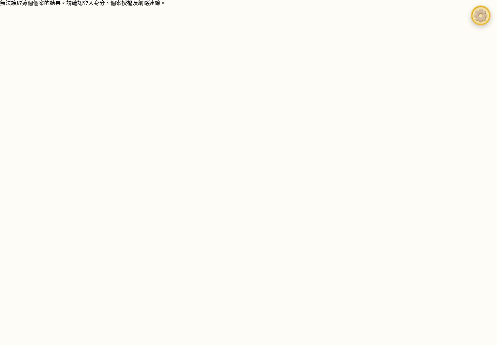

# 蒐秘密｜P0-C4 跨帳號／角色／個案隔離

產出：2026-10-24T05:29:20.388Z（UTC；臺灣日期 2026-10-24）。版本：8ef96ff4100533907bd4c2549a0c018b0553f345 加本輪未提交工作樹；逐檔 SHA-256 見[機器證據](p0c4-test-evidence-2026-10-24.json)。

環境：Windows、Node 24.15.0、Chrome 155.0.8059.85；全新原生 PostgreSQL 17.11／PostgREST 16.5／Auth v2.197.0 Windows 適配版。資料庫 p0c4_isolated_c0fc0a60735b，cluster ID 7699882706748678332；API 僅 127.0.0.1:55341。全部使用合成個案及獨立測試帳號，並非標準 Supabase 或正式環境。

**原生隔離瀏覽器與 API 範圍 PASS；不等同正式平台或整個隱私面已結案。**

| ID | 預期 | 實際結果 | 判定 |
|---|---|---|---|
| Account-01 | B 不讀 A 本機結果 | 修正前 B 看到 P0 synthetic A；修正後舊 profile 與乾淨情境均阻擋 | PASS after fix |
| Account-02 | B 不代傳 A pending | 真實離線 LB 20 題保持 A owner；B 時 main 仍不存在 | PASS |
| Account-03 | A 返回可恢復 | 實際重新登入；同結果 ID、原始 20 題及 owner 仍在，最後完整同步 | PASS |
| Account-04 | 同裝置不混淆 | 登出經既有醫療登入入口對家長的 signOut；再以普通表單登入 B／A | PASS |
| Account-05 | 分頁身分切換安全 | 第二頁 Auth 傳播後不再顯示 A，A pending 不被移除或錯置 | PASS |
| Account-06 | 無授權專業端直接 URL 被拒 | 真表單登入；偽造本機 active patient 選擇仍被 patients RLS 拒絕；8 URL 阻擋 | PASS |
| Account-07 | 研究身分未授權讀取遭拒 | 獨立 clinician-backed 研究帳號；研究工作台顯示無場次，API 六層拒絕 | PASS |
| Account-08 | 撤銷後再請求失效 | UI 先可見個案，guardian RPC 撤銷，同 JWT reload 後不可見 | PASS |

研究使用者是現有 clinician role 的獨立帳號，沒有捏造 researcher role 或放寬 RLS。家長 B、未授權專業、研究身分與匿名共 24 組真 PostgREST／RLS 拒讀涵蓋 main、Participant、Session、Task、Raw、Derived。授權家長的六項讀取及授權專業 Dashboard 正向可見亦實測。

根因：C3 鏡像清單漏掉 latestPMTestResult、pictureMemoryTestResult、ef_*、個案別結果與 active-patient 別名；封存容量不足時，Auth 已換人而原鏡像仍在。最小修正：補齊原讀者實際使用的別名，新增 ResultAccessRoute，在渲染前核對真實 getUser／profile role／patients RLS，並檢查 local／session 鏡像均完成帳號歸屬。Auth callback 延後發起 auth 請求，舊非同步授權結果不得覆蓋新身分。

本機相容性：mirror version 2；原受保護的 owner marker 保留。舊新增別名僅採明確 syncOwnerId／guardian_id，來源不足封存至 unassigned，不猜歸屬。不同封存歷史保留於 efGameResultMirrorConflict:<owner>:<key>:<uuid>，精確字串保存且不自動恢復／改寫；一般鏡像成功恢復後才移除其重複封存。所有 outbox key 都不在搬移／刪除清單。無 SQL schema 變更。

副作用／限制：需要重新確認權限的結果頁在離線或 auth／RLS 錯誤時拒絕顯示；原始待傳仍保留。尚未設計離線閱覽權限政策。這是 UI／API／RLS 與正常本機讀者的隔離證據，不代表作業系統檔案擷取、磁碟加密或實體裝置已驗收。

證據：[account-pending-B-browser.json](../.tmp/p0c4/account-pending-B-browser.json)、[account-06-browser.json](../.tmp/p0c4/account-06-browser.json)、[account-07-browser.json](../.tmp/p0c4/account-07-browser.json)、[account-08-after-browser.json](../.tmp/p0c4/account-08-after-browser.json)、[archive-conflict-before-fix.json](../.tmp/p0c4/archive-conflict-before-fix.json)、[archive-conflict-after-fix.json](../.tmp/p0c4/archive-conflict-after-fix.json)。

