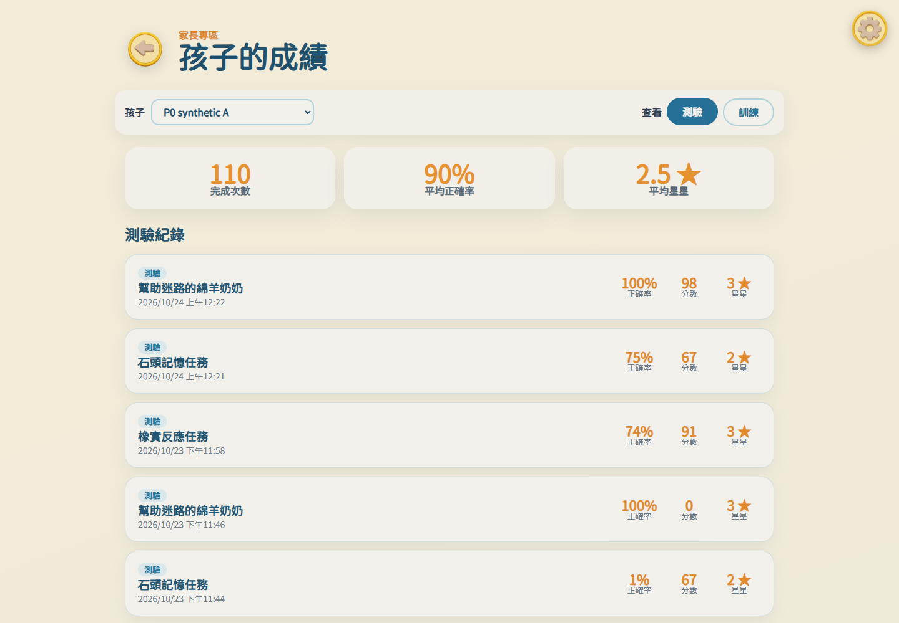

# 蒐秘密｜P0-C4 六項遊戲 UI 與資料讀回

產出：2026-10-24T05:29:20.388Z（UTC；臺灣日期 2026-10-24）。版本：8ef96ff4100533907bd4c2549a0c018b0553f345 加本輪未提交工作樹；逐檔 SHA-256 見[機器證據](p0c4-test-evidence-2026-10-24.json)。

環境：Windows、Node 24.15.0、Chrome 155.0.8059.85；全新原生 PostgreSQL 17.11／PostgREST 16.5／Auth v2.197.0 Windows 適配版。資料庫 p0c4_isolated_c0fc0a60735b，cluster ID 7699882706748678332；API 僅 127.0.0.1:55341。全部使用合成個案及獨立測試帳號，並非標準 Supabase 或正式環境。

**六項正常 UI 流程完成；原生研究資料讀回 PASS；完整平台／負向媒體案例尚未驗收。** 使用實際 App、原圖音效、普通密碼登入、兒童選擇及正常測驗地圖。依 ARI→DCCS→PM→CBT→LB→SRT 解鎖；影片使用既有跳過按鈕，試玩依規則通過。沒有 gameTesting、地圖解鎖、React 狀態注入、直接呼叫保存函式或加速時鐘。

| 遊戲 | 完整 UI 次數 | 已施測 Trial | 實際結果／判定 |
|---|---:|---:|---|
| ARI | 1 | 20 | 20 次相反動物皆正確；5,000ms 上限、實際音訊 play／ended，PASS |
| DCCS | 1 | 12 | 三規則各 4；三段試玩共 6；回應時三張素材就緒，PASS |
| PM | 1（工具中斷後續接） | 12 | 2～7 各兩題；15 秒；合法取消兩次、重新選取，該 Trial 仍有效，PASS |
| CBT | 2（含修正後重測） | 每次 8 | 九顆固定石頭；6 正確後負荷 5 連錯兩題合法停止；6/7 未施測，PASS |
| LB | 2（含修正後及恢復） | 每次 20 | 兩階段各 10；兩段均 stepIndex 0～9；20 個來源鍵，PASS |
| SRT | 1（工具中斷後續接） | 242 | 正式牆鐘 480,115ms；沒有縮短八分鐘；PASS 於實際流程／資料範圍 |

首輪共 314 筆，加入 CBT／LB 重測共 342 筆，分屬 8 個實際結果，不是重複 Trial。SRT：122 命中、60 漏點、2 誤點；完整 capture-phase 點擊事件與原始紀錄相符。每個完整四題 block 為三 Go、一 No-go，最後保留自然截斷；500ms 呈現與 1,000／3,000ms onset 間隔配置未改。工具停頓期間自然逾時／漏點皆保留，沒有事後補答案。

PM 一題因工具回饋換題競態而自然逾時；實際 1/12=8.3333%，在 RT 排除後仍進入研究分母。另以原 X03～X07／H09 真資料庫案例驗證 0%、25%、100%、2/6、零分母 null 及其他排除原因；原始計分中的四捨五入值未被改寫。

逐欄核對 8/8：main ID／guardian／patient、Session／Task ID、時間與完成狀態、Trial UUID／順序／來源鍵、raw schema 及 processing version、完整 raw JSON、刺激／回應／正確性／RT／逾時／排除原因與全部衍生欄位。Form ID 依目前來源未提供，未填假值；ARI 使用 taskVersion，SRT／CBT 使用 protocol.version，PM 使用 protocolVersion；DCCS／LB 未取得獨立 protocol version 的部分明列未紀錄。

家長在全新瀏覽器情境從雲端讀取六項最新結果，LB 顯示 98 分、CBT 顯示 75%；未授權專業人員的六項結果 URL 加兩個共用結果 URL 共 8 個全部拒絕，四身分×六層表的 24 組 API 讀取涵蓋全部實際結果，均拒絕。

未驗證：ARI 正式音訊故障負向 UI、SRT 破圖負向 UI、實體喇叭輸出與觸控時間精度；不能從正常素材載入推論故障路徑。SRT 初次 observer 在圖片剛插入 DOM 尚未 complete 時停止，後續續接；此觀測不足不列為已驗證的破圖處理。

證據：[game-semantic-final.json](../.tmp/p0c4/game-semantic-final.json)、[full-game-readback-final.json](../.tmp/p0c4/full-game-readback-final.json)、[all-games-negative-api.json](../.tmp/p0c4/all-games-negative-api.json)、[parent-six-final-browser.json](../.tmp/p0c4/parent-six-final-browser.json)。完整原始資料及 DB snapshot 只留在本機私有證據；公開僅合成資料摘要與 hash。

圖中大量紀錄包含整合測試 fixtures，不能當成正式兒童施測數；舊 LB 0 分／CBT 1% 顯示刻意保留，證明沒有自動覆寫歷史。
